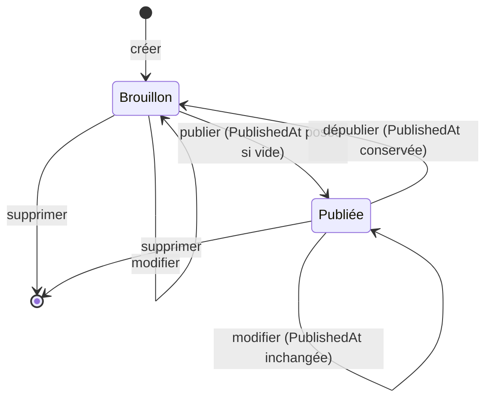

# ADR 0022 — Actualités : modèle, cycle de vie et date de publication

- **Statut** : Accepté (porteur, 24/11/2026)
- **Date** : 24/11/2026
- **Mise en œuvre** : étape 8, tranche « Actualités » (`technique/plan-actualites.md`)
- **Références** : cahier § 4.1 (actualités), § 6.4 ; mvp US-B1, US-B2, US-E1, R18, Q15 ; `architecture.md` § 4 et § 13 (question 4) ; ADR 0003 (dates UTC), 0006 (`rowversion`), 0007 (suppression de compte), 0009 (cycle de vie d'un événement), 0011 (listes), 0021 (`no-store`), 0023 (contenu)

## Contexte

Les administrateurs publient des actualités : créer en brouillon, modifier, publier, dépublier, supprimer (US-E1). Les visiteurs lisent les actualités publiées, les plus récentes d'abord, 10 par page (US-B1), et le détail d'une actualité (US-B2) ; un brouillon ou une actualité dépubliée donne « Contenu introuvable ».

Contrairement à un événement, une actualité **n'a aucun lien avec les réservations** : aucune règle ne dépend d'un décompte, aucune transition n'est irréversible, et la suppression est toujours permise (R18). Il faut trancher :
1. les champs (auteur ? image ? épinglage ?) ;
2. la date affichée, en particulier après une dépublication puis une republication (question 4 de `architecture.md` § 13) ;
3. la gestion de la concurrence entre administrateurs ;
4. le nom de la classe : une classe `News` dans l'espace de noms `Aaas.Domain.News` crée une ambiguïté en C# (dans ce fichier comme chez les appelants, `News` désigne à la fois l'espace de noms et le type : erreur CS0118 « est un espace de noms mais est utilisé comme un type », et avertissement d'analyse CA1724).

## Décision

### 1. Entité `NewsArticle` (Domain, dossier `News/`), table `News`

| Colonne | Type SQL | Règle |
|---|---|---|
| `Id` | `uniqueidentifier` PK | généré à l'ajout, comme `Events` |
| `Title` | `nvarchar(200)` NOT NULL | obligatoire, 200 caractères au plus après `Trim` |
| `Content` | `nvarchar(max)` NOT NULL | obligatoire, **8 000 caractères au plus** après normalisation (ADR 0023) |
| `Status` | `tinyint` NOT NULL | **1 Brouillon, 2 Publiée** (valeurs figées) ; `CK_News_Status (Status IN (1, 2))` |
| `PublishedAt` | `datetimeoffset` NULL | **date de publication affichée** : posée à la première publication, **jamais effacée** ; `CK_News_PublishedAt (Status = 1 OR PublishedAt IS NOT NULL)` |
| `CreatedAt`, `UpdatedAt` | `datetimeoffset` NOT NULL | UTC (ADR 0003) |
| `RowVersion` | `rowversion` | concurrence optimiste (ADR 0006) |

Index : `IX_News_Status_PublishedAt (Status, PublishedAt, Id)` — couvre le filtre et le tri de la liste publique (SQL Server parcourt l'index à l'envers pour l'ordre décroissant). La liste admin (quelques centaines de lignes au plus) n'a pas d'index dédié.

**Pas d'auteur, pas d'image, pas d'épinglage, pas de publication programmée** au MVP :
- auteur : ce serait une donnée personnelle (nom d'un bénévole affiché au public) et une clé étrangère vers `AspNetUsers` à détacher à la suppression du compte (ADR 0007) ; l'actualité est signée par l'association ;
- image : hors MVP (R18, Q15) ; elle demanderait un stockage de fichiers (Blob Storage), un contrôle de type et de taille, et une CSP élargie ;
- épinglage, publication programmée : absents des user stories.

Le dossier `src/Aaas.Domain/News/` contient `NewsArticle`, `NewsStatus`, `NewsRules` (validations, normalisation, extrait) et `NewsFields` (noms JSON des champs). La classe s'appelle `NewsArticle` pour éviter le conflit avec l'espace de noms ; la table garde le nom `News` (`ToTable("News")`), le `DbSet<NewsArticle>` s'appelle `News`.

### 2. Cycle de vie

| Action | Depuis | Effet | Refus |
|---|---|---|---|
| Créer | — | `Brouillon`, `PublishedAt = null` | 400 par champ |
| Modifier | Brouillon ou Publiée | titre, texte, `UpdatedAt` ; **`PublishedAt` inchangée** (US-E1) | 400, 404, 409 `concurrent_update` |
| Publier | Brouillon | `Publiée` ; `PublishedAt ??= now` | 404, 409 `news_state_changed` si déjà publiée |
| Dépublier | Publiée | `Brouillon` ; `PublishedAt` **conservée** | 404, 409 `news_state_changed` si déjà brouillon |
| Supprimer | Brouillon ou Publiée | suppression physique (R18) | 404 si déjà supprimée, 409 `concurrent_update` |

Les transitions sont des méthodes de `NewsArticle` (`Create`, `Update`, `Publish`, `Unpublish`), qui reçoivent `now` et lèvent `BusinessRuleException`. Le **statut** est la seule source de vérité pour la visibilité publique : **jamais** de filtre sur `PublishedAt IS NOT NULL` (une actualité dépubliée garde sa date).

### 3. Date de publication

- **Une seule date affichée**, `PublishedAt`, posée à la **première** publication. Une republication après dépublication **garde la date d'origine** (réponse proposée à la question 4 de `architecture.md` § 13) : la dépublication sert surtout à retirer un texte le temps de le corriger, et une republication ne doit pas faire remonter une vieille actualité en tête de liste.
- La règle est dans le Domain (`Publish` : `PublishedAt ??= now`) : si l'association préfère « republier = nouvelle date », seule cette ligne change (`PublishedAt = now`), sans migration.
- Stockée en UTC, affichée en **date seule** à l'heure de Tunis par le front (une actualité publiée à 23:30Z est datée du **lendemain** à Tunis).

### 4. Concurrence : `rowversion` seule, sans verrou

Aucune règle des actualités ne dépend d'autres lignes (pas de décompte) : la concurrence optimiste suffit (ADR 0006), **sans** `IEventLock`.
- **Modifier** : le DTO admin expose `version` (Base64 du `rowversion`), renvoyée par `PUT` ; périmée → 409 `concurrent_update` (`ConcurrencyGuard.EnsureSameVersion`, puis `SaveChangesOrConflictAsync` en filet).
- **Publier, dépublier, supprimer** : actions **sans** `version` (même convention que les événements, `architecture.md` § 5) ; la règle de transition suffit, et le `rowversion` lu au chargement fait échouer l'écriture si un autre admin est passé entre la lecture et l'enregistrement (409 `concurrent_update`).

### 5. Routes et visibilité

- Public, anonyme : `GET /api/news` (publiées, `PublishedAt` décroissante puis `Id`, 10 par défaut, 50 au plus, ADR 0011) et `GET /api/news/{id}` (publiée seulement ; brouillon ou inconnue → **404 « Contenu introuvable. »**, même corps).
- Admin (`AdminOnly`) : `/api/admin/news` (liste, fiche, créer, modifier, publier, dépublier, supprimer) ; `Cache-Control: no-store` posé par le `NoStoreMiddleware` existant (préfixe `/api/admin`, ADR 0021).
- **Routes de repli** pour un identifiant mal formé (leçon D1) : `GET /api/news/{id}` sans contrainte, anonyme → 404 ; côté admin, une méthode de repli soumise à `AdminOnly` → visiteur 401, membre 403, admin 404.

### 6. Code d'erreur

Un seul code nouveau : `news_state_changed` (409, « Cette actualité est déjà publiée. » / « Cette actualité n'est pas publiée. »). `concurrent_update`, `not_found` et `validation_failed` existent déjà.

## Alternatives écartées

| Alternative | Raison du rejet |
|---|---|
| Deux colonnes comme `Events` (`PublishedAt` effacée à la dépublication + `FirstPublishedAt`) | `FirstPublishedAt` sert aux événements à savoir s'ils sont supprimables ; une actualité l'est toujours. Une seule colonne suffit, et la règle de republication reste modifiable dans le Domain. |
| Republication = nouvelle date | Fait remonter une ancienne actualité en tête après une simple correction ; laissé en question à l'`expert-fonctionnel` (QN-2). |
| Statut « Archivée » ou suppression logique | R18 demande une suppression définitive ; un statut de plus pour aucun besoin exprimé. |
| Champ auteur (`AuthorId` → `AspNetUsers`) | Donnée personnelle exposée au public, clé étrangère à détacher (ADR 0007), aucun besoin exprimé. |
| Verrou `UPDLOCK` comme pour les événements | Aucun invariant entre plusieurs lignes à protéger ; la concurrence optimiste suffit. |
| `version` exigée pour supprimer | Plus sûr en théorie (on supprime exactement ce qu'on a vu), mais rompt la convention « actions sans version » ; 1 à 3 administrateurs, conflit improbable ; la confirmation du front rappelle ce qui va disparaître. |
| Garder la classe `News` et changer l'espace de noms (`Aaas.Domain.Newsroom`) | Possible, mais un dossier dont l'espace de noms porte un autre nom trouble la convention du projet ; renommer la classe est plus simple. |
| Code d'erreur générique `state_changed` partagé avec les événements | Les codes existants sont par entité (`event_state_changed`, `reservation_state_changed`) ; le front décide sur le code exact. |

## Conséquences

- Migration `AddNews` : une table, un index, deux `CHECK`, aucune donnée.
- `PublicNewsService` et `AdminNewsService` (Application) suivent le patron de `PublicEventService` / `AdminEventService`, en plus simple (ni verrou, ni occupation, ni avertissement).
- La politique de confidentialité n'est pas touchée : aucune donnée personnelle nouvelle.
- Tests : transitions (Domain, sans base), date conservée à la republication, `CHECK` en base, 404 identiques (brouillon, dépubliée, inconnue, mal formée), 401/403/404 sur les routes admin, deux `PUT` concurrents.

## Reste à valider

- Par le porteur : le modèle sans auteur ni image, la date conservée à la republication, la suppression sans `version`, le nom `NewsArticle`.
- Par l'`expert-fonctionnel` : QN-2 (date à la republication), QN-6 (suppression directe d'une actualité publiée) du plan.
