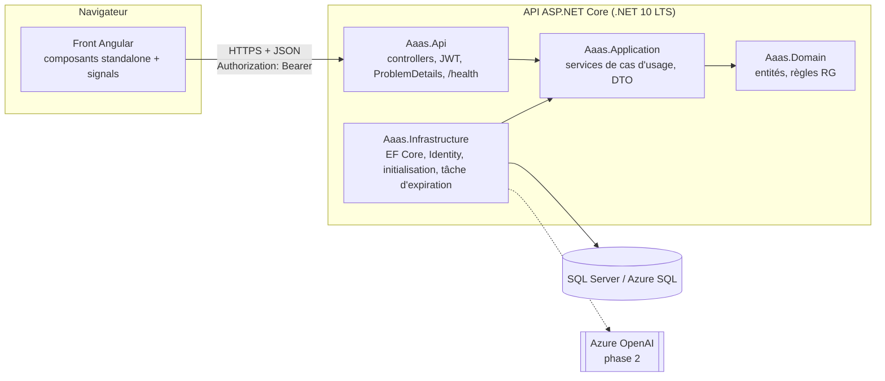
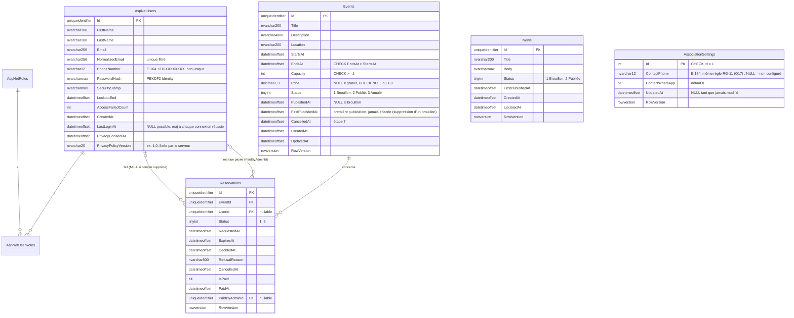
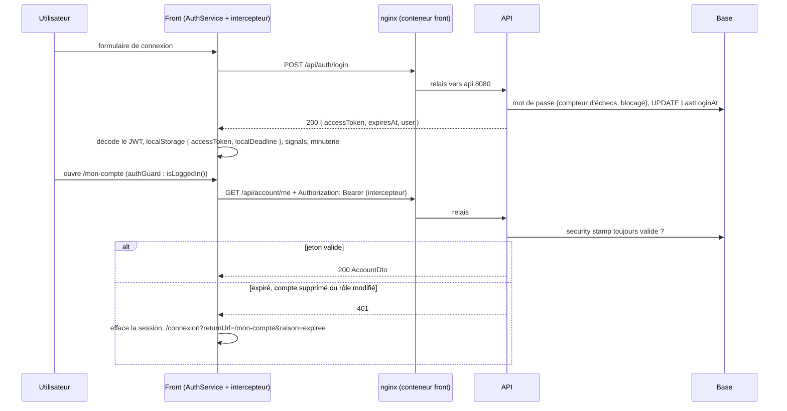
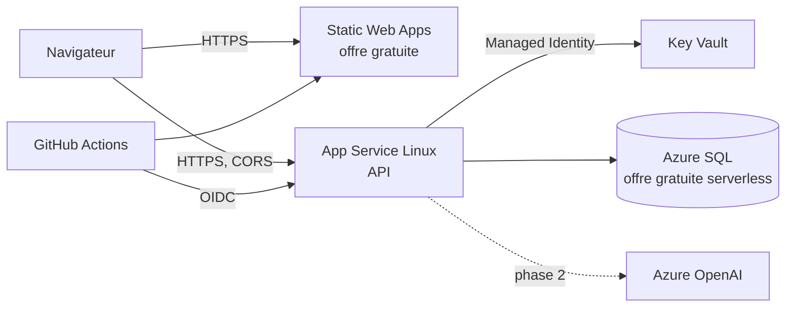

# Architecture — AAAS

> Rédigé par l'agent `architecte`. Vue d'ensemble : couches, schéma de données, flux, déploiement. Les décisions détaillées (contexte, alternatives écartées) sont dans `docs/adr/`. Référence : `docs/cahier-des-charges.md` (v1.1).
> Version 8 — 23/11/2026 — front Angular de la semaine 2 réalisé (ADR 0014 à 0017 acceptés par le porteur) : § 6 réécrit d'après le code (structure, session restaurée **sans** appel `/me`, `rxResource`, Material), § 7 service `front` (nginx non-root 8080, healthcheck, relais `/api`), § 0 et § 1 mis à jour. (Version 7 — 18/11/2026 — conception de l'étape 2 (événements côté admin, numéro de contact, consultation publique) : ADR 0009 à 0013, schéma `Events` et `AssociationSettings` précisé (`decimal(9,3)` sans objet `Money`, `Description nvarchar(4000)`, ligne unique créée par la migration), endpoints de l'étape 2, pagination `PagedResult<T>`, port `IEventLock` et service `EventOccupancyReader`, questions E2-1 à E2-13. Plan détaillé : [`plan-etape-2.md`](plan-etape-2.md). (Version 6 — 13/11/2026 — correction de la fuite par `QueryIterationFailed` : règle « EF Core ne journalise aucune exception SQL au-dessus de `Debug` », liste complète des événements EF traités, `ExecutionStrategyRetrying` laissé visible (choix assumé), point de décision ouvert sur les autres erreurs 500 et sur `/health/ready` (ADR 0002). (Version 5 — 13/11/2026 : alignement sur le code final de l'étape 1 : `BOOTSTRAP_ADMIN_EMAIL` et `BOOTSTRAP_ADMIN_PASSWORD` vides dans `.env.example` et obligatoires pour `docker compose` (`${VAR:?}`), `ApiExceptionHandler` qui renvoie toujours `true`, échec de démarrage relancé sans l'exception d'origine quand elle peut contenir un message SQL, image SQL Server épinglée, ports publiés sur `127.0.0.1`. Version 4 — 13/11/2026 : projet `tests/Aaas.Infrastructure.Tests`, journalisation des violations d'unicité, échecs de démarrage en `Critical`, promotion journalisée en `Warning`, course entre instances, adresse d'admin non publiée. Version 3 — 10/11/2026 : décisions du porteur, implémentation et revue de l'étape 1.))) À mettre à jour à chaque étape du MVP.

## 0. État d'avancement

| Étape (ordre du cahier § 8) | État | Ce qui existe |
|---|---|---|
| 1. Comptes et premier admin | **Implémentée** | inscription, connexion, `GET /api/account/me`, rôles, premier admin, migration `InitialIdentity`, sondes `/health` et `/health/ready`, `docker compose` (sqlserver + api), quatre projets de tests |
| 2. Événements côté admin (+ 3. consultation, regroupées) | **Implémentée** (19/11/2026), tests d'intégration complets et revue à faire | plan [`plan-etape-2.md`](plan-etape-2.md), ADR 0009 à 0013 ; migration `AddEventsAndAssociationSettings` ; ajouts v4 (cahier v1.2) : suppression d'un brouillon jamais publié (`FirstPublishedAt`), retrait du numéro de contact, `hasEnded` |
| Front S2 (écrans des étapes 1 et 2) | **Implémenté** (23/11/2026), revue à faire | `front/` : Angular 22, inscription, connexion, mon compte, événements (liste, détail), admin (liste, formulaire, publication, numéro de contact), image Docker nginx, 165 tests Vitest ; ADR 0014 à 0017, plan [`plan-front-angular.md`](plan-front-angular.md) ; état détaillé : [`etat-avancement.md`](etat-avancement.md) |
| 4 à 9 | à faire | — |

Dans ce document, ce qui n'existe pas encore est signalé par *(étape N)* ou *(S3)*.

## 1. Décisions d'architecture (index)

Les ADR 0001 à 0013 sont au statut **Proposé** : le porteur n'a pas encore validé formellement ces choix (voir § 13). Les ADR 0014 à 0017 (front) sont **acceptés** (porteur, 23/11/2026).

| ADR | Décision en une ligne |
|---|---|
| [0001](../adr/0001-architecture-en-couches-et-structure-de-la-solution.md) | 4 couches, controllers, pas de MediatR ni de repositories, exceptions typées → `ProblemDetails` ; EF Core dans Application à partir de l'étape 2 ; tests unitaires d'Infrastructure dans `tests/Aaas.Infrastructure.Tests`, `Aaas.Application.Tests` ne référence qu'Application |
| [0002](../adr/0002-authentification-identity-jwt.md) | Identity (PBKDF2) + JWT HS256 60 min sans refresh, blocage 15 min après 5 échecs, révocation par security stamp, rôles en tableau ; pas d'e-mail dans les journaux : EF Core ne journalise aucune exception SQL au-dessus de `Debug` (`SaveChangesFailed` ignoré ; `CommandError`, `QueryIterationFailed`, `NonQueryOperationFailed`, `ExecuteUpdateFailed`, `ExecuteDeleteFailed`, `ConnectionError`, `TransactionError` en `Debug` ; `ExecutionStrategyRetrying` laissé visible), l'appelant journalise en filtrant (violations d'unicité sans l'exception, `ApiExceptionHandler` qui renvoie toujours `true`, échec de démarrage relancé sans l'exception d'origine) ; point ouvert : les autres 500 gardent l'exception complète ; secrets vides dans `.env.example` et obligatoires pour compose ; risques acceptés ou différés (limitation de débit, énumération) ; actions avant production (S3) |
| [0003](../adr/0003-dates-utc-et-fuseau-africa-tunis.md) | `DateTimeOffset` UTC partout, `TimeProvider`, conversion à l'heure de Tunis uniquement dans le front |
| [0004](../adr/0004-capacite-et-concurrence-sur-la-derniere-place.md) | Verrou `UPDLOCK` sur la ligne de l'événement + index unique filtré |
| [0005](../adr/0005-expiration-des-demandes-en-attente.md) | `ExpiresAt` stockée, expiration appliquée à la lecture, matérialisée à l'écriture et par une tâche périodique (qui journalise elle-même ses erreurs) |
| [0006](../adr/0006-concurrence-entre-administrateurs.md) | Concurrence optimiste `rowversion`, 409 avec l'état actuel |
| [0007](../adr/0007-suppression-de-compte-et-anonymisation.md) | Suppression physique du compte (toutes ses données, dont création, dernière connexion et consentement), réservations détachées (`UserId = NULL`) |
| [0008](../adr/0008-creation-du-premier-administrateur.md) | Création idempotente du premier admin (`User` + `Admin`) au démarrage, depuis des secrets de configuration ; **pas de promotion automatique** d'un compte existant (arrêt du démarrage, sauf `Bootstrap:PromoteExistingAccount=true`, une seule instance, trace `Warning`) ; adresse d'admin non publiée, sans valeur par défaut, obligatoire pour compose ; admins suivants par script `sqlcmd -I` |
| [0009](../adr/0009-evenement-cycle-de-vie-dates-et-validation.md) | Événement : statuts `Draft`/`Published`/`Cancelled` stockés, commencé/terminé calculés ; liste publique = `EndsAt > now` ; dates reçues en chaîne avec décalage obligatoire (`[DateTimeWithOffset]`) ; règles de valeurs dans le Domain (`EventRules.Validate`) → 400 par champ |
| [0010](../adr/0010-prix-des-evenements-en-tnd.md) | Prix `decimal(9,3) NULL` (0 → `NULL` = gratuit), refus au-delà de 3 décimales, nombre JSON, pas d'objet `Money` |
| [0011](../adr/0011-listes-pagination-tri-et-filtres.md) | Pagination `page`/`pageSize` (≤ 50), enveloppe `PagedResult<T>`, tri serveur stable (`StartsAt`, `Id`), filtres admin `status`/`period`, décompte groupé des places (pas de N+1) |
| [0012](../adr/0012-modification-d-un-evenement-verrou-version-et-avertissement.md) | Modification : `IEventLock` (`UPDLOCK` + stratégie d'exécution) **et** `version` ; avertissement `registrants_warning` en deux temps contrôlé par le serveur ; occupation passée au Domain (`EventOccupancy`) ; `EventOccupancyReader` renvoie zéro jusqu'à l'étape 4 |
| [0013](../adr/0013-parametres-de-l-association-table-singleton.md) | Numéro de contact : table `AssociationSettings` à une ligne (`CHECK Id = 1`) créée par la migration ; lecture par tout connecté, écriture admin avec `version` ; avertissement non bloquant à la publication |
| [0014](../adr/0014-front-angular-version-structure-et-conventions.md) | Front : Angular 22, standalone, signals, zoneless, `OnPush`, `rxResource` en lecture, reactive forms, Material 3, routes françaises chargées à la demande, admin en `canMatch`, Vitest, ESLint (**accepté**) |
| [0015](../adr/0015-session-jwt-cote-front.md) | Session : `localStorage` `{ accessToken, localDeadline }`, JWT décodé sans appel `/me` au démarrage, échéance relative, intercepteur (Bearer vers `/api/` seulement, 401 → reconnexion), guards de confort, onglets synchronisés (**accepté**) |
| [0016](../adr/0016-formulaires-erreurs-dates-et-version-cote-front.md) | Formulaires aux noms et messages de l'API, `toApiError` / `applyServerErrors` décidant sur `code`, dates de Tunis (`DatePipe` `+0100`, `toTunisIso`), `version` dans un signal et flux 409 (**accepté**) |
| [0017](../adr/0017-conteneur-front-nginx-proxy-et-configuration-de-l-api.md) | Conteneur front : Node → nginx non-root 8080, repli SPA, relais `/api` (même origine, pas de CORS en local), CSP, healthcheck ; `proxy.conf.mjs` en développement (**accepté**) |

## 2. Vue d'ensemble



Un seul déployable côté serveur (une API « monolithe modulaire » en couches), un front statique, une base. Pas de microservices, pas de file de messages.

## 3. Couches et structure de la solution

```
AAAS/
├─ global.json                     SDK .NET 10 LTS épinglé
├─ Directory.Build.props           nullable, implicit usings, analyse
├─ Directory.Packages.props        versions NuGet centralisées
├─ nuget.config, dotnet-tools.json source NuGet ; outil local dotnet-ef
├─ Aaas.slnx                       format de solution .NET 10
├─ docker-compose.yml              sqlserver + api (+ front en S2) ; secrets et e-mail de l'admin obligatoires (${VAR:?})
├─ .env.example, .dockerignore     modèle des variables, secrets et e-mail de l'admin laissés vides (le .env réel n'est pas versionné) ; exclusions du contexte Docker
├─ src/
│  ├─ Aaas.Domain/                 aucune dépendance NuGet
│  │  ├─ Common/                   PhoneNumber, BusinessRuleException, ErrorCodes, Roles ; FieldError (étape 2)
│  │  ├─ Events/                   Event, EventStatus, EventDetails, EventOccupancy, EventRules, EventFields (étape 2)
│  │  ├─ Reservations/             Reservation, ReservationStatus, règles de transition (étape 4)
│  │  ├─ News/                     News, NewsStatus (étape 8)
│  │  └─ Settings/                 AssociationSettings (étape 2)
│  ├─ Aaas.Application/            dépend de Domain (+ EF Core à partir de l'étape 2)
│  │  ├─ Accounts/                 AccountService, DTO, Validation/ (attributs), IIdentityService, ITokenService
│  │  ├─ Common/Errors/            RequestValidationException, AuthenticationFailedException, NotFoundException ; ConcurrencyGuard (étape 2)
│  │  ├─ Common/                   PagedResult<T>, RowVersions, FieldErrors ; Validation/ ([TunisianPhoneNumber] déplacé, [DateTimeWithOffset], [RowVersion]) (étape 2)
│  │  ├─ Options/                  BootstrapOptions, PrivacyPolicyOptions ; ReservationOptions (étape 4)
│  │  ├─ Abstractions/             IAppDbContext, IEventLock (étape 2)
│  │  ├─ Events/                   AdminEventService, PublicEventService, EventOccupancyReader, EventQueries, DTO (étape 2)
│  │  ├─ Settings/                 SettingsService, DTO (étape 2)
│  │  └─ Reservations/ News/       (étapes suivantes)
│  ├─ Aaas.Infrastructure/
│  │  ├─ Persistence/              AppDbContext (implémente IAppDbContext), Configurations/, Conventions/ (UTC), Migrations/,
│  │  │                            SqlServerErrors (numéros SQL) ; EventLock (UPDLOCK, étape 2)
│  │  ├─ Identity/                 AppUser, IdentityService, TokenService, JwtOptions, AppClaimTypes,
│  │  │                            LetterRequiredPasswordValidator, FrenchIdentityErrorDescriber
│  │  ├─ Initialization/           DatabaseInitializer (migrations, rôles, premier admin)
│  │  ├─ Jobs/                     ExpirePendingReservationsJob (étape 5)
│  │  └─ DependencyInjection.cs    AddInfrastructure(...) : DbContext (dont filtrage des journaux EF), Identity, options, health checks
│  └─ Aaas.Api/
│     ├─ Controllers/              AuthController, AccountController ; EventsController, AdminEventsController,
│     │                            SettingsController, AdminSettingsController (étape 2) ; ...
│     ├─ Auth/                     JwtAuthenticationExtensions (validation, révocation, politiques)
│     ├─ Errors/                   ApiExceptionHandler → ProblemDetails (renvoie toujours true)
│     ├─ Program.cs                validation des options, initialisation (échec journalisé en Critical, relancé sans donnée personnelle), pipeline
│     └─ Dockerfile
├─ tests/
│  ├─ Aaas.Domain.Tests/           référence Domain
│  ├─ Aaas.Application.Tests/      référence Application uniquement ; Accounts/ (AccountService avec doublures, validation des DTO)
│  ├─ Aaas.Infrastructure.Tests/   référence Infrastructure, sans base ; Identity/PasswordPolicyTests,
│  │                               Initialization/DatabaseInitializerTests (doublures UserManager, RoleManager, IIdentityService)
│  └─ Aaas.Api.IntegrationTests/   WebApplicationFactory + Testcontainers
└─ front/                          application Angular (S2), Dockerfile, nginx.conf
```

Règles de dépendance : `Domain` ← `Application` ← `Infrastructure` ; `Api` référence `Application` et `Infrastructure` (uniquement pour composer l'injection de dépendances). Les **règles métier** (RG-01 à RG-08, transitions du § 2 de `mvp.md`) sont des méthodes du Domain qui reçoivent `now` en paramètre : elles se testent sans base ni horloge réelle.

Les projets de tests suivent les mêmes dépendances que les couches qu'ils testent :

| Projet de tests | Référence | Contenu à l'étape 1 | Docker ? |
|---|---|---|---|
| `Aaas.Domain.Tests` | Domain | règles pures (`PhoneNumber`…) | non |
| `Aaas.Application.Tests` | Application | `AccountService` avec doublures des ports, validation des DTO | non |
| `Aaas.Infrastructure.Tests` | Infrastructure | 33 tests : politique de mot de passe (R21), `DatabaseInitializer` (premier admin, compte existant, option de promotion, course entre instances) | non |
| `Aaas.Api.IntegrationTests` | Api | bout en bout sur un vrai SQL Server (inscription, connexion, démarrage) | **oui** (Testcontainers) |

> **Écart assumé à l'étape 1** : Application ne référence pas encore EF Core et `IAppDbContext` n'existe pas. Les comptes passent entièrement par le port `IIdentityService`, implémenté dans Infrastructure avec `UserManager`. EF Core et `IAppDbContext` seront ajoutés à l'étape 2, quand un service aura besoin de requêter des entités du Domain (ADR 0001). **Prévu à l'étape 2** : référence à `Microsoft.EntityFrameworkCore` (pas `SqlServer` ni `Relational`), `IAppDbContext` (`DbSet<Event>`, `DbSet<AssociationSettings>`, `SaveChangesAsync`) et `IEventLock` ; les services d'événements sont testés par les tests d'intégration et leurs règles dans `Aaas.Domain.Tests` (pas de doublure de `DbContext`).
>
> **Tests d'Infrastructure (écart résorbé)** : à l'étape 1, le test de la politique de mot de passe vivait dans `Aaas.Application.Tests`, avec une référence à Infrastructure actée comme exception jusqu'au deuxième test d'Infrastructure. Ce déclencheur est atteint (`DatabaseInitializerTests`) : `tests/Aaas.Infrastructure.Tests` existe, `PasswordPolicyTests` y a été déplacé, et `Aaas.Application.Tests` ne référence plus que Application (ADR 0001, point 8).

Où vit chaque règle (à reporter dans `regles-metier.md` par l'expert technique) :

| Règle | Endroit |
|---|---|
| RG-01 / R2 réservable, R7 places restantes | Domain `Event.IsBookable(now, occupancy)`, `Event.RemainingSeats(occupancy)` ; occupation fournie par `EventOccupancyReader` (Application, seul endroit qui compte les réservations ; renvoie zéro avant l'étape 4, ADR 0012) *(étape 2)* |
| RG-06 / R11 capacité, R12 avertissement « inscrits », R14 dépublication, transitions d'un événement | Domain `Event.Update`, `Event.Publish`, `Event.Unpublish`, sous `IEventLock` pour ce qui dépend de l'occupation (ADR 0012) *(étape 2)* |
| Validations de valeurs d'un événement (dates, capacité, prix), RG-08 prix | Domain `EventRules.Validate` (→ 400 par champ, ADR 0009, 0010) *(étape 2)* |
| RG-04 échéance, RG-05 délais d'annulation, RG-07 / R15 suppression, transitions de réservation | Domain (`Event`, `Reservation`) *(étapes 4 à 7)* |
| RG-02 jamais de dépassement | Domain (comparaison) + Infrastructure (verrou, ADR 0004) |
| RG-03 unicité | Domain + index unique filtré |
| RG-11 téléphone « +216 » + 8 chiffres | Domain `PhoneNumber` (source unique) ; utilisée par l'attribut de DTO `[TunisianPhoneNumber]`, par `AccountService`, par `DatabaseInitializer` (`Bootstrap:AdminPhone`) et, à l'étape 2, par `AssociationSettings.UpdateContact` (Q17) |
| R20 données du compte, `LastLoginAt` | `AppUser` (colonnes) ; `AccountService.LoginAsync` + `IdentityService.RecordLoginAsync` (mise à jour) |
| R21 mot de passe, blocage | configuration d'Identity (`AddInfrastructure`) + `LetterRequiredPasswordValidator` ; testée dans `Aaas.Infrastructure.Tests` |
| R24 consentement (date + version) | `AccountService.RegisterAsync` (version lue dans `PrivacyPolicy:CurrentVersion`) |
| R24 pas de donnée personnelle dans les journaux | `AddInfrastructure` (`ConfigureWarnings` d'EF Core : aucune exception SQL au-dessus de `Debug`) + `ApiExceptionHandler` + `Program.cs` (§ 9) |
| RG-09 au moins un admin, R22 | `DatabaseInitializer` (création, sans promotion automatique d'un compte existant) ; `AccountService` (suppression, étape 9) |
| RG-10 numéro de contact | Domain `AssociationSettings` ; Application `SettingsService` ; lecture réservée aux connectés (`GET /api/settings/contact`, politique par défaut), écriture `AdminOnly` (ADR 0013) *(étape 2)* |

## 4. Schéma de données



À l'étape 1, seule la partie Identity (`AspNetUsers`, `AspNetRoles`, `AspNetUserRoles` et les autres tables Identity) existe (migration `InitialIdentity`). L'étape 2 ajoute `Events` et `AssociationSettings` (migration `AddEventsAndAssociationSettings`, avec l'insertion de la ligne `Id = 1` des paramètres) ; `Events.CancelledAt` arrive à l'étape 7. `Reservations` (étape 4) et `News` (étape 8) sont la cible des étapes suivantes.

Précisions :
- **Compte (R20, cahier § 6.4)** : exactement prénom, nom, e-mail, téléphone, mot de passe haché, date de création, date de dernière connexion, consentement (date + version). **Aucune donnée d'âge** (décision du porteur : pas de contrôle de majorité). `LastLoginAt` est initialisée à l'inscription (qui connecte l'utilisateur) puis mise à jour à chaque connexion **réussie** ; un échec ne la modifie pas. Le téléphone **n'est pas unique** : deux comptes peuvent partager un numéro (décision par défaut, ADR 0002).
- **Version de la politique** : `PrivacyPolicyVersion` reçoit `PrivacyPolicy:CurrentVersion` (configuration, « 1.0 »), jamais une valeur envoyée par le client. Redemander l'accord quand la politique change n'est pas au MVP (Q16) ; la colonne permet de le faire plus tard sans migration de données.
- **Statuts de réservation** (`tinyint`, valeurs figées car utilisées dans un index filtré) : 1 En attente, 2 Confirmée, 3 Refusée, 4 Expirée, 5 Annulée par l'utilisateur, 6 Annulée par l'association. Statut « Terminé » d'un événement : **calculé** (`EndsAt <= now`), jamais stocké.
- **Index** : `UX_AspNetUsers_NormalizedEmail` unique filtré `IS NOT NULL` (remplace l'index non unique `EmailIndex` d'Identity) ; `UserNameIndex` (Identity, unique filtré) ; puis `UX_Reservations_Event_User_Active (EventId, UserId) WHERE Status IN (1,2) AND UserId IS NOT NULL` (RG-03) ; `IX_Reservations_EventId_Status` (décompte) ; `IX_Reservations_Status_ExpiresAt` (expiration, liste admin) ; `IX_Events_Status_StartsAt` (listes publique et admin : filtre par statut et tri ; le filtre `EndsAt > now` est résiduel, sans conséquence au volume attendu, ADR 0011) ; `IX_News_Status_FirstPublishedAt`.
- **Index filtrés et `QUOTED_IDENTIFIER`** : SQL Server refuse toute écriture dans une table qui a un index filtré si la session a `QUOTED_IDENTIFIER OFF` (erreur 1934). EF Core et SSMS sont à `ON` ; `sqlcmd` ne l'est qu'avec l'option **`-I`**, obligatoire pour les scripts manuels (`exploitation.md` § 6).
- **Contraintes** : `CK_Events_Dates (EndsAt > StartsAt)`, `CK_Events_Capacity (Capacity >= 1)`, `CK_Events_Price (Price IS NULL OR Price > 0)`, `CK_Events_Status (Status IN (1, 2, 3))`, `CK_AssociationSettings_Singleton (Id = 1)`. Ce sont des filets : les règles sont d'abord vérifiées par le Domain. Clés étrangères `Reservations → Events` en `NO ACTION` (un événement ayant eu des réservations ne se supprime pas, RG-07) ; `Reservations → AspNetUsers` (deux FK) en `NO ACTION`, détachement fait par l'application (ADR 0007).
- **Montants** : `decimal(9,3)` (millimes ; 5 octets, contre 9 pour une précision ≥ 10), propriété `decimal? Price` du Domain, **sans objet `Money`** (une seule devise, aucun calcul) ; « 0 » est normalisé en `NULL` (gratuit) ; plus de 3 décimales → refus, pas d'arrondi (ADR 0010).
- **Événements, textes** : titre et lieu `nvarchar(200)`, description `nvarchar(4000)` (limite de saisie à confirmer, E2-5). Statuts (`tinyint`, valeurs figées) : 1 Brouillon, 2 Publié, 3 Annulé ; « commencé » et « terminé » sont calculés (ADR 0009).
- **Concurrence** : `RowVersion` (`rowversion`) sur `Events` et `AssociationSettings`, exposée en Base64 dans le champ `version` des DTO admin (ADR 0006). Une demande de place (étape 4) verrouille la ligne `Events` sans la modifier : elle ne change pas la `version` (ADR 0012).
- **Numéro de contact** : table à une seule ligne plutôt qu'une table clé/valeur, pour garder des colonnes typées ; la ligne `Id = 1` est créée par la migration (`HasData`), jamais par l'application (ADR 0013). Même règle que le téléphone des membres (Q17, valeur par défaut) : stockage E.164 via `PhoneNumber`. Jamais recopié dans les réservations (un changement de numéro vaut aussi pour les demandes anciennes, US-E8). Les liens d'appel et WhatsApp sont construits par le front (`tel:+216...`, `https://wa.me/216...`). En production, la ligne est vide après le premier déploiement : l'admin doit saisir le numéro (check-list de mise en ligne).
- **Migrations EF** : une migration par étape (`InitialIdentity` à l'étape 1, `AddEventsAndAssociationSettings` à l'étape 2, etc.), nommées en anglais, jamais modifiées une fois sur `main`.

## 5. Conventions d'API

- Préfixe `/api`, JSON en camelCase, enums sérialisés en chaînes (`"Pending"`), dates ISO 8601 avec décalage (ADR 0003).
- Erreurs en `ProblemDetails` (RFC 9457) : `title` en français lisible par l'utilisateur, extension `code` stable pour le front, `errors` par champ (clés = noms JSON, ex. `phoneNumber`) pour les 400. Si l'en-tête `Accept` de la requête refuse le JSON, la réponse d'erreur garde son statut mais n'a **pas de corps** (ADR 0002 : `ApiExceptionHandler` renvoie toujours `true`) ; le front envoie toujours `Accept: application/json`.
- Codes : 200/201/204 ; 400 validation ; 401 non authentifié ou identifiants incorrects ; 403 rôle insuffisant ; 404 introuvable **ou** appartenant à un autre membre (on ne révèle pas l'existence) ; 409 règle métier ou conflit de concurrence ; 500 erreur inattendue (`code = "internal_error"`, message générique).
- **Validation en deux temps pour l'inscription** : la validation automatique des DTO (`[ApiController]`) vérifie champs obligatoires, longueurs, e-mail, téléphone et consentement ; les règles du mot de passe sont ensuite vérifiées par Identity. Une requête avec un téléphone invalide **et** un mot de passe faible ne signale d'abord que le téléphone. Le front reproduit les règles du mot de passe dans son formulaire (confort), le serveur reste la référence (ADR 0002).
- **Sécurisé par défaut** : tout endpoint exige un jeton, sauf `[AllowAnonymous]` explicite.
- **Dates en entrée** : chaîne ISO 8601 avec décalage **obligatoire** (`2026-12-05T10:00+01:00` ou `...Z`) ; sans décalage → 400 sur le champ (ADR 0003, 0009). Dans les DTO d'entrée, les dates sont des `string` validées par `[DateTimeWithOffset]`, converties en UTC par le service.
- **Listes paginées** (à partir de l'étape 2) : paramètres `page` (≥ 1) et `pageSize` (1 à 50), réponse `{ items, page, pageSize, totalCount }` ; tri imposé par le serveur (ADR 0011). Les messages de liaison des paramètres de requête sont en français (`ModelBindingMessageProvider`). Limite connue : une erreur de **type** dans le corps JSON (`"capacity": "trente"`) est signalée sous la clé `$.capacity` avec un message technique.
- **Fiches modifiables** (événement, paramètres) : le DTO de lecture admin expose `version` (Base64 du `rowversion`), renvoyée telle quelle à la modification ; périmée → 409 `concurrent_update` (ADR 0006). Les **actions** (publier, dépublier ; plus tard confirmer, refuser…) sont des `POST .../action` sans `version` : la règle de transition du Domain suffit.
- **Avertissements** : un avertissement **bloquant** qui demande une confirmation est un 409 avec un `code` dédié (`registrants_warning`), et la requête est renvoyée avec `confirmRegistrantsWarning: true` ; un avertissement **non bloquant** est renvoyé dans un tableau `warnings: [{ code, message }]` d'une réponse 200 (`contact_not_configured` à la publication).
- Endpoints de l'étape 1 (détail dans `docs/technique/api.md`, tenu par l'expert technique) : `POST /api/auth/register` (201), `POST /api/auth/login` (200), `GET /api/account/me` (authentifié). Les réponses de compte exposent **`roles` en tableau** (`["User"]`, ou `["Admin", "User"]` pour un admin). Documentation interactive : OpenAPI intégré à ASP.NET Core (`/openapi/v1.json`), exposé en développement uniquement.
- Endpoints de l'étape 2 *(conçus, plan `plan-etape-2.md` § 6)* :

  | Verbe et route | Accès | Réponse | Erreurs propres |
  |---|---|---|---|
  | `GET /api/events?page=&pageSize=` | anonyme | `PagedResult<EventSummaryDto>` (publiés ou annulés, non terminés, par `startsAt` croissant) | 400 |
  | `GET /api/events/{id}` | anonyme | `EventDetailDto` (publié ou annulé, même terminé) | 404 si brouillon ou absent |
  | `GET /api/admin/events?status=&period=&page=&pageSize=` | `AdminOnly` | `PagedResult<AdminEventSummaryDto>` | 400 |
  | `GET /api/admin/events/{id}` | `AdminOnly` | `AdminEventDto` (avec `version`, `pendingCount`, `confirmedCount`) | 404 |
  | `POST /api/admin/events` | `AdminOnly` | 201 `AdminEventDto`, en brouillon | 400 |
  | `PUT /api/admin/events/{id}` | `AdminOnly` | `AdminEventDto` | 400, 404, 409 `concurrent_update`, `event_cancelled`, `event_ended`, `capacity_below_reserved`, `registrants_warning` |
  | `POST /api/admin/events/{id}/publish` | `AdminOnly` | `{ event, warnings }` | 404, 409 `event_state_changed`, `event_cancelled`, `event_started` |
  | `POST /api/admin/events/{id}/unpublish` | `AdminOnly` | `AdminEventDto` | 404, 409 `event_state_changed`, `event_cancelled`, `event_has_active_reservations` |
  | `DELETE /api/admin/events/{id}` (v4) | `AdminOnly` | 204 | 404, 409 `event_already_published`, `concurrent_update` |
  | `GET /api/settings/contact` | connecté | `{ phoneNumber, whatsApp, isConfigured, version, updatedAt }` | 401 pour un visiteur |
  | `PUT /api/admin/settings/contact` | `AdminOnly` | idem | 400, 409 `concurrent_update` |
  | `DELETE /api/admin/settings/contact` (v4, corps `{ version }`) | `AdminOnly` | idem, numéro `null`, WhatsApp `false` | 400, 409 `concurrent_update` |

  Les DTO publics exposent `remainingSeats`, `isFull`, `hasStarted`, `hasEnded` (v4), `isBookable` et `status` ; le front en déduit la mention (Annulé, Terminé, Réservations closes, Complet, N places restantes). Le prix est un nombre JSON ou `null` (gratuit).
- **Sondes de santé** (anonymes) :

  | Route | Sorte | Touche la base ? | Utilisée par |
  |---|---|---|---|
  | `GET /health` | *liveness* (« le processus répond ») | **non** | sonde d'App Service (S3), supervision externe |
  | `GET /health/ready` | *readiness* (« l'API peut servir des requêtes ») | oui (`AddDbContextCheck`) | diagnostic manuel, tests, éventuel *warm-up* |

  Pourquoi deux sondes : Azure SQL serverless (offre gratuite) se met en **pause** après une période sans connexion, ce qui est ce qui le rend gratuit. App Service appelle sa sonde de santé environ chaque minute : si cette sonde interrogeait la base, celle-ci ne s'endormirait jamais et consommerait le quota gratuit. La sonde de vivacité ne touche donc pas la base.

  **À vérifier** (§ 9) : quand `/health/ready` échoue, le service de health checks d'ASP.NET Core peut journaliser en Error l'exception de la vérification ; à constater avant S3.

## 6. Front Angular (S2, réalisé)

Décisions : ADR 0014 à 0017 (acceptés). Plan : [`plan-front-angular.md`](plan-front-angular.md). Notions expliquées dans `docs/revision/angular.md` ; trajet complet dans `docs/revision/flux-ecran-api-base.md`.

Rappel des notions :
- **Composant standalone** : déclare lui-même ses dépendances (`imports: [...]`), sans `NgModule`. Analogie : une page Razor autonome.
- **Signal** : valeur réactive (`signal()`, `computed()`) ; en **zoneless** (défaut v21+) un template ne se met à jour que si un signal qu'il lit change, d'où la règle « tout état affiché est un signal ».
- **Service `providedIn: 'root'`** : singleton injecté avec `inject()` (≈ `AddSingleton`).
- **Intercepteur HTTP fonctionnel** : ≈ `DelegatingHandler`.
- **Guard** : confort (masquer, rediriger) ; la sécurité réelle est l'API.
- **Reactive forms typés** : contrôles nommés comme les clés JSON de l'API ; les erreurs 400 se recopient sur les champs.
- **`rxResource`** : lecture réactive d'un `Observable` (`value()`, `isLoading()`, `error()`, `reload()`), relancée quand un paramètre (page, filtre, id) change.

Versions : Angular 22.3, Angular Material 22.3 (M3), TypeScript 6.0, Node 24 (`front/.nvmrc`), Vitest 5.1, angular-eslint 22.8.

Organisation (`front/src/app/`) :

```
├─ app.ts / app.html / app.config.ts / app.routes.ts    coquille, providers (≈ Program.cs), routes
├─ core/                    singletons, aucun écran
│  ├─ api/                  AuthApi, AccountApi, EventsApi, AdminEventsApi, SettingsApi (HttpClient → Observable)
│  ├─ models/               api-models.ts : recopie des DTO d'api.md
│  ├─ auth/                 AuthService (signals), jwt.ts, session-storage.ts, auth.interceptor.ts, auth.guards.ts, return-url.ts
│  ├─ errors/               toApiError (ProblemDetails → { status, code, message, fieldErrors }), applyServerErrors
│  ├─ time/                 tunis-time.ts (toTunisIso, toTunisLocalInput), date-formats.ts
│  ├─ config/               app-info.ts (nom, logo, coordonnées : SEUL endroit à changer), locale, titres d'onglet, formatage
│  └─ notifications/        NotificationService (message court, signal)
├─ shared/                  forms/ (validateurs, messages, <app-field-errors>, garde de sortie), pipes/ (tndPrice),
│                           events/ (mentions, statuts), ui/ (<app-pager>, dialogue de confirmation, chargement), phone.ts, ids.ts
├─ layout/                  en-tête, pied de page, notifications, « Contenu introuvable », « Accès réservé »
└─ features/
   ├─ account/              register/, login/, my-account/
   ├─ public/               event-list/, event-detail/, privacy/
   └─ admin/                admin.routes.ts, admin-layout.ts, events/admin-event-list/, events/admin-event-form/,
                            settings/contact-settings/
```

Règles : `features/` dépend de `core/` et `shared/`, jamais l'inverse ; `core/` ne dépend pas de `shared/` ; aucun `HttpClient` dans un composant.

Routes (en français, chaque page chargée à la demande) :

| Chemin | Écran | Accès |
|---|---|---|
| `/` | redirection vers `/evenements` (pas encore d'actualités) | tous |
| `/evenements`, `/evenements/:id` | liste (`?page=`), détail | tous |
| `/inscription`, `/connexion` | formulaires (`?returnUrl=`, `?raison=expiree`) | visiteur (`guestGuard`) |
| `/mon-compte` | lecture du compte | connecté (`authGuard`) |
| `/confidentialite` | politique (texte provisoire) | tous |
| `/acces-refuse`, `**` | accès réservé, contenu introuvable | tous |
| `/admin/evenements`, `/admin/evenements/nouveau`, `/admin/evenements/:id`, `/admin/parametres` | espace admin chargé par `loadChildren` | admin (`adminGuard` en `canMatch`) ; garde de sortie sur les formulaires |

Plus tard : `/actualites`, `/actualites/:id`, `/mes-reservations` (`authGuard`), demandes et inscrits côté admin.

Session (ADR 0015) : au démarrage, `AuthService` relit `localStorage` `aaas.session = { accessToken, localDeadline }` et décode le JWT (prénom, rôles) **sans appel réseau** : les pages publiques ne dépendent jamais de l'API d'authentification. Une session révoquée est détectée au premier appel protégé (401 → déconnexion et page de connexion). « Mon compte » appelle `GET /api/account/me` à l'ouverture de la page seulement.



Formulaires et erreurs (ADR 0016) : validation front de confort avec **les mêmes messages** que l'API (`shared/forms/validation-messages.ts`) ; décisions sur le `code` de l'API, jamais sur le texte ; `version` d'une fiche gardée dans un signal et remplacée après chaque réponse ; `concurrent_update` → dialogue « Recharger » / « Fermer » ; `registrants_warning` → confirmation puis renvoi avec `confirmRegistrantsWarning: true`.

Points du formulaire d'inscription issus des décisions du porteur : téléphone prérempli « +216 », validateur identique à RG-11 ; une seule case « J'ai lu et j'accepte la politique de confidentialité » (lien vers `/confidentialite`), aucune question d'âge ; le front n'envoie pas de version de politique (le serveur l'enregistre). « Mon compte » affiche prénom, nom, e-mail, téléphone (`+216 20 123 456`), date de création, version et date du consentement, dernière connexion.

Taille : bundle initial 423 Ko bruts / 107 Ko transférés (budget d'avertissement 500 Ko) ; l'espace admin et les formulaires sont dans des fichiers chargés à la demande.

## 7. Conteneurs (Docker)

Rappel des notions (le détail est dans `docs/revision/docker.md`) :
- **Image** : un modèle figé (système + application), construit à partir d'un `Dockerfile`. **Conteneur** : une instance en cours d'exécution d'une image. Analogie : la classe et l'objet.
- **Dockerfile multi-stage** : plusieurs étapes `FROM` ; on compile dans une image lourde (SDK .NET, Node) et on ne copie que le résultat dans une image légère (runtime ASP.NET, nginx). L'image finale ne contient ni SDK ni code source.
- **Cache de couches** : chaque instruction produit une couche réutilisée si rien n'a changé ; on copie d'abord les `.csproj` / `package.json` et on restaure, puis le reste du code, pour ne pas tout retélécharger à chaque modification.
- **`.dockerignore`** : exclut `bin/`, `obj/`, `node_modules/`, `.git` du contexte de construction.
- **Volume** : stockage qui survit à la suppression du conteneur (les données SQL Server).
- **`docker compose`** : décrit plusieurs conteneurs, leur réseau commun (chaque service est joignable par son nom, ex. `sqlserver`), leurs variables d'environnement et leur ordre de démarrage.
- **Healthcheck** : commande que Docker lance périodiquement **dans** le conteneur ; le conteneur passe de `starting` à `healthy` ou `unhealthy`. `depends_on` avec `condition: service_healthy` fait attendre un service tant que l'autre n'est pas `healthy` (sinon `depends_on` n'attend que le *lancement*).
- **Interpolation des variables** : `${VAR:?message}` fait échouer `docker compose` avec ce message si `VAR` est absente **ou vide** dans `.env` ; `${VAR:-défaut}` remplace une valeur absente ou vide par `défaut`.

Services :

| Service | Image | Ports (hôte → conteneur) | Healthcheck | Notes |
|---|---|---|---|---|
| `sqlserver` | `mcr.microsoft.com/mssql/server:2022-CU27-GDR2-ubuntu-22.04` (tag épinglé, le même que les tests d'intégration ; 2025 si le type `VECTOR` est retenu pour le RAG) | `127.0.0.1:1433` → 1433 (poste local uniquement) | **oui** : `sqlcmd ... -Q "SELECT 1"` | volume `sqlserver-data`, `MSSQL_SA_PASSWORD` obligatoire (`:?`) |
| `api` | construite depuis `src/Aaas.Api/Dockerfile` (SDK → runtime `aspnet`, utilisateur non-root `$APP_UID`) | `127.0.0.1:8080` → 8080 (poste local uniquement) | **non** (voir ci-dessous) | attend `sqlserver` `healthy` ; `Database__MigrateOnStartup=true` ; depuis `.env` : `Jwt__SigningKey`, `Bootstrap__AdminEmail` et `Bootstrap__AdminPassword` **obligatoires** (`:?`), `Bootstrap__AdminFirstName`/`LastName`/`Phone` facultatifs (`:-`), `Bootstrap__PromoteExistingAccount` (`false` par défaut) |
| `front` | construite depuis `front/Dockerfile` (contexte `front/` : `node:24.22.3-alpine3.24` compile → `nginxinc/nginx-unprivileged:1.30.6-alpine3.24`, utilisateur non-root UID 101, environ 61 Mo) | `127.0.0.1:4200` → 8080 (poste local uniquement ; même port que `ng serve`, ne pas lancer les deux) | **oui** : `wget -q --spider http://127.0.0.1:8080/healthz` | `depends_on: api` simple ; nginx sert les fichiers statiques, renvoie `index.html` pour les routes Angular (repli SPA), relaie `/api` vers `api:8080` avec `resolver 127.0.0.11` (pas de CORS en local, API recréée sans 502 durable), pose la CSP et les en-têtes de sécurité (ADR 0017) |

**Pourquoi pas de healthcheck sur `api`** : un healthcheck compose s'exécute dans le conteneur, et l'image `mcr.microsoft.com/dotnet/aspnet` ne contient ni `curl` ni `wget`. Les options (installer `curl`, ce qui grossit l'image et sa surface d'attaque ; embarquer un petit exécutable de sonde) n'apportent rien tant qu'aucun service ne dépend de l'API dans compose. La route `/health` existe et sert à App Service, qui sonde depuis l'extérieur. Conséquence : le `front` utilise `depends_on: api` simple (`service_started`) ; nginx renvoie 502 pendant les quelques secondes où l'API démarre, et le front affiche « Le service est momentanément indisponible. Réessayez dans un instant. » avec un bouton « Réessayer ».

**Variables `.env` du premier admin** (modèle `.env.example`, ADR 0008) :
- `BOOTSTRAP_ADMIN_EMAIL` et `BOOTSTRAP_ADMIN_PASSWORD` sont **vides** dans `.env.example`, et `docker-compose.yml` les rend **obligatoires** (`${BOOTSTRAP_ADMIN_EMAIL:?...}`, `${BOOTSTRAP_ADMIN_PASSWORD:?...}`) : `docker compose up` refuse de démarrer tant qu'elles ne sont pas renseignées. Pas d'e-mail par défaut : une adresse publiée pourrait être prise par un tiers via l'inscription et bloquer le démarrage. Une fois l'admin créé, ces valeurs ne sont plus lues, mais doivent rester renseignées pour compose.
- `BOOTSTRAP_ADMIN_FIRSTNAME`, `BOOTSTRAP_ADMIN_LASTNAME`, `BOOTSTRAP_ADMIN_PHONE` ont des valeurs d'exemple sans enjeu (téléphone au format RG-11, entre guillemets).
- L'option **`BOOTSTRAP_PROMOTE_EXISTING_ACCOUNT=false`** est présente dans `.env.example`, avec un commentaire qui renvoie à `exploitation.md` § 5 ; compose la transmet avec `false` par défaut (`:-false`).

Le contexte de construction de l'API est la racine du dépôt (le Dockerfile a besoin de `global.json`, `nuget.config`, `Directory.*.props` et des projets référencés).

## 8. Configuration et secrets

| Clé | Local (`dotnet run`) | `docker compose` | Azure |
|---|---|---|---|
| `ConnectionStrings:Default` | user-secrets | construite par compose à partir de `MSSQL_SA_PASSWORD` (**vide** dans `.env.example`, obligatoire) | Key Vault (ou chaîne sans mot de passe avec Managed Identity sur Azure SQL) |
| `Jwt:SigningKey` (≥ 32 octets) | user-secrets | `JWT_SIGNING_KEY` (**vide** dans `.env.example`, obligatoire) | Key Vault |
| `Jwt:Issuer`, `Jwt:Audience`, `Jwt:LifetimeMinutes` | `appsettings.json` | idem | idem |
| `PrivacyPolicy:CurrentVersion` (« 1.0 ») | `appsettings.json` | idem | idem ; à incrémenter à chaque changement du texte de la politique |
| `Database:MigrateOnStartup` | `false` par défaut ; `true` dans `appsettings.Development.json` ou user-secrets | `true` (compose) | `false` (migrations par la CI) |
| `Bootstrap:AdminEmail` | user-secrets | `BOOTSTRAP_ADMIN_EMAIL` (**vide** dans `.env.example`, sans valeur par défaut, obligatoire) | Key Vault (retiré après le premier démarrage) |
| `Bootstrap:AdminPassword` | user-secrets | `BOOTSTRAP_ADMIN_PASSWORD` (**vide** dans `.env.example`, obligatoire) | Key Vault (retiré après le premier démarrage) |
| `Bootstrap:AdminFirstName`, `AdminLastName` | user-secrets | `BOOTSTRAP_ADMIN_FIRSTNAME`, `BOOTSTRAP_ADMIN_LASTNAME` (valeurs d'exemple, facultatives pour compose) | Key Vault (retiré après le premier démarrage) |
| `Bootstrap:AdminPhone` | idem, **format RG-11** : `+216 20 123 456` ou `+21620123456` | `BOOTSTRAP_ADMIN_PHONE` (entre guillemets dans `.env` à cause des espaces) | idem |
| `Bootstrap:PromoteExistingAccount` | absent (`false`) ; `true` uniquement, et temporairement, pour promouvoir un compte existant **dont on a vérifié qu'il appartient à l'association**, avec **une seule instance** démarrée | `BOOTSTRAP_PROMOTE_EXISTING_ACCOUNT=false` dans `.env.example` (transmis par `docker-compose.yml`, `false` par défaut) | idem ; remettre à `false` après usage |
| `Reservation:PendingLifetime` (48 h), `Reservation:MemberCancellationDeadline` (24 h), `Reservation:ExpirationSweepInterval` (5 min) *(étapes 4-5)* | `appsettings.json` | idem | paramètres d'application |
| `Cors:AllowedOrigins` | `http://localhost:4200` | idem | URL de Static Web Apps |

Validation au démarrage : `JwtOptions` (clé présente et assez longue) et `PrivacyPolicyOptions` (version présente) sont validées par `ValidateDataAnnotations().ValidateOnStart()`, déclenché explicitement dans `Program.cs` avant l'initialisation de la base. Hors compose, les options `Bootstrap:*` ne bloquent pas le démarrage si elles sont absentes (simple avertissement listant les clés manquantes) ; avec compose, l'e-mail et le mot de passe sont imposés par `:?`. Un téléphone ou un mot de passe **invalide** arrête l'API, de même qu'un compte **déjà existant** avec `Bootstrap:AdminEmail` alors qu'aucun admin n'existe (pas de promotion automatique, ADR 0008).

**Échec de l'initialisation** (`Program.cs`, détail dans l'ADR 0002) : toute exception (sauf l'annulation) est journalisée en **`Critical`**, puis le processus s'arrête. C'est la **seule** trace de l'échec au niveau habituel : EF Core ne journalise plus lui-même l'échec d'une lecture (`QueryIterationFailed`) ou d'une écriture au-dessus de `Debug` (§ 9).
- `InvalidOperationException` de configuration (type exact, sans `InnerException`, messages sans donnée personnelle) : journalisée avec l'exception puis relancée par `throw;`.
- Toute autre exception (SQL, EF, exception qui en enveloppe une autre) : seuls un message fixe, le **type** et le **numéro d'erreur SQL** sont journalisés, puis une `InvalidOperationException` **neutre, sans `InnerException`**, est relancée. Sinon le runtime .NET écrirait l'exception d'origine sur la sortie d'erreur, donc le message SQL (et l'e-mail possible) dans `docker compose logs`. **Écart assumé** : la pile d'appels d'origine est perdue dans ce cas ; l'alternative `throw;` systématique a été écartée pour cette raison.

**Secrets d'exemple** : dans `.env.example` (versionné, dépôt public), `MSSQL_SA_PASSWORD`, `JWT_SIGNING_KEY` et `BOOTSTRAP_ADMIN_PASSWORD` restent **vides**, et `docker-compose.yml` les rend obligatoires (`:?`). Une valeur d'exemple assez longue passerait la validation et finirait en production ; une valeur vide fait échouer `docker compose up` (ou, hors compose, `ValidateOnStart` pour la clé JWT), ce qui oblige à la renseigner (ADR 0002).

**Adresse du premier admin** : ce n'est pas un secret, mais l'adresse réelle ne doit pas être publiée (ni dans `.env.example`, ni dans une documentation publique). `BOOTSTRAP_ADMIN_EMAIL` est donc **vide** dans `.env.example`, sans valeur par défaut, et obligatoire pour compose. Connue d'avance, elle permettrait à un tiers de s'inscrire avec elle avant le premier démarrage et de bloquer l'installation (ADR 0008).

## 9. Sécurité : risques connus et décisions différées

Détail et parades envisagées dans l'ADR 0002 (et ADR 0008 pour le premier admin). **Aucune limitation de débit n'est en place à l'étape 1** ; décision à reprendre au plus tard avant la mise en ligne (S3).

| Risque | Gravité pour un outil associatif | Statut | Parade envisagée |
|---|---|---|---|
| Pas de limitation de débit sur `/api/auth/*` (essais en masse, comptes créés en masse) | moyenne | différé (S3) | `AddRateLimiter` par IP sur `/api/auth/*`, réponse 429 ; `ForwardedHeaders` derrière App Service |
| Énumération des comptes par le temps de réponse de la connexion (hachage seulement si l'e-mail existe) | faible (l'inscription révèle déjà qu'un e-mail est pris) | différé | hachage factice pour un e-mail inconnu |
| Énumération des comptes via `account_locked` : un e-mail inconnu ne renvoie **jamais** `account_locked` ; après 5 essais sur un e-mail existant, la réponse change | faible (l'inscription révèle déjà qu'un e-mail est pris, plus simplement) | **accepté** | aucune au MVP : masquer le blocage priverait le membre de l'information prévue par R21 ; la limitation de débit réduit le volume testable |
| Déni de service par blocage ciblé (5 échecs volontaires sur le compte d'un admin) | moyenne (bloque le traitement des demandes) | différé (S3) | limitation de débit par IP ; déblocage manuel en SQL (`sqlcmd -I`) |
| Prise de contrôle par inscription préalable avec l'e-mail du premier admin | élevée | **corrigé** (ADR 0008) | plus de promotion automatique : le démarrage s'arrête ; promotion manuelle (`exploitation.md`) ou option explicite `Bootstrap:PromoteExistingAccount=true` (une seule instance, trace `Warning`) |
| Déni de service à l'installation (inscription préalable avec l'adresse de l'admin, qui bloque le démarrage) | faible (aucune élévation de privilèges, correction manuelle) | **accepté** | adresse d'admin non publiée, sans valeur par défaut dans `.env.example` ; démarrer l'API configurée avant d'ouvrir le site |
| SQL Server et API joignables depuis le réseau local du poste | moyenne (compte SA exposé) | **corrigé** | ports publiés sur `127.0.0.1` dans `docker-compose.yml` |
| Message SQL brut journalisé en Error par EF Core lors d'une **lecture** en échec (`QueryIterationFailed`), avant le `catch` de l'appelant | moyenne (constaté au démarrage) | **corrigé** | règle « aucune exception SQL d'EF Core au-dessus de `Debug` », liste complète ci-dessous |
| Données personnelles dans les journaux si le niveau `Debug` est activé sur EF Core (message SQL joint aux événements rétrogradés) | faible (réglage non activé par défaut) | **accepté** | ne jamais activer `Debug` sur `Microsoft.EntityFrameworkCore*` hors diagnostic local |
| Message SQL brut (valeur tronquée 2628/8152, valeur non convertible 245…) dans une erreur 500 **autre** qu'une violation d'unicité, journalisée avec l'exception complète par `ApiExceptionHandler` | faible à moyenne (erreurs peu probables, mais une donnée saisie peut y figurer) | **ouvert** (décision du porteur) | option B recommandée : pour toute exception contenant une `SqlException`, journaliser type + numéro SQL (+ pile) sans le message (ADR 0002) |
| Exception d'une vérification `/health/ready` en échec journalisée en Error par le service de health checks | faible (messages de connexion a priori sans donnée personnelle) | **à vérifier** | constater avec une base indisponible ; si besoin, relever le niveau de `Microsoft.Extensions.Diagnostics.HealthChecks` |
| Pile d'appels perdue pour un échec SQL/EF au démarrage | faible (diagnostic par type et numéro SQL, reproduction locale) | **accepté** | contrepartie de l'absence d'e-mail sur la sortie d'erreur (ADR 0002) |

Mesures déjà en place : hachage PBKDF2 d'Identity, blocage 15 min après 5 échecs, message identique pour e-mail inconnu et mauvais mot de passe, JWT HS256 seul accepté, révocation par security stamp, politique « authentifié par défaut », CORS limité au front, aucun secret dans le dépôt (`MSSQL_SA_PASSWORD`, `JWT_SIGNING_KEY`, `BOOTSTRAP_ADMIN_PASSWORD` et `BOOTSTRAP_ADMIN_EMAIL` **vides** dans `.env.example` et obligatoires pour compose), ports compose limités à `127.0.0.1`, utilisateur non-root dans l'image Docker, pas de donnée personnelle dans le jeton ni dans les journaux.

**Pas d'e-mail dans les journaux** : une violation d'unicité SQL Server (2601/2627) produit un message d'exception qui contient la valeur dupliquée (l'e-mail, pour `email_taken`) ; plus généralement, le message d'une `SqlException` peut porter une donnée saisie. **Règle : EF Core ne journalise aucune exception SQL au-dessus de `Debug` ; l'exception remonte toujours, et c'est l'appelant qui journalise en filtrant.** Mise en œuvre (détail dans l'ADR 0002, code dans `AddInfrastructure`, `ConfigureWarnings`) :
- **ignoré** : `CoreEventId.SaveChangesFailed` (doublon de `CommandError`) ;
- **rétrogradés en `Debug`** (gardés pour un diagnostic local, pas ignorés) : `RelationalEventId.CommandError` (commande), `CoreEventId.QueryIterationFailed` (lecture : `FirstOrDefaultAsync`, `ToListAsync`, `RoleExistsAsync`… ; c'est lui qui laissait passer le message SQL au démarrage), `RelationalEventId.NonQueryOperationFailed`, `ExecuteUpdateFailed`, `ExecuteDeleteFailed` (`ExecuteUpdate`/`ExecuteDelete`), `RelationalEventId.ConnectionError`, `TransactionError`. Les paramètres SQL restent masqués (pas d'`EnableSensitiveDataLogging`), mais **pas** le message de l'exception jointe, d'où le risque accepté ci-dessus si on active `Debug` sur EF Core ;
- **laissé visible, volontairement** : `CoreEventId.ExecutionStrategyRetrying` (Information, exception jointe). Il ne concerne que des erreurs **transitoires** (délai, deadlock, base en pause) dont le message ne contient pas de donnée, et il sert à **repérer les réveils d'Azure SQL serverless**. À revoir si l'on ajoute des numéros d'erreur transitoires (`errorNumbersToAdd`) ;
- **alternative écartée** : tout ignorer (`Ignore` sur tous ces événements). Même résultat en exploitation (le `Debug` n'y est jamais activé), mais plus aucun outil de diagnostic EF en local ;
- `ApiExceptionHandler` journalise une violation d'unicité qui lui parviendrait (500) **sans l'exception** : numéro SQL, type, méthode HTTP et chemin seulement ; les **autres** exceptions restent journalisées avec leur détail complet, message SQL compris s'il y en a un (**point de décision ouvert**, § 13) ;
- `ApiExceptionHandler` **renvoie toujours `true`**, même si `TryWriteAsync` n'a rien écrit (en-tête `Accept` qui refuse le JSON : réponse avec le statut seul, sans corps). Renvoyer `false` rendrait la main au middleware `UseExceptionHandler`, qui en .NET 10 journalise l'exception brute : le filtre 2601/2627 serait contourné ;
- au démarrage, `Program.cs` ne journalise ni ne relance l'exception d'origine quand elle peut contenir un message SQL (§ 8, « Échec de l'initialisation ») ;
- **à vérifier** : la sonde `/health/ready` (`AddDbContextCheck`) en échec, dont l'exception éventuelle peut être journalisée par le service de health checks.

Hors requête HTTP, chaque appelant journalise ses propres erreurs : le démarrage en `Critical` (message sûr), et la future tâche d'expiration (étape 5, ADR 0005) devra faire de même. Tout nouveau code qui accède à la base hors requête doit intercepter ses erreurs, sinon elles ne laissent aucune trace au niveau habituel. Toute nouvelle trace qui concerne un compte utilise le `UserId`.

### À faire avant la mise en production (S3)

| Action | Pourquoi |
|---|---|
| `UseForwardedHeaders` (`X-Forwarded-For`, `X-Forwarded-Proto`), en tête du pipeline, `KnownNetworks`/`KnownProxies` vidés | derrière App Service, sans lui l'API voit l'IP du proxy (limitation de débit inutilisable) et croit être en HTTP (redirection HTTPS incorrecte) |
| HTTPS obligatoire et HSTS : « HTTPS uniquement » sur App Service, `UseHsts()` hors développement, `UseHttpsRedirection()` après `UseForwardedHeaders` | le jeton et le mot de passe ne circulent jamais en clair |
| Limitation de débit (`AddRateLimiter`) sur `/api/auth/*`, par IP, réponse 429 en `ProblemDetails` avec un `code` stable | password spraying, inscriptions en masse, blocage ciblé (tableau ci-dessus) |
| Niveau de journalisation d'EF Core en Azure : `Information` au plus bas (jamais `Debug`) | éviter la réapparition de l'e-mail dans les journaux (ci-dessus) |
| Trancher le message SQL brut dans les autres 500 et vérifier `/health/ready` | en Azure, les journaux quittent le poste local (flux App Service, Application Insights éventuel) |

(Les ports `docker compose` publiés sur `127.0.0.1`, qui figuraient dans cette liste, sont faits ; le front de S2 suivra la même règle.)

## 10. CI/CD (S3, GitHub Actions)

- **`ci.yml`** (pull request et push) : `dotnet build`, `dotnet test` (quatre projets de tests ; le runner Ubuntu dispose de Docker, nécessaire à Testcontainers pour `Aaas.Api.IntegrationTests`), `npm ci`, `ng test`, `ng build`, construction des images Docker sans publication. Si la CI valide `docker-compose.yml` (`docker compose config`), elle doit fournir des valeurs factices pour les variables obligatoires (`:?`).
- **`cd.yml`** (push sur `main`) : publication de l'image de l'API dans GitHub Container Registry, exécution du *migration bundle* EF contre Azure SQL, déploiement de l'API sur App Service, déploiement du front sur Static Web Apps.
- Connexion à Azure par **OIDC** (fédération d'identité GitHub ↔ Entra ID) : aucun mot de passe Azure stocké dans GitHub.
- Une ADR dédiée sera écrite en S3 (mode de déploiement de l'API, voir § 13) ; elle reprendra la liste « À faire avant la mise en production » du § 9.

## 11. Azure (S3)



- Région **France Central**, un seul groupe de ressources, budget et alertes de coût.
- Static Web Apps **gratuit** : pas de backend lié (fonctionnalité payante), d'où l'appel direct à l'API App Service avec CORS limité à l'URL du front.
- App Service : l'offre gratuite F1 n'a pas « Always On » (l'API s'endort, premier appel lent) ; c'est pourquoi l'exactitude de l'expiration ne dépend pas de la tâche de fond (ADR 0005). Sonde de santé d'App Service réglée sur **`/health`** (vivacité, sans base), jamais sur `/health/ready`. Réglage « HTTPS uniquement » activé (§ 9).
- Key Vault : accès par l'identité managée de l'App Service, rôle « Key Vault Secrets User » ; secrets exposés à l'API par références Key Vault dans les paramètres d'application ou par le fournisseur de configuration Key Vault (choix en S3).
- Azure SQL : offre gratuite (serverless, mise en pause automatique). Premier appel après une pause : plusieurs secondes, d'où `EnableRetryOnFailure` (déjà activé) et l'obligation de passer les transactions par la *execution strategy* d'EF. Les réessais sont visibles dans les journaux (`ExecutionStrategyRetrying`, Information), ce qui permet de repérer les réveils de la base.
- Premier démarrage en production : démarrer l'API configurée (`Bootstrap:*`, avec une adresse d'admin non publiée) **avant** d'annoncer le site, pour que personne ne puisse s'inscrire avant avec l'adresse de l'admin (sinon le démarrage s'arrête, ADR 0008). Si `Bootstrap:PromoteExistingAccount=true` est nécessaire, limiter l'App Service à **une instance** le temps du démarrage. En Azure, il n'y a pas de contrainte `:?` : une configuration `Bootstrap:*` incomplète ne produit qu'un avertissement, à vérifier dans le flux de journaux après le premier démarrage.

## 12. Assistant RAG (phase 2, S4)

Emplacement réservé, sans conception détaillée à ce stade (une ADR sera écrite en S4) :
- `Aaas.Application/Assistant/` : `AssistantService` (construction du prompt, citation des sources, réponse « je ne sais pas »), interfaces `IChatClient`/`IEmbeddingClient` (abstractions `Microsoft.Extensions.AI`) et `IDocumentIndex`.
- `Aaas.Infrastructure/Assistant/` : client Azure OpenAI, découpage des documents, index vectoriel.
- Piste de stockage la moins coûteuse : type `VECTOR` d'Azure SQL (pas de ressource supplémentaire) ; alternative : Azure AI Search, offre gratuite (taille limitée).
- Endpoint prévu : `POST /api/assistant/questions` (membres connectés), front `features/assistant/`.

## 13. Questions ouvertes et points d'attention

Voir aussi le § 5 de `docs/fonctionnel/mvp.md`. Ces points ne changent pas le périmètre ; ils sont à arbitrer par le porteur ou l'`expert-fonctionnel`.

### Tranchés par le porteur (cahier v1.1)

| # (version 1) | Sujet | Décision |
|---|---|---|
| 1 | Données du compte | `CreatedAt` et `LastLoginAt` ajoutées à R20 et au § 6.4 ; `LastLoginAt` mise à jour à chaque connexion réussie |
| 2 | Vocabulaire | table de correspondance dans `mvp.md` (rôle `User`, statut `CancelledByUser`) |
| 3 | Téléphone | **uniquement** « +216 » + 8 chiffres, stocké en E.164 ; saisie locale, préfixe `00` et numéros étrangers refusés ; même règle pour `Bootstrap:AdminPhone` |
| 6 | Mineurs | aucun contrôle ni case dédiés |
| 7 | Version de la politique | enregistrée avec la date du consentement, fixée par le serveur (`PrivacyPolicy:CurrentVersion = 1.0`) ; pas de nouveau consentement au MVP (Q16) |

### Valeurs par défaut retenues, à confirmer

- **Q16** : pas de nouvel accord demandé quand la politique change ; la colonne `PrivacyPolicyVersion` permettra de l'ajouter plus tard.
- **Q17** : le numéro de contact de l'association suit la même règle RG-11 (à appliquer à l'étape 2, US-E8).
- **Téléphone partagé** : deux comptes peuvent avoir le même numéro (pas d'index unique).

### Étape 2 (détail et valeurs par défaut : `plan-etape-2.md` § 16)

- Pour l'`expert-fonctionnel` : E2-1 événement en cours listé ou non ; E2-2 détail d'un événement terminé accessible ; E2-3 format du prix (« 15 TND » / « 12,500 TND ») ; E2-4 changement de lieu et avertissement ; E2-5 bornes de saisie ; E2-6 modification d'un événement commencé ; E2-7 retrait du numéro de contact ; E2-8 avertissement « numéro non configuré » bloquant ou non ; E2-12 numéro fixe (Q17).
- Pour le porteur : E2-9 suppression d'un brouillon avant l'étape 7 ; E2-10 `decimal(9,3)` au lieu de `(10,3)` ; E2-11 abandon de `Money` ; E2-13 taille de page 20.

### Encore ouverts

1. **Blocage** : avec Identity, le 5e échec bloque déjà le compte et la réponse l'indique ; le scénario parle de la 6e tentative. Comportement implémenté compatible, à confirmer.
2. **Durée de session** : 60 min sans « rester connecté ». Acceptable pour des bénévoles qui gèrent des demandes ?
3. **Admins suivants (R22, Q11)** : script SQL documenté au MVP (`sqlcmd -I`) ; suffisant ?
4. **Actualité dépubliée puis republiée** : garde-t-elle sa date de publication d'origine ? Proposition : oui (`FirstPublishedAt`).
5. **App Service et images Docker** : le cahier demande une image Docker en CI et App Service. L'offre F1 ne permettrait pas (à vérifier en S3) d'exécuter un conteneur personnalisé ; le plan B1 le permet mais coûte environ 13 € par mois (objectif O4). Proposition : publier l'image dans GHCR (preuve de savoir-faire, `docker compose`) et déployer le code publié sur F1, sauf décision contraire en S3.
6. **Risques de sécurité différés ou acceptés** (§ 9) : accepter que la limitation de débit attende S3, et accepter l'énumération des comptes via `account_locked`.
7. **Messages de validation en deux temps** à l'inscription (téléphone puis mot de passe) : acceptable, compensé par la validation côté front ?
8. **Premier admin** : l'arrêt du démarrage quand l'adresse `Bootstrap:AdminEmail` est déjà prise (au lieu d'une promotion automatique) convient-il ? (ADR 0008)
9. **Message SQL brut dans les autres erreurs 500** (Proposé, ADR 0002) : aujourd'hui, `ApiExceptionHandler` ne filtre que les violations d'unicité ; toute autre exception est journalisée complète, message SQL compris (R24 ne vise que les données personnelles et les doublons). Option A : garder ainsi pour le diagnostic (risque à accepter explicitement). Option B, **recommandée par l'architecte** : pour toute exception dont la chaîne contient une `SqlException`, journaliser type + numéro SQL (+ pile d'appels) sans le message, comme au démarrage. Et, à vérifier : journalisation de l'exception d'une vérification `/health/ready` en échec.
