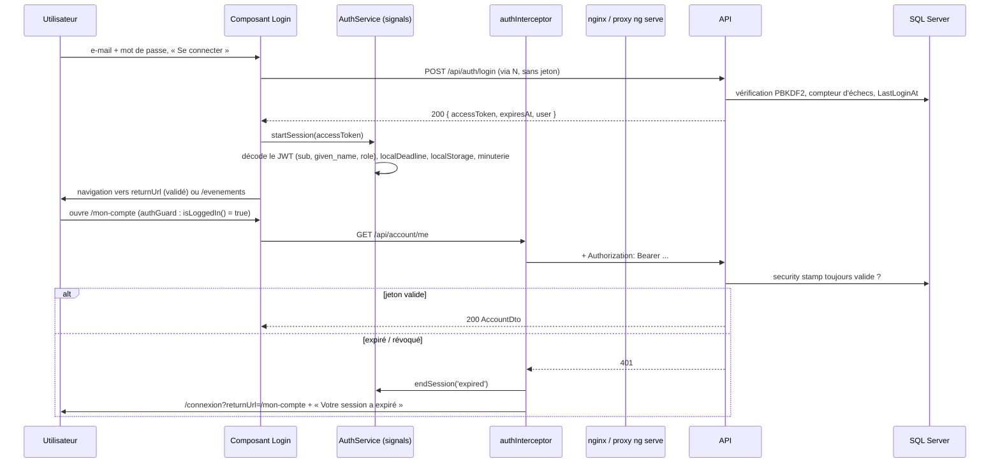
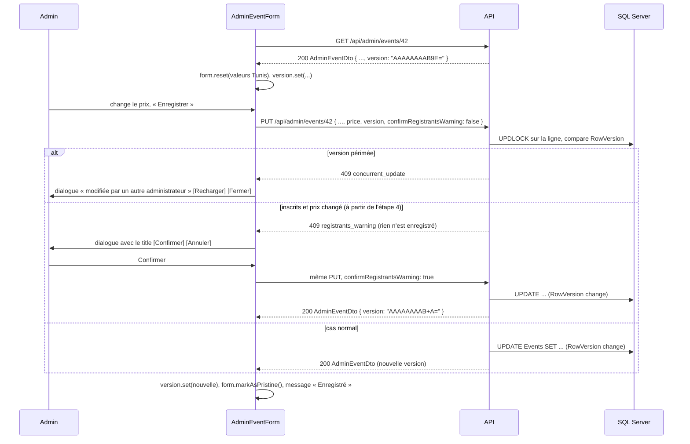

# Plan — Semaine 2 : front Angular

> Rédigé par l'agent `architecte` le 20/11/2026. Référence : cahier des charges v1.2, `fonctionnel/mvp.md` v4, `technique/api.md` (étape 2). Décisions : ADR [0014](../adr/0014-front-angular-version-structure-et-conventions.md) (version, structure), [0015](../adr/0015-session-jwt-cote-front.md) (session JWT), [0016](../adr/0016-formulaires-erreurs-dates-et-version-cote-front.md) (formulaires, erreurs, dates, 409), [0017](../adr/0017-conteneur-front-nginx-proxy-et-configuration-de-l-api.md) (Docker, nginx, proxy). Aucun code n'est écrit à ce stade : ce plan est destiné à l'`expert-technique` (réalisation), au `testeur` (§ 21) et au porteur (§ 22).

---

## 0. Décisions en bref

| Sujet | Décision par défaut | ADR |
|---|---|---|
| Version | **Angular 22.x**, Node 24 LTS, TypeScript 6, `npm ci` | 0014 |
| Style de code | standalone, signals, zoneless, `OnPush` (défaut v22), `inject()`, `@if`/`@for` | 0014 |
| Données serveur | services `HttpClient` → `Observable` ; lecture par `rxResource` ; écriture par appel explicite | 0014 |
| Routing | routes en français, `loadComponent`, admin en `loadChildren` + `canMatch`, `withComponentInputBinding()` | 0014, 0015 |
| UI | Angular Material (M3) + CSS responsive, textes en français dans les templates | 0014 |
| Client API | interfaces et services écrits à la main, une constante `apiBaseUrl` | 0014 |
| Session | `localStorage` `{ accessToken, localDeadline }`, JWT décodé localement, **pas** d'appel `/me` au démarrage | 0015 |
| Intercepteur | ajoute le Bearer vers `/api/` ; 401 d'une requête authentifiée → déconnexion + `/connexion?returnUrl=` | 0015 |
| Guards | `authGuard`, `adminGuard` (`canMatch`), `guestGuard` ; confort seulement | 0015 |
| Formulaires | reactive forms typés, mêmes noms et mêmes messages que l'API, `<app-field-errors>` | 0016 |
| Erreurs | `toApiError()` + `applyServerErrors()` ; décisions sur `code`, jamais sur le texte | 0016 |
| Dates | `DatePipe` à `+0100`, locale `fr` ; `datetime-local` + `toTunisIso()` / `toTunisLocalInput()` | 0003, 0016 |
| Version (409) | `version` dans un signal, remplacée après chaque réponse ; dialogues `registrants_warning` / `concurrent_update` | 0016 |
| Pagination | page dans l'URL, `<app-pager>` maison | 0011, 0016 |
| Dev | `ng serve` + `proxy.conf.mjs` vers l'API : même origine, pas de CORS | 0017 |
| Docker | `node:24-alpine` → `nginx-unprivileged` (8080), repli SPA, relais `/api`, CSP, `127.0.0.1:4200` | 0017 |
| Tests | Vitest (`ng test`), `TestBed`, `HttpTestingController` ; pas d'e2e au MVP | 0014 |
| CI | job front prêt pour S3 (`npm ci`, `ng test`, `ng build`, `docker build`) | — |

---

## 1. Périmètre de la semaine 2

### 1.1 Écrans livrés (API disponible)

| Écran | Route | Accès | Endpoints | User story |
|---|---|---|---|---|
| Coquille (en-tête, menu, pied de page avec « Politique de confidentialité ») | — | tous | — | US-F1 (lien) |
| Inscription | `/inscription` | visiteur | `POST /api/auth/register` | US-A1 |
| Connexion | `/connexion` | visiteur | `POST /api/auth/login` | US-A2 |
| Déconnexion | menu | connecté | — (local) | US-A3 |
| Événements à venir | `/evenements` | tous | `GET /api/events?page=` | US-C1 |
| Détail d'un événement | `/evenements/:id` | tous | `GET /api/events/{id}` | US-C2 (partie visiteur) |
| Admin : liste des événements | `/admin/evenements` | admin | `GET /api/admin/events` | US-E2 |
| Admin : créer / modifier, publier, dépublier, supprimer | `/admin/evenements/nouveau`, `/admin/evenements/:id` | admin | `POST`, `GET`, `PUT`, `publish`, `unpublish`, `DELETE` | US-E2 |
| Admin : numéro de contact | `/admin/parametres` | admin | `GET /api/settings/contact`, `PUT`/`DELETE /api/admin/settings/contact` | US-E8 |
| Mon compte *(recommandé, coût faible)* | `/mon-compte` | connecté | `GET /api/account/me` | US-F3 (lecture) |
| Politique de confidentialité (texte provisoire) | `/confidentialite` | tous | — | US-F1 |
| Contenu introuvable, accès réservé | `**`, `/acces-refuse` | tous | — | US-B2, US-C2, épique E |

`/` redirige vers `/evenements` tant que les actualités (étape 8) n'existent pas.

### 1.2 Hors semaine 2, faute d'API

Demande de place, numéro à contacter côté membre (US-D1, D4), mes réservations, annulation (D2, D3), demandes à traiter et inscrits (E4 à E7), annulation d'événement (E3), actualités (B1, B2, E1), suppression de compte (F2). Sur le détail d'un événement, le bouton « Demander une place » est affiché **pour un visiteur** (il mène à la connexion, US-C2) et **masqué pour un membre connecté** tant que l'étape 4 n'existe pas (question UX-9).

> **Écart de planning à arbitrer (question P-1)** : le cahier (§ 8) prévoyait en S1 toute l'API (étapes 1 à 9) et en S2 tous les écrans. Seules les étapes 1 et 2 de l'API sont faites. Recommandation : passer en **tranches verticales** (pour chaque étape restante : API, puis ses écrans, puis tests et docs), ce qui livre plus tôt un parcours utilisable de bout en bout. À reporter dans le cahier § 8 (avec une ligne d'historique) si le porteur l'accepte.

---

## 2. Les notions Angular à réviser (avec leur rôle dans le projet)

| Notion | En une phrase | Analogie .NET | Où dans AAAS |
|---|---|---|---|
| **Composant standalone** | Classe TypeScript + template HTML + style, qui déclare elle-même ce qu'elle utilise (`imports: [...]`) | Une page Razor ou un composant Blazor | chaque écran, `<app-pager>`, `<app-field-errors>` |
| **Template et liaisons** | `{{ valeur }}` (texte), `[prop]="expr"` (propriété), `(click)="méthode()"` (événement) | syntaxe Razor `@Model.X`, `onclick` | partout |
| **Contrôle de flux** | `@if (cond) { } @else { }`, `@for (e of items(); track e.id) { } @empty { }` | `@if`, `@foreach` de Razor | listes, messages vides |
| **Signal** | Valeur réactive : `count = signal(0)`, lecture `count()`, écriture `count.set(1)` ; le template se met à jour quand un signal qu'il lit change | propriété avec `INotifyPropertyChanged` | état local, session |
| **`computed`** | Signal dérivé, recalculé seulement quand ses sources changent | propriété calculée mise en cache | `isAdmin`, mention d'un événement, nombre de pages |
| **`input()` / `output()`** | Entrées et sorties d'un composant, sous forme de signals | paramètres `[Parameter]` de Blazor, événements C# | `<app-pager [page] (pageChange)>`, `id` de route |
| **Zoneless + `OnPush`** | Angular ne réaffiche un composant que si un signal lu change, un événement du template survient, ou une entrée change ; plus de `zone.js` qui « devine » | — | piège : un champ de classe modifié dans un `subscribe` ne s'affiche pas → toujours un signal |
| **Injection de dépendances** | `private api = inject(EventsApi)` ; `@Injectable({ providedIn: 'root' })` = singleton | `AddSingleton` + injection par constructeur | services d'API, `AuthService` |
| **`app.config.ts`** | Liste des « providers » de l'application (routeur, `HttpClient`, locale…) | `Program.cs` (`builder.Services.Add...`) | § 3 |
| **`HttpClient` et `Observable`** | `http.get<T>(url)` renvoie un `Observable` **froid** : rien ne part tant qu'on n'y souscrit pas ; il émet une valeur puis se termine | `Task<T>` paresseux ; `HttpClient` .NET | `core/api/*` |
| **`rxResource`** | Transforme un appel `Observable` dépendant de signals en ressource : `value()`, `isLoading()`, `error()`, `reload()` ; relance si un paramètre change | — | listes et détails |
| **Intercepteur fonctionnel** | Fonction appelée pour chaque requête `HttpClient` ; peut modifier la requête ou réagir à la réponse | middleware ASP.NET Core, `DelegatingHandler` | `authInterceptor` |
| **Routeur** | Associe des URL à des composants ; `routerLink` pour naviguer sans recharger la page | routing des endpoints / pages Razor | `app.routes.ts` |
| **Lazy loading** | `loadComponent` / `loadChildren` : le code d'une page est téléchargé à la première visite (fichier JS séparé, *chunk*) | chargement d'assembly à la demande | toutes les pages, espace admin |
| **Guard** | Fonction qui autorise une navigation (`true`) ou redirige (`UrlTree`) ; `canMatch` empêche même le chargement du code | `[Authorize]`, mais côté client = confort | `authGuard`, `adminGuard`, `guestGuard` |
| **Reactive forms typés** | Le formulaire est un objet TypeScript (`FormGroup` de `FormControl<string>`) avec validateurs ; le HTML s'y lie par `[formGroup]` / `formControlName` | modèle + DataAnnotations, mais côté client | inscription, connexion, événement, contact |
| **Validateur** | Fonction `(control) => null | { cle: détail }` | `ValidationAttribute.IsValid` | téléphone, mot de passe, prix |
| **Pipe** | Transformation d'affichage dans le template : `{{ e.startsAt | date:'...' }}`, `{{ e.price | tndPrice }}` | `ToString("format")`, convertisseur | dates, prix |
| **Environnements** | Fichiers `environment*.ts` remplacés à la compilation selon la configuration | `appsettings.{Environment}.json`, mais **figés à la compilation** | `apiBaseUrl` |
| **Build** | `ng build` compile TypeScript, regroupe et minifie (esbuild) dans `dist/front/browser/` : des fichiers statiques que n'importe quel serveur web peut servir | `dotnet publish` | Dockerfile, Static Web Apps |

La fiche `docs/revision/angular.md` (à créer en T0 et compléter à chaque tâche par l'`expert-technique`) reprend ce tableau avec des extraits du code réel et les questions d'entretien (cycle de vie, détection de changements, signals vs `Observable`, `canActivate` vs `canMatch`, `switchMap`, désabonnement, `trackBy`/`track`).

---

## 3. Création du projet et configuration globale (T0)

Commandes, à lancer depuis la racine du dépôt (versions exactes fixées au moment de l'exécution) :

1. `npx @angular/cli@22 new front --style=scss --routing --ssr=false --skip-git` (zoneless et Vitest sont les valeurs par défaut de la v22 : vérifier dans `package.json` l'absence de `zone.js` et la présence de `vitest`).
2. `cd front && npx ng add @angular/material` (thème M3, typographie : police hébergée localement, pas Google Fonts, ADR 0017).
3. `front/.nvmrc` (`24`), champ `engines` de `package.json`.

`app.config.ts` (le « `Program.cs` » du front) déclare :
- `provideBrowserGlobalErrorListeners()` ; zoneless (par défaut) ;
- `provideRouter(routes, withComponentInputBinding())` ;
- `provideHttpClient(withInterceptors([authInterceptor]))` (le moteur `fetch` est le défaut de la v22) ;
- `{ provide: LOCALE_ID, useValue: 'fr' }` + `registerLocaleData(localeFr)` ;
- `{ provide: DATE_PIPE_DEFAULT_OPTIONS, useValue: { timezone: '+0100' } }` (ADR 0003) ;
- options globales Material utiles (apparence des champs).

`angular.json` : budgets (avertissement à 500 Ko pour le bundle initial), `optimization.styles.inlineCritical: false` (CSP, ADR 0017), `serve.options.proxyConfig: "proxy.conf.mjs"`.

`index.html` : `lang="fr"`, titre de l'association, `meta viewport`.

---

## 4. Organisation des dossiers

```
front/
├─ package.json, package-lock.json, angular.json, tsconfig*.json, .nvmrc
├─ proxy.conf.mjs               /api → API_URL (défaut http://localhost:5080)          (ADR 0017)
├─ Dockerfile, .dockerignore    build Node → nginx non-root                            (ADR 0017)
├─ nginx/default.conf           repli SPA, relais /api, cache, gzip, CSP, /healthz
├─ public/                      favicon, polices locales
└─ src/
   ├─ index.html, main.ts, styles.scss
   ├─ environments/environment.ts            { apiBaseUrl: '' }  (environment.azure.ts en S3)
   └─ app/
      ├─ app.ts / app.html                   coquille : <app-header>, <router-outlet>, <app-footer>
      ├─ app.config.ts, app.routes.ts
      ├─ core/                               singletons, aucun composant d'écran
      │  ├─ api/          auth.api.ts, account.api.ts, events.api.ts, admin-events.api.ts, settings.api.ts
      │  ├─ models/       account.ts, auth.ts, event.ts, admin-event.ts, paged-result.ts, contact-settings.ts, problem-details.ts
      │  ├─ auth/         auth.service.ts, session-storage.ts, jwt.ts (décodage), auth.interceptor.ts, auth.guards.ts, return-url.ts
      │  ├─ errors/       api-error.ts (toApiError), apply-server-errors.ts
      │  └─ time/         tunis-time.ts (TUNIS_UTC_OFFSET, toTunisIso, toTunisLocalInput), date-formats.ts
      ├─ shared/
      │  ├─ forms/        validators.ts (tunisianPhone, password, price, endAfterStart), validation-messages.ts,
      │  │                field-errors.ts (<app-field-errors>), form-error-banner.ts
      │  ├─ pipes/        tnd-price.pipe.ts
      │  ├─ events/       event-mention.ts (fonction pure), event-status-label.ts
      │  └─ ui/           pager.ts (<app-pager>), confirm-dialog.ts, loading.ts
      ├─ layout/          header.ts (menu, prénom, déconnexion, menu mobile), footer.ts, not-found.ts, forbidden.ts
      └─ features/
         ├─ account/      register/, login/, my-account/
         ├─ public/       events/event-list/, events/event-detail/, privacy/
         └─ admin/        admin.routes.ts, admin-layout.ts (sous-menu),
                          events/admin-event-list/, events/admin-event-form/, settings/contact-settings/
```

Règles : `features/` dépend de `core/` et `shared/`, jamais l'inverse ; une page ne parle à l'API que par un service de `core/api/` ; aucun `HttpClient` dans un composant.

---

## 5. Routes

| Chemin | Composant (chargé à la demande) | Guard | Titre (`title`) |
|---|---|---|---|
| `''` | redirection vers `evenements` | — | — |
| `evenements` | `EventList` | — | Événements |
| `evenements/:id` | `EventDetail` | — | (titre de l'événement) |
| `inscription` | `Register` | `guestGuard` | Créer un compte |
| `connexion` | `Login` | `guestGuard` | Se connecter |
| `mon-compte` | `MyAccount` | `authGuard` | Mon compte |
| `confidentialite` | `Privacy` | — | Politique de confidentialité |
| `acces-refuse` | `Forbidden` | — | Accès réservé |
| `admin` | `loadChildren: admin.routes` | `canMatch: [adminGuard]` | — |
| `admin/evenements` | `AdminEventList` | (hérité) | Administration — événements |
| `admin/evenements/nouveau` | `AdminEventForm` | | Nouvel événement |
| `admin/evenements/:id` | `AdminEventForm` | `canDeactivate` (modifications non enregistrées, UX-8) | Modifier l'événement |
| `admin/parametres` | `ContactSettings` | | Numéro de contact |
| `**` | `NotFound` | — | Contenu introuvable |

Paramètres de requête : `/evenements?page=2`, `/admin/evenements?status=Draft&period=all&page=1`, `/connexion?returnUrl=/mon-compte`. Grâce à `withComponentInputBinding()`, `id`, `page`, `status`, `period`, `returnUrl` arrivent dans des `input()` du composant.

---

## 6. Client API typé

- **Modèles** (`core/models/`) : recopie exacte des DTO de `api.md` en `interface` (camelCase), dates en `string` (ISO avec décalage, jamais converties en `Date` à la réception : le `DatePipe` sait lire la chaîne), prix `number | null`, statuts en types littéraux (`'Draft' | 'Published' | 'Cancelled'`), `PagedResult<T>` générique, `ProblemDetails` (`title`, `status`, `code`, `errors?`, `traceId?`).
- **Services** (`core/api/`), un par contrôleur, méthodes typées : `EventsApi.list(page)`, `get(id)` ; `AdminEventsApi.list({ status, period, page })`, `get`, `create`, `update(id, body)`, `publish`, `unpublish`, `delete` ; `SettingsApi.getContact()`, `saveContact()`, `removeContact(version)` (`http.delete(url, { body: { version } })` : `HttpClient` ajoute `Content-Type: application/json`, sinon 415) ; `AuthApi.register`, `login` ; `AccountApi.me`.
- URL = `` `${environment.apiBaseUrl}/api/...` `` ; paramètres par `HttpParams` (jamais par concaténation).
- Les services ne gèrent ni erreurs ni messages : ils renvoient l'`Observable` brut.

---

## 7. Erreurs ProblemDetails

Détail et table des codes : ADR 0016 § 2. Patron d'un envoi de formulaire :

1. `form.markAllAsTouched()` ; si invalide, on s'arrête (les messages sont affichés sous les champs).
2. `submitting.set(true)` ; appel du service.
3. Succès : action (navigation, message, mise à jour de la `version`).
4. Erreur : `const e = toApiError(err)` ; selon `e.code` : `applyServerErrors(form, e)` et/ou bandeau `errorMessage.set(e.message)`, ou dialogue (409).
5. `submitting.set(false)` dans tous les cas.

Pages de lecture : `rxResource.error()` → `toApiError` ; `not_found` → composant « Contenu introuvable » affiché à la place du détail (l'URL reste celle demandée) ; autre erreur → message et bouton « Réessayer » (`reload()`).

---

## 8. Authentification (ADR 0015)



Points précis : claim `role` chaîne **ou** tableau ; prénom affiché depuis `given_name` ; menu « Administration » visible si `isAdmin()` ; message de la page de connexion lu depuis un paramètre de navigation (`?raison=expiree`) ou un signal du service.

---

## 9. Formulaires et validation en français (ADR 0016 § 1)

| Formulaire | Champ (= clé JSON) | Validateurs front | Message (identique à l'API) |
|---|---|---|---|
| Inscription | `firstName`, `lastName` | requis, ≤ 100 | « Le prénom est obligatoire. » / « …ne doit pas dépasser 100 caractères. » |
| | `email` | requis, e-mail, ≤ 256 | « L'e-mail est obligatoire. » / « L'e-mail n'est pas valide. » |
| | `phoneNumber` | requis, `tunisianPhone` (espaces retirés, `^\+216\d{8}$`), préfixe « +216 » prérempli | message RG-11 de l'API (« …par exemple +216 20 123 456. ») |
| | `password` | requis, 8 à 128, une lettre (`\p{L}`), un chiffre ; aide affichée sous le champ | messages d'Identity en français |
| | `acceptPrivacyPolicy` | `requiredTrue`, lien vers `/confidentialite` (nouvel onglet) | « Vous devez accepter la politique de confidentialité pour créer un compte. » |
| Connexion | `email`, `password` | requis | — ; erreurs `invalid_credentials` / `account_locked` en bandeau |
| Événement | `title`, `location` | requis, ≤ 200, compteur de caractères | messages de `api.md` |
| | `description` | requis, ≤ 4 000, compteur | idem |
| | `startsAt`, `endsAt` | requis ; `endAfterStart` au niveau du groupe | « La fin doit être après le début. » ; « dans le futur » laissé au serveur |
| | `capacity` | requis, entier, 1 à 10 000 | « La capacité doit être comprise entre 1 et 10 000 places. » |
| | `price` | facultatif ; nombre ≥ 0, ≤ 99 999,999, ≤ 3 décimales ; virgule acceptée | messages de `api.md` |
| Contact | `phoneNumber` | requis, `tunisianPhone` | message RG-11 |
| | `whatsApp` | case à cocher, désactivée sans numéro | — |

Les textes exacts sont recopiés de `docs/technique/api.md` et de `regles-metier.md` dans `validation-messages.ts` ; le testeur vérifie l'égalité sur quelques cas.

---

## 10. Dates en heure de Tunis (ADR 0003, 0016 § 3)

- Stockage et transport : UTC (`...+00:00`). Le front **affiche** avec `DatePipe` décalé à `+0100`, et **envoie** `toTunisIso(valeurDuChamp)` (`+01:00`).
- Pourquoi pas le fuseau du navigateur : un admin en France (UTC+1 l'hiver, **UTC+2 l'été**) verrait et saisirait des heures fausses d'une heure en été.
- Le champ `datetime-local` renvoie `"2026-12-05T10:00"` sans fuseau : c'est exactement pour cela que l'API refuse une date sans décalage (ADR 0009) et que `toTunisIso` existe.
- Libellés : « Début (heure de Tunis) », « Fin (heure de Tunis) ».

---

## 11. Prix et mentions

- `tndPrice` (pipe pur) : `null` → « Gratuit » ; 15 → « 15 TND, à régler sur place » ; 12.5 → « 12,500 TND, à régler sur place ».
- `eventMention(dto)` : Annulé > Terminé > Réservations closes > Complet > « N places restantes » / « 1 place restante ».
- Statut admin (`event-status-label.ts`) : Brouillon, Publié, Annulé, complété par « En cours » (`hasStarted && !hasEnded`) ou « Terminé » (`hasEnded`).

---

## 12. Pagination (ADR 0011, 0016 § 5)

`EventList` : `page = input(1, { transform: toPageNumber })` (absent, non numérique, < 1 → 1) ; `events = rxResource({ params: () => ({ page: this.page() }), stream: ({ params }) => this.api.list(params.page) })` ; `totalPages = computed(...)`. `<app-pager>` émet le numéro choisi ; le composant navigue vers `?page=n` (`router.navigate([], { queryParams: { page: n } })`) : le signal `page` change, `rxResource` relance l'appel, le bouton « précédent » du navigateur fonctionne. Défilement en haut de page à chaque changement. Liste admin : même patron avec `status` et `period` (listes déroulantes) ; changer un filtre remet la page à 1.

---

## 13. Version et flux 409 (ADR 0006, 0012, 0016 § 4)



Même patron pour le numéro de contact (`PUT` et `DELETE` avec `{ version }`). Après **Publier** : `version.set(réponse.event.version)` et affichage des `warnings`. Après **Supprimer** (204) : retour à la liste avec un message.

---

## 14. Flux complet : écran → API → base

### 14.1 Un visiteur ouvre `/evenements?page=2` (dans `docker compose`)

```
Navigateur                        Conteneur front (nginx, 8080)        Conteneur api (Kestrel, 8080)        Conteneur sqlserver
──────────                        ─────────────────────────────        ─────────────────────────────        ───────────────────
GET http://localhost:4200/evenements?page=2
   │ (port publié 127.0.0.1:4200 → 8080)
   └──────────────────────────▶  try_files : pas de fichier « evenements »
                                  → renvoie index.html (repli SPA)
◀─ index.html, puis main-XXXX.js (cache long), chunk de EventList (lazy)
Angular démarre : AuthService restaure la session (localStorage, sans réseau)
Routeur : « evenements » → EventList ; input page = 2
rxResource → EventsApi.list(2) → HttpClient → authInterceptor (Bearer si connecté)
GET /api/events?page=2&pageSize=20 (même origine, pas de CORS)
   └──────────────────────────▶  location /api/ → resolver 127.0.0.11 → api:8080
                                                                       middlewares (exception, CORS, JWT facultatif)
                                                                       EventsController → PublicEventService
                                                                       EF Core : SELECT ... WHERE Status IN (2,3)
                                                                       AND EndsAt > @now ORDER BY StartsAt, Id
                                                                       OFFSET 20 ROWS FETCH NEXT 20  ──────────▶ volume sqlserver-data
                                                                       EventOccupancyReader (décompte groupé)
                                                                       Domain : RemainingSeats, IsBookable
◀─ 200 { items, page: 2, pageSize: 20, totalCount: 37 } ◀───────────────
events.value() change → template : @for, tndPrice, date (+0100), eventMention, <app-pager>
```

### 14.2 Un admin enregistre une modification : voir le diagramme du § 13 (le trajet réseau est le même : nginx → `api:8080` → SQL Server ; la différence est le jeton ajouté par l'intercepteur et le verrou `UPDLOCK` + `rowversion` côté base).

### 14.3 En développement (`ng serve`)

Même trajet, mais le rôle de nginx est tenu par le serveur de développement Angular : il sert les fichiers compilés en mémoire (rechargement automatique) et relaie `/api` vers `http://localhost:5080` (`dotnet run`) ou `http://localhost:8080` (API dans compose, `API_URL=http://localhost:8080 npm start`).

---

## 15. Développement local : proxy et CORS

| Mode | Commandes | Front | API | CORS ? |
|---|---|---|---|---|
| Tout en local | `dotnet run --project src/Aaas.Api` (+ `docker compose up -d sqlserver`) ; `cd front && npm start` | `localhost:4200` (`ng serve`) | `localhost:5080` | non (proxy) |
| Front en local, API en conteneur | `docker compose up -d sqlserver api` ; `API_URL=http://localhost:8080 npm start` | `localhost:4200` | `localhost:8080` | non (proxy) |
| Tout en conteneurs | `docker compose up --build` | `localhost:4200` (nginx) | via nginx | non (nginx) |
| Azure (S3) | CI | Static Web Apps | App Service | **oui** (`Cors:AllowedOrigins` = URL SWA) |

**Pourquoi CORS n'apparaît pas en local** : CORS est une protection **du navigateur** qui ne s'applique qu'aux appels vers une **autre origine** (schéma + hôte + port). Avec le relais, la page et l'API sont vues sous la même origine `http://localhost:4200`. En Azure, le front (`*.azurestaticapps.net`) et l'API (`*.azurewebsites.net`) sont deux origines : le navigateur envoie une requête préalable `OPTIONS` (en-tête `Authorization`), et l'API doit répondre avec `Access-Control-Allow-Origin` = l'URL du front.

---

## 16. Docker : image du front et `docker compose` (ADR 0017)

### 16.1 Notions (complément de `docs/revision/docker.md`)

| Notion | Pour le front |
|---|---|
| Multi-stage | étape 1 avec Node (≈ 1 Go : npm, compilateur) pour **compiler** ; étape 2 avec nginx (≈ 50 Mo) pour **servir** ; on ne copie que `dist/front/browser/`. Même idée que SDK .NET → runtime ASP.NET. |
| `npm ci` vs `npm install` | `npm ci` installe **exactement** `package-lock.json`, échoue s'il n'est pas cohérent avec `package.json`, et part d'un `node_modules` vide : reproductible (équivalent de `dotnet restore` avec versions centralisées). |
| Cache de couches | `COPY package.json package-lock.json` puis `RUN npm ci` **avant** `COPY . .` : modifier un composant ne relance pas le téléchargement des paquets (même règle que les `.csproj`). |
| Contexte de build | `front/` ; `front/.dockerignore` exclut `node_modules/` (sinon des centaines de Mo envoyés au démon, et des binaires Windows copiés dans une image Linux). |
| Pourquoi nginx | Un front compilé n'est que des fichiers : il faut un serveur web. nginx joue aussi le **reverse proxy** (`/api` → `api:8080`), comme le ferait un YARP devant une API. |
| Repli SPA | `/evenements/42` n'existe pas sur disque : nginx renvoie `index.html`, puis le routeur Angular affiche la bonne page. Sans cela, un rechargement de page donne une 404 nginx. |
| Non-root | `nginx-unprivileged` écoute sur 8080 (un port < 1024 exige root) ; même principe que `USER $APP_UID` dans l'image de l'API. |
| DNS de Docker | Dans un réseau compose, `api` se résout par le DNS interne `127.0.0.11` ; `resolver` force nginx à re-résoudre (l'IP change si le conteneur `api` est recréé). |
| Port publié | `127.0.0.1:4200:8080` : le navigateur du poste parle au port 4200 de l'hôte, Docker relaie vers le 8080 du conteneur. |
| Healthcheck | `wget --spider http://127.0.0.1:8080/healthz` dans le conteneur (BusyBox) ; `docker compose ps` affiche `healthy`. |
| Configuration figée à la compilation | `environment.ts` est compilé dans le JS : contrairement à l'API (variables d'environnement lues au démarrage), changer l'URL de l'API demande de **recompiler**. D'où le chemin relatif `/api` en local. |

### 16.2 Fichiers

- `front/Dockerfile` : deux étapes (`build` Node 24 Alpine, `final` nginx non-root), commentaires en français comme `src/Aaas.Api/Dockerfile`, tags précis épinglés.
- `front/nginx/default.conf` : voir ADR 0017 § 4.
- `front/.dockerignore`.
- `docker-compose.yml` : service `front` (build `./front`, image `aaas-front:local`, `depends_on: api`, port `127.0.0.1:4200:8080`, healthcheck). Commentaire en tête du fichier : « Ouvrir http://localhost:4200 ».
- Le `.dockerignore` racine **ne change pas** (il exclut déjà `front/` du contexte de l'API).

### 16.3 À observer (pour la fiche de révision)

- `docker compose build front` deux fois : la seconde, `npm ci` est `CACHED` ; modifier un `.html` : seules les étapes `COPY . .` et `ng build` sont refaites.
- `docker image ls aaas-front` : taille de l'image finale (quelques dizaines de Mo) contre l'image `node`.
- `docker compose up -d --build api` puis rechargement du front : toujours fonctionnel grâce au `resolver`.
- `curl -I http://localhost:4200/evenements/x` → 200 (`index.html`) ; `curl -I http://localhost:4200/api/events` → JSON de l'API.

---

## 17. Tests du front

| Niveau | Outil | Cible | Exemples |
|---|---|---|---|
| Fonctions pures | Vitest | `core/time`, `shared/pipes`, `shared/forms/validators`, `event-mention`, `jwt`, `return-url`, `toApiError` | `toTunisIso('2026-12-05T10:00')` = `'2026-12-05T10:00+01:00'` ; `toTunisLocalInput('2026-12-31T23:30:00+00:00')` = `'2027-01-01T00:30'` ; `tndPrice(99999.999)` = « 99 999,999 TND… » ; téléphone : tous les cas de US-A1 ; `role` chaîne et tableau |
| Services d'API | `HttpTestingController` | méthode, URL, paramètres, corps | `removeContact` envoie un `DELETE` avec corps JSON |
| Intercepteur | `HttpTestingController` + faux `Router` | ajout du Bearer, 401 | pas de jeton vers une URL hors API ; 401 d'une requête authentifiée → déconnexion + redirection ; 401 du login → pas de redirection |
| Guards | `TestBed.runInInjectionContext` | `UrlTree` renvoyé | membre sur `admin` → `/acces-refuse` ; visiteur → `/connexion?returnUrl=...` |
| Composants | `TestBed` (zoneless : `await fixture.whenStable()`), services d'API remplacés par des doublures | rendu et interactions | inscription : 400 recopié sur `phoneNumber` ; liste : mentions, « Aucun événement prévu pour le moment », pager ; formulaire admin : `registrants_warning` → dialogue → renvoi avec le drapeau ; `concurrent_update` → rechargement ; version remplacée après publication |

- Commandes : `npm test` (mode surveillance), `npm run test:ci` (= `ng test --watch=false`, couverture avec `@vitest/coverage-v8`).
- Pas de bibliothèque supplémentaire (Testing Library) ni d'e2e navigateur au MVP (question Q-T1) ; la vérification de bout en bout se fait à la main sur `docker compose up` (définition de « terminé », point 7), avec une liste de parcours (§ 21).

---

## 18. CI (préparée en S2, activée en S3)

Le pipeline est un livrable de S3 (cahier § 8). En S2, on prépare des **scripts npm** stables pour que le job soit trivial :

| Script | Commande |
|---|---|
| `start` | `ng serve` |
| `build` | `ng build` |
| `test:ci` | `ng test --watch=false --coverage` |
| `lint` *(si ESLint est ajouté, question Q-T2)* | `ng lint` |

Job prévu dans `ci.yml` (S3), filtré sur `front/**` : `actions/setup-node` (version lue dans `front/.nvmrc`, cache npm sur `front/package-lock.json`), `npm ci`, `npm run test:ci`, `npm run build`, `docker build front` (sans publication). Le job .NET existant n'est pas modifié. Déploiement Static Web Apps en S3 (avec `environment.azure.ts` et `staticwebapp.config.json`).

---

## 19. Tâches ordonnées

Chaque tâche est **livrable seule** : elle compile, ses tests passent, `docker compose up` fonctionne, la doc concernée est à jour, revue par `code-reviewer`.

| # | Tâche | Contenu | Tests | Docs |
|---|---|---|---|---|
| **T0** | Squelette | `ng new`, Material, `app.config.ts` (locale, dates, routeur, HttpClient), coquille (en-tête, pied de page avec lien confidentialité, `NotFound`), routes vides, `proxy.conf.mjs`, scripts npm | test de création de la coquille | `revision/angular.md` (création, notions de base), `exploitation.md` (lancer le front) |
| **T1** | Docker du front | `Dockerfile`, `nginx/default.conf`, `front/.dockerignore`, service `front` dans compose | vérifications manuelles du § 16.3 | `revision/docker.md` (section front), `exploitation.md`, `architecture.md` § 7 |
| **T2** | Socle commun | modèles, services d'API, `toApiError`, `applyServerErrors`, `tunis-time`, `tndPrice`, `eventMention`, validateurs et messages, `<app-field-errors>`, `<app-pager>`, dialogue de confirmation | tous les tests de fonctions pures et des services | `revision/angular.md` (pipes, validateurs, `HttpClient`) |
| **T3** | Session et connexion (US-A2, US-A3) | `AuthService`, stockage, décodage JWT, intercepteur, guards, `returnUrl`, page de connexion, déconnexion, menu selon le rôle, synchronisation des onglets, page « Accès réservé » | intercepteur, guards, `AuthService`, composant de connexion | `revision/angular.md` (intercepteur, guards, signals) |
| **T4** | Inscription (US-A1) + confidentialité (US-F1, texte provisoire) + Mon compte (US-F3) | formulaire complet, erreurs serveur par champ, connexion automatique après 201 | composant d'inscription (validations front, 400, 409 `email_taken`) | `revision/angular.md` (reactive forms) ; guide membre (créer un compte, se connecter) |
| **T5** | Liste publique (US-C1) | `rxResource`, page dans l'URL, mentions, prix, dates, liste vide, page hors limites, mise en page mobile | composant de liste | guide membre (consulter les événements) |
| **T6** | Détail public (US-C2, partie visiteur) | `id` en `input()`, `not_found`, événement terminé ou annulé, bouton « Demander une place » pour un visiteur → `/connexion?returnUrl=/evenements/:id` | composant de détail | — |
| **T7** | Admin : liste (US-E2) | `admin.routes.ts`, `canMatch`, sous-menu, filtres `status`/`period`, colonnes (statut, dates, places, en attente/confirmées), bouton « Nouvel événement » | composant de liste admin, `adminGuard` | guide admin (liste) |
| **T8** | Admin : formulaire (US-E2) | création → redirection vers la fiche ; modification avec `version` ; Publier / Dépublier / Supprimer (confirmation, `canBeDeleted`) ; avertissement `contact_not_configured` ; flux 409 ; fiche en lecture seule si terminé ou annulé ; garde de sortie | composant de formulaire (tous les 409, version remplacée, actions désactivées si modifié) | guide admin (créer, publier, modifier un événement) ; `revision/angular.md` (concurrence côté front) |
| **T9** | Admin : numéro de contact (US-E8) | formulaire numéro + WhatsApp, enregistrer, retirer (confirmation, `DELETE` avec `{ version }`), liens `tel:` / `wa.me` en aperçu | composant de paramètres (409, 400 RG-11, retrait) | guide admin (numéro de contact) |
| **T10** | Finitions | CSP vérifiée (console du navigateur sans erreur), accessibilité de base (libellés, focus, contraste), responsive sur téléphone, budgets de build, titres de pages | parcours manuels du § 21 sur `docker compose up` | `architecture.md` § 6 et § 7 (version 8), relecture par le `documentaliste` |

Ordre justifié : T1 juste après T0 pour valider **tôt** la chaîne complète navigateur → nginx → API → base, même avec un écran vide ; T3 avant T4 parce que l'inscription connecte l'utilisateur ; les écrans admin après les écrans publics, qui posent les patrons (`rxResource`, pager, mentions).

---

## 20. Documentation à mettre à jour (même tâche que le code)

| Document | Mise à jour | Par |
|---|---|---|
| `docs/technique/architecture.md` | § 6 (structure, session sans `/me` au démarrage, Material, `rxResource`), § 7 (service `front` : non-root 8080, healthcheck), § 1 (index des ADR 0014 à 0017) | architecte (à la validation de ce plan) |
| `docs/technique/exploitation.md` | lancer le front (`npm start`, `API_URL`), `docker compose` avec le front, ports, dépannage (502 au démarrage, port 4200 occupé) | expert-technique |
| `docs/technique/api.md` | rien sur les endpoints ; préciser que le front appelle en chemin relatif via le relais | expert-technique |
| `docs/technique/regles-metier.md` | colonne « affichage front » pour les mentions et messages (où le front reprend une règle, à titre de confort) | expert-technique |
| `docs/revision/angular.md` (nouvelle) | toutes les notions du § 2, avec le code réel et des questions d'entretien | expert-technique |
| `docs/revision/docker.md` | section « image du front » (§ 16) | expert-technique |
| `docs/guide-utilisateur/` | guide membre (compte, événements) et guide admin (événements, numéro de contact) | documentaliste |
| `docs/fonctionnel/` | texte provisoire de la politique de confidentialité (Q13), réponses aux questions UX | expert-fonctionnel |

---

## 21. Risques et points à tester (pour le `testeur`)

| Risque | Parade | Test |
|---|---|---|
| Heure décalée d'une heure (fuseau du navigateur utilisé par erreur) | `toTunisIso`, `DatePipe` à `+0100`, aucune `new Date(...).getHours()` | fonctions pures avec un fuseau de poste différent (`TZ=Europe/Paris` en été, `TZ=America/New_York`) : résultat identique |
| Passage de minuit / de l'année | conversion par l'instant, pas par les champs | 23:30Z le 31/12 → 00:30 le 01/01 à Tunis |
| Secondes perdues au préremplissage | champ à la minute | événement créé par l'API avec des secondes, puis enregistré sans changement : comportement à documenter |
| Faux `concurrent_update` après une action | version remplacée après chaque réponse | publier puis enregistrer : 200 |
| Écran qui ne se met pas à jour (zoneless) | tout état affiché est un signal | test de composant après une réponse asynchrone |
| Claim `role` scalaire pour un membre, tableau pour un admin | normalisation | décodage avec les deux formes |
| Horloge du poste décalée | `localDeadline` relative | session utilisable avec `Date.now()` décalé de +2 h |
| Redirection ouverte via `returnUrl` | validation | `returnUrl=//exemple.com`, `https://exemple.com` → `/evenements` |
| Jeton envoyé à un tiers | Bearer seulement vers `/api/` | requête vers une autre URL sans en-tête |
| 401 du login traité comme une session expirée | seulement si la requête portait un jeton | mauvais mot de passe : message « E-mail ou mot de passe incorrect », pas de redirection |
| `DELETE` du contact refusé en 415 | corps JSON via `http.delete(url, { body })` | test du service + essai réel |
| Double soumission | `submitting` | double clic : un seul appel |
| Rechargement d'une route profonde en 404 | repli SPA nginx | `F5` sur `/admin/evenements/:id` dans compose |
| nginx en 502 après recréation de l'API | `resolver 127.0.0.11` | `docker compose up -d --build api` puis appel |
| CSP qui casse l'application | `inlineCritical: false`, polices locales | console du navigateur sans violation CSP |
| Messages front et API divergents | messages recopiés | comparaison sur 3 cas (téléphone, capacité, prix) |
| Dérive des interfaces TypeScript | revue à chaque changement d'`api.md` | — |

Parcours manuels (sur `docker compose up`, téléphone et ordinateur) : inscription → connexion automatique → mon compte ; déconnexion ; connexion admin → créer un brouillon → modifier → publier (avec et sans numéro de contact) → voir l'événement côté visiteur → dépublier → supprimer un brouillon jamais publié ; deux onglets admin sur la même fiche → second enregistrement en 409 ; retirer et remettre le numéro de contact ; page 2 de la liste ; adresse d'un brouillon → « Contenu introuvable » ; membre sur `/admin` → « Accès réservé ».

---

## 22. Questions ouvertes

### Pour le porteur (UX et organisation) — valeur par défaut appliquée en attendant

| # | Question | Défaut |
|---|---|---|
| **P-1** | Passer aux **tranches verticales** (API + écrans par étape) pour la suite, et mettre à jour le cahier § 8 ? | Oui |
| **UX-1** | Angular Material ou CSS maison ? | Material |
| **UX-2** | Nom affiché, logo, couleurs de l'association ? | nom de l'association en texte, thème Material neutre |
| **UX-3** | Page d'accueil `/` avant les actualités ? | redirection vers `/evenements` |
| **UX-4** | Format des dates : « samedi 5 décembre 2026 à 10:00 » (détail), « sam. 5 déc. 2026, 10:00 » (listes) ? « 10 h 00 » plutôt que « 10:00 » ? | formats ci-contre, `HH:mm` |
| **UX-5** | Session qui expire pendant une saisie : avertir 5 minutes avant ? (lié à la question ouverte n° 2 de l'architecture : durée de 60 min) | pas d'avertissement ; message et retour à la connexion, saisie perdue |
| **UX-6** | Conflit entre admins : recharger (saisie perdue) ou afficher les deux versions ? | recharger, avec « Fermer » pour recopier sa saisie |
| **UX-7** | Désactiver Publier / Dépublier / Supprimer tant que le formulaire a des modifications non enregistrées ? | oui |
| **UX-8** | Demander confirmation en quittant un formulaire modifié ? | oui (formulaire d'événement et numéro de contact) |
| **UX-9** | Membre connecté sur un événement réservable avant l'étape 4 : bouton masqué ou « Bientôt disponible » ? | masqué |
| **UX-10** | Après connexion ou inscription sans `returnUrl` : aller où ? | `/evenements` |
| **UX-11** | Port 4200 partagé entre `ng serve` et le conteneur `front` ? | oui (pas les deux en même temps) |
| **Q-T1** | Tests de bout en bout navigateur (Playwright) ? | non au MVP, parcours manuels |
| **Q-T2** | ESLint (`ng add @angular-eslint/schematics`) ? | oui, en T0 (coût faible, attendu en CI) |

### Pour l'`expert-fonctionnel`

- **Q13** : texte de la politique de confidentialité (données, usages, durée, contact, loi 2004-63, INPDP) : indispensable au lien de l'inscription. En attendant : page « version provisoire » rédigée à partir de R20, R24, R25.
- Libellés exacts des menus et boutons (« Demander une place », « Administration », « Se déconnecter ») et du message de session expirée.
