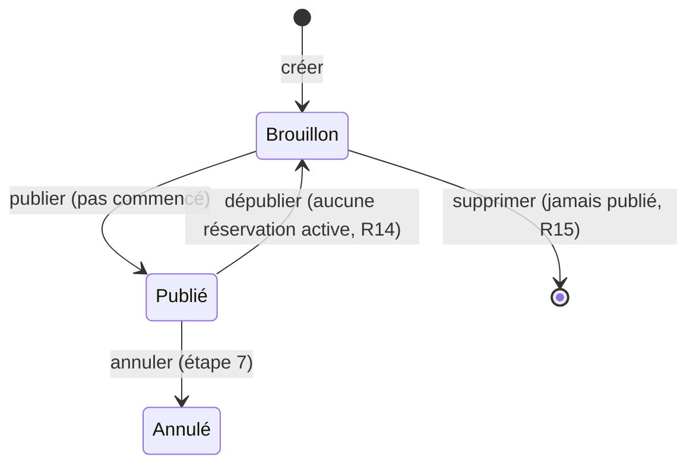
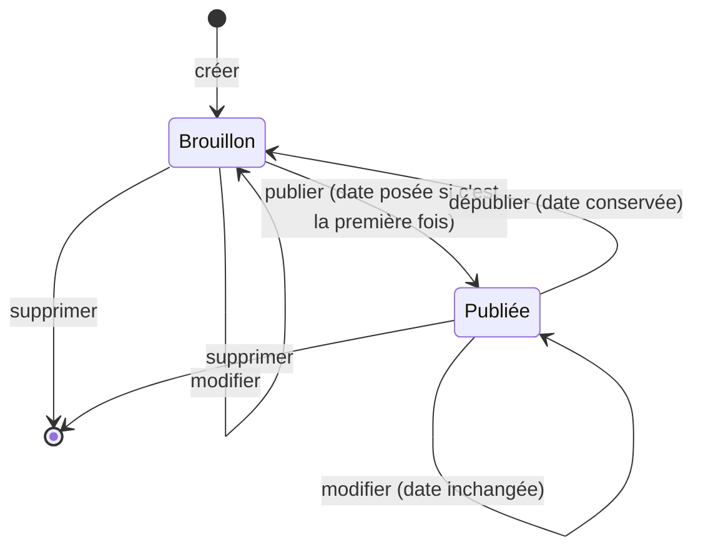

# Règles métier et cycle de vie — AAAS

> Tenu par l'agent `expert-technique`. Pour chaque règle : ce qui est appliqué, et **où** dans le code.
> Références : `docs/cahier-des-charges.md` (RG-xx), `docs/fonctionnel/mvp.md` (R-xx, US-xx), `docs/adr/`.
> État : **réservations, tâche B** (24/11/2026) : comptes ; événements ; numéro de contact ; demande, suivi et annulation d'une place par le membre ; traitement par l'admin (confirmer, refuser, annuler, « Payée », inscrits) (§ 3 bis), avec leurs écrans. Expiration périodique (tâche C) : livrée le 24/11/2026. Actualités : à venir. Ce que le front reprend ou affiche : § 6.

## 1. Comptes et authentification

### 1.1 Inscription (US-A1, R20, RG-11)

| Règle | Comportement | Où dans le code |
|---|---|---|
| Champs obligatoires | Prénom (≤ 100), nom (≤ 100), e-mail valide (≤ 256), téléphone, mot de passe (≤ 128), case de consentement cochée. Sinon **400**, erreur sur le champ concerné. | `RegisterRequest` (attributs de validation) — `src/Aaas.Application/Accounts/AccountDtos.cs` |
| Téléphone tunisien uniquement (RG-11) | Accepté : `+216` suivi d'exactement 8 chiffres (0-9), **mobile ou fixe** (`+216 20 123 456`, `+216 71 123 456`), espaces tolérés. Refusé : saisie locale (`20 123 456`), préfixe `00`, autre indicatif, tirets ou points, chiffres non latins. Stocké normalisé : `+21620123456`. Message : « Le numéro de téléphone doit être un numéro tunisien au format +216 suivi de 8 chiffres, par exemple +216 20 123 456. » | `PhoneNumber.TryParse` — `src/Aaas.Domain/Common/PhoneNumber.cs` ; utilisé par `TunisianPhoneNumberAttribute` (400, `src/Aaas.Application/Common/Validation/`) et revérifié par `AccountService.RegisterAsync` |
| E-mail unique sans tenir compte de la casse | `Salma@Exemple.tn` = `salma@exemple.tn`. Doublon : **409** `email_taken`, « Un compte existe déjà avec cet e-mail. ». Protégé aussi contre deux inscriptions simultanées par l'index unique filtré `UX_AspNetUsers_NormalizedEmail`. Ce cas (erreur SQL 2601) n'est pas journalisé comme erreur et l'e-mail n'apparaît pas dans les journaux (R24) : `SaveChangesFailed` ignoré ; `CommandError` et les autres événements EF Core porteurs d'une exception SQL (`QueryIterationFailed`, `ConnectionError`, `TransactionError`, échecs d'`ExecuteUpdate`/`ExecuteDelete`) rétrogradés en Debug. | `IdentityService.CreateUserAsync` + `AppUserConfiguration` (index) ; `ConfigureWarnings` dans `src/Aaas.Infrastructure/DependencyInjection.cs` |
| Mot de passe (R21) | Au moins 8 caractères, au moins un chiffre, au moins une lettre (minuscule ou majuscule, accents compris). Sinon **400** avec tous les messages sur le champ `password`. | Options Identity dans `src/Aaas.Infrastructure/DependencyInjection.cs` + `LetterRequiredPasswordValidator` ; messages : `FrenchIdentityErrorDescriber` |
| Consentement (R24, § 6.4) | Case obligatoire. On enregistre la **date** (`PrivacyConsentAt`) et la **version** de la politique acceptée (`PrivacyPolicyVersion`, valeur de la configuration `PrivacyPolicy:CurrentVersion`, actuellement `1.0`). | `AccountService.RegisterAsync`, `PrivacyPolicyOptions` |
| Rôle à l'inscription (R22) | Toujours `User`. Aucun champ de rôle n'est lu dans la requête. | `AccountService.RegisterAsync` |
| Connexion automatique | L'inscription renvoie directement un jeton ; `LastLoginAt` = date d'inscription. | `AccountService.RegisterAsync`, `IdentityService.CreateUserAsync` |
| Atomicité | Compte et rôle sont créés dans une même transaction : jamais de compte sans rôle. | `IdentityService.CreateUserAsync` (execution strategy + transaction) |
| Mineurs | Aucun contrôle ni case dédiée (décision du porteur, § 6.4). | — |

Données conservées pour un compte (R20, § 6.4) : prénom, nom, e-mail, téléphone, mot de passe **haché** (PBKDF2, Identity), date de création (`CreatedAt`), date de dernière connexion (`LastLoginAt`), date et version du consentement. Rien d'autre. Toutes les dates sont en UTC (ADR 0003).

### 1.2 Connexion (US-A2, R21)

| Règle | Comportement | Où dans le code |
|---|---|---|
| Identifiants incorrects | E-mail inconnu **ou** mauvais mot de passe : même réponse **401** `invalid_credentials`, « E-mail ou mot de passe incorrect. » | `AccountService.LoginAsync`, `IdentityService.CheckPasswordAsync` |
| Blocage après échecs | Après **5 échecs consécutifs**, le compte est bloqué **15 minutes**. La réponse au 5e échec est déjà **401** `account_locked` ; pendant le blocage, même le bon mot de passe est refusé. Message : « Trop de tentatives de connexion. Votre compte est bloqué temporairement : réessayez dans N minutes. » (N calculé sur la fin réelle du blocage). | `SignInManager.CheckPasswordSignInAsync(lockoutOnFailure: true)` ; options `Lockout` dans `DependencyInjection.cs` |
| Remise à zéro | Une connexion réussie remet le compteur d'échecs à zéro (« 5 fois **de suite** »). | Identity (`CheckPasswordSignInAsync`) |
| Dernière connexion (R25) | `LastLoginAt` mis à jour à chaque connexion réussie. | `IdentityService.RecordLoginAsync` |

### 1.3 Session et jeton (US-A3, ADR 0002)

| Règle | Comportement | Où dans le code |
|---|---|---|
| Durée de session | Jeton valable **60 minutes** (`Jwt:LifetimeMinutes`), sans renouvellement automatique. Ensuite : **401**, le front renvoie vers la connexion. | `TokenService`, `JwtOptions` |
| Révocation immédiate | À chaque requête authentifiée, le *security stamp* du jeton est comparé à celui de la base. Compte supprimé ou stamp renouvelé (changement de rôle) : **401** immédiat. | `JwtAuthenticationExtensions.ValidateSecurityStampAsync` → `IdentityService.IsSecurityStampValidAsync` |
| Sécurisé par défaut | Tout endpoint exige un jeton valide, sauf ceux marqués explicitement anonymes (`/api/auth/*`, `/health`, `/health/ready` ; `/openapi/v1.json` en Development seulement). Un chemin inconnu renvoie **401** `unauthorized` (et non 404) à un anonyme ; ces réponses ne comptent pas comme activité pour la tâche d'expiration (§ 3 bis, ADR 0020 § 4). | Politique de repli (`SetFallbackPolicy`) dans `JwtAuthenticationExtensions` |
| Contenu du jeton | Identifiant, prénom, rôles, security stamp. Ni e-mail ni téléphone. | `TokenService.CreateAccessToken` |

### 1.4 Administrateurs (R22, RG-09, ADR 0008)

| Règle | Comportement | Où dans le code |
|---|---|---|
| Pas d'inscription admin | Le rôle Admin ne s'obtient jamais par l'API publique. | `AccountService.RegisterAsync` |
| Premier admin | Au démarrage, **si aucun admin n'existe** et que `Bootstrap:AdminEmail`, `AdminPassword`, `AdminFirstName`, `AdminLastName`, `AdminPhone` sont renseignés : création du compte avec les rôles `User` + `Admin` (mêmes règles de mot de passe et de téléphone que l'inscription). Consentement daté de la création. | `DatabaseInitializer.EnsureFirstAdminAsync` — `src/Aaas.Infrastructure/Initialization/DatabaseInitializer.cs` |
| Idempotence | S'il existe déjà un admin, rien n'est fait, même si `Bootstrap:*` est présent. Redémarrer ne crée jamais un second admin. | idem |
| E-mail déjà inscrit (par défaut) | Aucun admin n'existe et un compte porte déjà `Bootstrap:AdminEmail` : **pas de promotion automatique**, l'API **refuse de démarrer** (`InvalidOperationException` : « Un compte existe déjà avec Bootstrap:AdminEmail… »). Le message ne contient pas l'e-mail (R24). Raison : n'importe qui aurait pu s'inscrire avec cet e-mail avant le premier démarrage. Solution : promotion manuelle (`exploitation.md` § 6) ou option ci-dessous. | `DatabaseInitializer.HandleExistingAccountAsync` |
| E-mail déjà inscrit, `Bootstrap:PromoteExistingAccount=true` | Le compte existant est **promu** : rôles `User` + `Admin`, mot de passe inchangé (celui du Bootstrap est ignoré), security stamp renouvelé (ancien jeton : 401). Trace d'audit en `Warning` (identifiant du compte, pas l'e-mail). **Une seule instance de l'API doit tourner pendant cette promotion** : les démarrages simultanés ne sont pas gérés sur ce chemin. | idem |
| Deux instances au même démarrage : rôles | Base neuve : si la création d'un rôle échoue (violation d'unicité SQL 2601/2627 sur `RoleNameIndex`, ou refus « rôle déjà existant » d'Identity), l'initialisation vide le suivi EF et revérifie : le rôle existe → on continue ; sinon → l'erreur est relancée. | `DatabaseInitializer.CreateRoleAsync` |
| Deux instances au même démarrage : premier admin | Si la création échoue sur « e-mail déjà utilisé » (index unique), l'initialisation revérifie : un admin existe → rien à faire ; sinon → même règle que « e-mail déjà inscrit ». | `DatabaseInitializer.HandleEmailTakenConcurrentlyAsync` |
| Configuration absente ou incomplète | Avertissement listant les clés manquantes (sans valeur), l'API démarre sans admin. Avec docker compose, un `BOOTSTRAP_ADMIN_EMAIL` ou `BOOTSTRAP_ADMIN_PASSWORD` vide bloque `docker compose up`. | `DatabaseInitializer.EnsureFirstAdminAsync`, `BootstrapOptions.MissingKeys` |
| Échec de l'initialisation | Log `Critical` puis arrêt de l'API. Exception SQL/EF : seuls le type et le numéro SQL sont journalisés, l'exception relancée est neutre (R24) mais reprend ce type et ce numéro (`erreur SQL : 208`, ou `aucune`). L'hôte est libéré avant l'arrêt pour que le log `Critical` soit bien écrit. | `src/Aaas.Api/Program.cs` |
| Configuration invalide | Mot de passe trop faible, mot de passe d'exemple public (`ChangeMe2026`) ou téléphone invalide : l'API **refuse de démarrer** avec un message explicite. | idem, `BootstrapOptions.KnownExamplePasswords` |
| Admins suivants | Procédure manuelle (script SQL) : voir `docs/technique/exploitation.md` § 6. | — |
| Au moins un admin (RG-09) | Garanti à la création ; la protection contre la suppression du dernier admin arrive avec US-F2 (ADR 0007). | à venir |

## 2. Dates

Toutes les dates sont des `DateTimeOffset` stockées en UTC (décalage forcé à `+00:00` par la convention `UtcDateTimeOffsetConverter`, `src/Aaas.Infrastructure/Persistence/Conventions/`). L'heure courante vient toujours de `TimeProvider` (jamais `DateTime.Now`). La conversion à l'heure de Tunis est faite par le front (ADR 0003).

**Dates saisies** (étape 2) : l'API exige un décalage explicite (`2026-12-05T10:00+01:00` ou `...Z`) ; sans décalage → 400 sur le champ. Le front ajoute `+01:00` à la saisie d'un champ `datetime-local` (heure de Tunis). Où : `IsoDateTimes` et `[DateTimeWithOffset]` — `src/Aaas.Application/Common/` (ADR 0009).

## 3. Événements (US-E2, US-C1, US-C2)

Code : entité `Event` et règles `EventRules` — `src/Aaas.Domain/Events/` ; cas d'usage `AdminEventService`, `PublicEventService`, `EventOccupancyReader`, `EventQueries` — `src/Aaas.Application/Events/` ; verrou `EventLock` — `src/Aaas.Infrastructure/Persistence/EventLock.cs`.

### 3.1 Statuts et cycle de vie

| Statut stocké | Valeur (`tinyint`) | Visible du public ? |
|---|---|---|
| Brouillon (`Draft`) | 1 | non |
| Publié (`Published`) | 2 | oui |
| Annulé (`Cancelled`) | 3 | oui, mention « Annulé » (transition à l'étape 7) |

« Commencé » (`StartsAt <= maintenant`) et « terminé » (`EndsAt <= maintenant`) sont **calculés**, jamais stockés.



| Transition / action | Conditions | Refus (409) | Où |
|---|---|---|---|
| Créer | valeurs valides (§ 3.2) | — (400 sinon) | `Event.Create` ; `AdminEventService.CreateAsync` |
| Publier | brouillon, début pas encore atteint. Enregistre `PublishedAt` et, la première fois, `FirstPublishedAt` | `event_state_changed` (déjà publié), `event_cancelled`, `event_started` | `Event.Publish` ; `AdminEventService.PublishAsync` (sans verrou, `rowversion`) |
| Dépublier | publié ; **aucune demande en attente ni réservation confirmée** (R14). `PublishedAt` remis à vide, `FirstPublishedAt` conservé | `event_state_changed` (pas publié), `event_cancelled`, `event_has_active_reservations` | `Event.Unpublish` ; `AdminEventService.UnpublishAsync` (sous verrou) |
| Supprimer | brouillon **jamais publié** (`FirstPublishedAt` nul) : il n'a jamais pu recevoir de réservation (R15 étape 2, RG-07). Suppression définitive | `event_already_published` (publié, annulé, ou publié puis dépublié) | `Event.EnsureCanBeDeleted`, `EventRules.CanBeDeleted` ; `AdminEventService.DeleteAsync` |
| Modifier | ni annulé ni terminé ; **un événement commencé reste modifiable** (R28, RG-12) | `event_cancelled`, `event_ended`, puis R11, R12 (§ 3.3) | `Event.EnsureCanBeEdited`, `Event.Update` ; `AdminEventService.UpdateAsync` (sous verrou) |

Pourquoi `FirstPublishedAt` : la dépublication remet `PublishedAt` à vide ; sans marqueur persistant, un événement publié puis dépublié ressemblerait à un brouillon jamais publié. Or des membres ont pu le voir et y réserver. La suppression d'un événement publié sans aucune réservation arrivera à l'étape 7 (US-E3, Q29).

### 3.2 Valeurs saisies (RG-13, R28, R29, RG-08)

| Règle | Comportement | Où |
|---|---|---|
| Textes (R29) | titre et lieu obligatoires, ≤ 200 caractères ; description obligatoire, ≤ 4 000. Espaces de début et de fin retirés à l'enregistrement. | attributs de `EventInput` (`EventDtos.cs`) + `EventRules.Validate` (filet) |
| Début | dans le futur à la création ; à la modification, **seulement s'il change** (un événement commencé garde son début passé, mais on ne peut pas le déplacer dans le passé, R28) | `EventRules.Validate` |
| Fin | après le début ; **toujours dans le futur** (R28, Q28 : on ne termine pas un événement en avançant sa fin dans le passé) | `EventRules.Validate` |
| Capacité (RG-13) | entier de 1 à 10 000 | `EventRules.Validate` |
| Prix (RG-08, R12, ADR 0010) | facultatif, en TND ; ≥ 0, ≤ 99 999,999, au plus 3 décimales (refus, pas d'arrondi). `0` ou vide = **gratuit**, stocké `NULL`. Affichage (front) : « Gratuit », « 15 TND, à régler sur place », « 12,500 TND, à régler sur place » | `EventRules.Validate`, `EventRules.NormalizePrice` |

Erreurs de saisie → **400** par champ (`errors.startsAt`…). Ordre : forme d'abord (obligatoire, longueur, format de date), puis valeurs (Domain). Les messages exacts sont dans `api.md` et dans les constantes de `EventRules`.

Filets en base (contraintes `CHECK`, une écriture qui contournerait le Domain échoue) : `CK_Events_Dates` (`EndsAt > StartsAt`), `CK_Events_Capacity` (`>= 1`), `CK_Events_Price` (`NULL` ou `> 0`), `CK_Events_Status` (`1, 2, 3`).

### 3.3 Places et inscrits (R2, R7, R11, R12, R14)

| Règle | Comportement | Où |
|---|---|---|
| Places occupées | demandes en attente **non échues** + réservations confirmées, comptées en **une** requête SQL pour toute une page d'événements (pas de N+1) ; jamais stockées | `EventOccupancyReader` (seul endroit qui compte), filtre `ReservationQueries.IsActive` |
| R7 places restantes | capacité − places occupées, jamais négatif ; « Complet » si toutes occupées | `EventRules.RemainingSeats`, `EventRules.IsFull` |
| R2 réservable | publié, pas commencé, pas complet (annulé ou brouillon : jamais) | `EventRules.IsBookable` |
| R11 capacité | la capacité ne peut pas descendre sous les places occupées : 409 `capacity_below_reserved` avec le décompte (« 15 places sont déjà occupées (10 confirmées, 5 en attente)… ») | `Event.Update` |
| R12 avertissement | avec des inscrits, changer le **début, la fin ou le prix** demande une confirmation : 409 `registrants_warning`, rien n'est enregistré ; la même requête avec `confirmRegistrantsWarning: true` enregistre et **conserve les réservations**. Changer le lieu ou le titre : pas d'avertissement (Q21). Même instant exprimé avec un autre décalage, ou prix 0 sur un événement gratuit : pas un changement | `Event.RequiresRegistrantsWarning`, `Event.Update` |
| Priorité | R11 est vérifiée avant R12 : une capacité trop basse est refusée même si l'avertissement est confirmé | `Event.Update` |
| R14 dépublication | refusée s'il reste une demande en attente ou une réservation confirmée ; proposer d'annuler à la place | `Event.Unpublish` |

**Verrou** : modifier et dépublier prennent un verrou SQL sur la ligne de l'événement (`UPDLOCK`, dans une transaction) avant de compter les places, pour qu'une demande de place ne puisse pas s'intercaler (ADR 0004, 0012). Si le **début** change, l'échéance des demandes en attente non échues est recalculée sous ce même verrou (§ 3 bis). La publication et la suppression d'un brouillon n'en ont pas besoin (aucune réservation possible).

**Concurrence entre admins** (ADR 0006) : la fiche admin porte une `version` ; une modification avec une version périmée → 409 `concurrent_update`, rien n'est écrit. Publier, dépublier, supprimer sont des actions sans `version` : la règle de transition suffit, et une écriture simultanée est arrêtée par le `rowversion` (409 `concurrent_update`).

### 3.4 Visibilité publique (RG-14, R19)

| Règle | Comportement | Où |
|---|---|---|
| Liste | publiés **ou annulés**, **non terminés** (un événement en cours reste listé avec « Réservations closes ») ; tri par début croissant puis par identifiant ; 20 par page (max 50) | `EventQueries.IsListedPublicly`, `PublicEventService.ListAsync` |
| Détail | publié ou annulé, **même terminé** (historique, utile à « Mes réservations ») ; `hasEnded` permet d'afficher « Terminé » | `EventQueries.IsVisiblePublicly`, `PublicEventService.GetAsync` |
| Brouillon | jamais visible : 404 « Contenu introuvable », comme un identifiant inconnu (on ne révèle pas son existence) | idem |
| Mention affichée (front) | priorité : Annulé > Terminé > Réservations closes > Complet > « N places restantes » | DTO `status`, `hasEnded`, `hasStarted`, `isFull` |

Liste admin : tous statuts ; filtre `status` ; `period` = à venir (non terminés, défaut), passés, tous. Où : `AdminEventService.ListAsync`, `EventQueries.InPeriod`.

## 3 bis. Réservations (US-D1 à D5, RG-02 à RG-05, ADR 0004, 0005, 0018, 0019, 0021)

Code : entité `Reservation`, `ReservationStatus`, `ReservationRules` — `src/Aaas.Domain/Reservations/` ; `Event.EnsureOpenForRequests` / `EnsureCanAcceptRequest` — `src/Aaas.Domain/Events/Event.cs` ; cas d'usage `MemberReservationService`, `ReservationExpiryService`, `ReservationQueries` — `src/Aaas.Application/Reservations/` ; délais `ReservationOptions` — `src/Aaas.Application/Options/` ; table `ReservationConfiguration` — `src/Aaas.Infrastructure/Persistence/Configurations/`.

État au 24/11/2026 : **tâches A et B** livrées (demander, suivre, annuler par le membre ; confirmer, refuser, annuler par l'admin, « Payée », inscrits). Écriture automatique de « Expirée » par une tâche périodique : **tâche C, livrée le 24/11/2026** (l'exactitude n'en dépend pas, voir « Statut effectif »). Traitement admin : `AdminReservationService` (`src/Aaas.Application/Reservations/`), `AdminReservationsController`.

### Statuts (valeurs stockées, figées)

| Valeur | Statut | Libellé membre | Libellé admin | Occupe une place |
|---|---|---|---|---|
| 1 | `Pending` En attente | « En attente de confirmation » | « En attente » | oui, **tant que l'échéance n'est pas atteinte** |
| 2 | `Confirmed` Confirmée | « Confirmée » | « Confirmée » | oui |
| 3 | `Refused` Refusée | « Refusée » | « Refusée » | non |
| 4 | `Expired` Expirée | « Expirée » | « Expirée » | non |
| 5 | `CancelledByUser` Annulée par le membre | « Annulée par vous » | « Annulée par le membre » | non |
| 6 | `CancelledByAssociation` Annulée par l'association | « Annulée par l'association » | idem | non |

Une ligne = une demande = **une place** (pas d'accompagnant). Un membre peut avoir **plusieurs lignes** pour un même événement (refusée puis nouvelle demande…) mais **une seule active** (1 ou 2).

### Cycle de vie

```
                 demande (sous verrou)
   (aucune) ─────────────────────────────► En attente ──── échéance atteinte ───► Expirée
                                              │  │  │                       (statut effectif immédiat ;
                                              │  │  ├── le membre annule ──► Annulée par le membre
                                              │  │  │                              écrite plus tard)
                                              │  │  ├── l'admin refuse (motif facultatif) ──► Refusée
                                              │  │  └── l'admin annule ──► Annulée par l'association
                                              │  └── l'admin confirme ──► Confirmée
                                              │                              │  │
                                              │   le membre annule jusqu'à   │  └── l'admin annule avant la fin
                                              │   début − 24 h ◄─────────────┘      ──► Annulée par l'association
   « Payée » : mention (pas un statut), posée sur une Confirmée d'un événement payant, conservée si elle est
   ensuite annulée, retirable quel que soit le statut.
```

Tableau complet « 6 statuts × 7 actions » (permis, sans effet, refusé avec quel code) : `tests/Aaas.Domain.Tests/Reservations/ReservationAdminTests.cs` (`Transition_table`).

### Règles

| Règle | Comportement | Où |
|---|---|---|
| Demande (US-D1) | un membre connecté (ou un admin pour lui-même) demande une place ; elle est créée **En attente** et **bloque une place** | `Reservation.Request`, `MemberReservationService.RequestAsync` |
| Ordre des refus | événement inconnu ou **brouillon** → 404 « Contenu introuvable. » (on ne révèle pas un brouillon) ; **annulé** → `event_cancelled` ; **commencé ou terminé** → `reservations_closed` ; **déjà une demande active** → `already_reserved` (avec `reservationId`) ; **complet** → `event_full`. Un membre déjà inscrit à un événement complet apprend donc qu'il est inscrit | `Event.EnsureOpenForRequests`, `Reservation.Request`, `Event.EnsureCanAcceptRequest` |
| RG-02 capacité, jamais dépassée | la demande s'exécute dans une transaction qui **verrouille la ligne de l'événement** (`UPDLOCK, ROWLOCK`) ; l'heure (`now`) est lue **après** l'obtention du verrou ; le décompte se fait ensuite. Deux demandes sur le même événement passent donc l'une après l'autre ; les lectures publiques ne sont pas bloquées | `EventLock` (Infrastructure), `MemberReservationService.RequestAsync` |
| RG-03 une seule active | contrôlée sous verrou (Domain), puis garantie en base par l'index unique filtré `UX_Reservations_Event_User_Active (EventId, UserId) WHERE Status IN (1, 2) AND UserId IS NOT NULL`. Une violation de l'index (script, bug) devient aussi `already_reserved`, sans message SQL | `ReservationConfiguration`, `EventLock.SaveChangesTranslatingUniqueViolationAsync` |
| RG-04 échéance | `ExpiresAt = min(demande + 48 h, début de l'événement)`, calculée à la demande et **stockée** | `ReservationRules.ComputeExpiresAt` |
| Statut effectif | une demande En attente dont l'échéance est **atteinte** (`now >= ExpiresAt`) **est** Expirée : elle ne compte plus dans les places, s'affiche « Expirée » partout et ne se confirme plus, **même si la base dit encore 1**. Toutes les réponses exposent ce statut effectif | `Reservation.EffectiveStatus`, `Reservation.IsActive`, `ReservationQueries.IsActive` (même règle en SQL, test de concordance) |
| Écriture de « Expirée » | avant chaque nouvelle demande sur un événement, sous le verrou, les demandes échues **de cet événement** sont écrites Expirée (`UPDATE` en une requête) : cela libère l'index unique pour que le membre puisse redemander. **Tâche de fond** (tâche C) : toutes les 5 min, les demandes échues de **tous** les événements sont écrites Expirée, en une requête idempotente (`WHERE Status = 1`), **seulement si l'API a répondu avec succès (code < 400) à une requête `/api/` depuis le passage précédent** (pour laisser dormir Azure SQL serverless : ni les sondes `/health`, ni les 401/404 d'un robot ne comptent) ; une confirmation concurrente sur une ligne touchée échoue en `reservation_state_changed` (`rowversion`). Rien n'est envoyé au membre | `ReservationExpiryService.ExpireDueForEventAsync` ; `ReservationExpiryService.ExpireDueAsync`, `ExpirePendingReservationsJob`, `ApiActivity` (`src/Aaas.Infrastructure/Jobs/`), `ApiActivityMiddleware` |
| Début de l'événement déplacé (RG-12) | quand un admin change le **début**, sous le verrou de la modification, chaque demande En attente **non échue** reprend `min(demande + 48 h, nouveau début)` : ramenée si le début avance, allongée (sans dépasser 48 h après la demande) s'il recule. Une demande échue n'est **jamais ranimée** ; une confirmée n'est pas touchée. L'heure (`now`) de la modification est lue **après** l'obtention du verrou (une modification qui a attendu ne décide pas avec une heure périmée) et sert aussi à la réponse. Si un membre annule une des demandes lues entre la lecture et l'enregistrement, la modification est **rejouée une fois** sur des données relues (pas de `concurrent_update` : la fiche de l'admin n'est pas périmée) ; un second conflit donne `concurrent_update`. Le délai de 24 h se mesure toujours par rapport au début **actuel** | `Reservation.RescheduleDeadline`, `AdminEventService.UpdateAsync` |
| Annulation par le membre (US-D3) | En attente non échue : à tout moment. Confirmée : jusqu'à **début − 24 h, borne incluse** (exactement 24 h avant : accepté ; 24 h − 1 s : `cancellation_deadline_passed`, le membre doit contacter l'association). Déjà annulée, refusée ou expirée : `reservation_state_changed` avec `currentStatus`. La mention « Payée » est conservée (remboursement hors application) | `Reservation.CancelByUser`, `MemberReservationService.CancelAsync` |
| Annulation sans verrou | annuler ne peut que libérer une place : pas de verrou ; une écriture concurrente est détectée par la `rowversion`. Si elle a changé le **statut effectif** (admin qui confirme, refuse, tâche d'expiration) → `reservation_state_changed` avec le statut relu. Sinon (échéance recalculée par un changement de date) → la règle d'annulation est **réappliquée une fois** sur la ligne relue : 200 si elle est toujours annulable ; un second conflit → `reservation_state_changed` | `MemberReservationService.CancelAsync` (ADR 0006, 0019 § 5) |
| `canCancel`, `cancellableUntil` | calculés par l'API (le front ne compare jamais l'heure du poste) : échéance pour une demande en attente, début − 24 h pour une confirmée | `Reservation.CanBeCancelledByUser`, `Reservation.CancellableUntil` |
| Mes réservations (US-D2) | « À venir » = active **et** événement non terminé (un événement en cours reste « À venir »), par début croissant ; « Historique » = le reste, par début décroissant | `ReservationQueries.IsCurrentForMember`, `MemberReservationService.ListAsync` |
| « Ma demande » sur le détail | la plus récente du membre pour cet événement (active ou non), ou rien (204) ; le détail public reste identique pour tous | `MemberReservationService.GetForEventAsync` |
| Confidentialité | un membre ne voit **que** ses réservations : l'identifiant vient du jeton ; celle d'un autre → 404. Réponses `/api/me` et `/api/admin` en `Cache-Control: no-store`. Journaux : aucun e-mail, téléphone, nom ni motif (seulement des GUID et des nombres) | `MyReservationsController`, `NoStoreMiddleware` (ADR 0021) |
| Numéro à contacter (US-D4) | affiché au membre avec sa demande ; lu dans les paramètres de l'association, jamais recopié dans la réservation | front : `ContactStore` ; API : `GET /api/settings/contact` |
| Confirmer (US-E6) | admin seulement ; En attente **non échue** → Confirmée (`DecidedAt`). Une demande échue (même non encore écrite) ne se confirme plus : `reservation_state_changed`, `currentStatus: "Expired"`, message admin « Cette demande a expiré : le membre doit faire une nouvelle demande. » ; comme l'échéance ne dépasse jamais le début, un événement commencé n'a plus rien à confirmer. Places inchangées. L'admin qui confirme n'est **pas** enregistré (P-R6) | `Reservation.Confirm`, `AdminReservationService.ConfirmAsync` |
| Refuser (US-E6) | En attente non échue → Refusée ; motif **facultatif**, espaces retirés, vide → aucun motif, **500 caractères au plus** (après retrait des espaces ; 400 `errors.reason` sinon). Le motif est visible du membre ; le dialogue rappelle de ne pas y mettre de données personnelles. Place libérée ; le membre peut redemander | `Reservation.Refuse`, `ReservationRules.NormalizeRefusalReason`, `AdminReservationService.RefuseAsync` |
| Annulation par l'association (US-E5) | En attente non échue ou Confirmée → Annulée par l'association, **sans délai** (contrairement au membre) tant que l'événement **n'est pas terminé** (pendant l'événement : accepté ; à l'heure de fin ou après : `event_ended`). « Payée » conservée. L'application n'envoie aucun message : l'admin prévient la personne par téléphone | `Reservation.CancelByAssociation`, `AdminReservationService.CancelAsync` |
| « Payée » (US-E7, RG-08) | posée **seulement** sur une Confirmée d'un événement **payant**, à tout moment (même après la fin) ; enregistre la date et **l'admin** (seule trace d'un admin sur une réservation, R13). Ordre des refus : statut final → `reservation_state_changed` ; gratuit → `payment_not_applicable` ; en attente → `reservation_not_confirmed`. Déjà payée → sans effet (date et admin d'origine gardés). Retrait possible **quel que soit le statut**, y compris annulée (QF-5) | `Reservation.MarkPaid`, `Reservation.UnmarkPaid`, `AdminReservationService` |
| Boutons de l'admin | `actions` de chaque ligne calculées par le Domain avec les mêmes règles (sans exception) : confirmer/refuser si en attente non échue ; annuler si active et événement non terminé ; marquer payée si confirmée, payant, non payée ; retirer si payée. Le serveur revérifie toujours | `Reservation.AdminActions` |
| Deux acteurs en même temps (US-E6, ADR 0006, 0019 § 5) | aucune action admin ne prend le verrou de l'événement ; la `rowversion` de la réservation arrête la seconde écriture : si le **statut effectif** a changé (autre admin, membre, expiration) → 409 `reservation_state_changed` + `currentStatus`, message « Cette demande a déjà été traitée ou annulée. » (ou le message « expirée » ci-dessus) ; sinon (échéance recalculée, « Payée » posée par un autre) → action réappliquée une fois sur la ligne relue ; un second conflit d'affilée → 409 `concurrent_update` (et non « déjà traitée », qui serait faux). Exception : **retirer « Payée »**, permis dans tous les statuts, est réappliqué même si le statut a changé (ex. le membre annule au même instant → 200, Annulée par le membre, non payée) | `AdminReservationService.TransitionAsync` (paramètre `reapplyIfStatusChanged`) |
| Pagination « Demandes à traiter » (front) | si la page affichée revient vide alors qu'il reste des demandes (dernière ligne de la dernière page traitée, `?page=` trop grand), l'écran passe à la dernière page existante sans ajouter d'entrée d'historique | `pending-requests.ts` (`lastPageIfOutOfRange`) |
| Demandes à traiter (US-E6) | en attente non échues, tous événements, **échéance la plus proche d'abord** ; `totalCount` = compteur du menu « Demandes (N) » | `AdminReservationService.ListPendingAsync` |
| Inscrits d'un événement (US-E4) | non paginé ; en attente (plus ancienne d'abord), confirmées (**nom puis prénom**, insensible à la casse, comptes supprimés à la fin), autres (plus récente demande d'abord) ; total « occupées / capacité (confirmées, en attente) » calculé sur le statut effectif ; compte supprimé → « Compte supprimé » sans coordonnées ; admin « Payée » supprimé → « un administrateur supprimé » | `AdminReservationService.GetEventRegistrantsAsync` |
| Coordonnées vues par l'admin (RG-15, ADR 0021) | prénom, nom, téléphone, e-mail des inscrits, **seulement** dans `/api/admin/...` (`AdminOnly`, `no-store`), lues en **une requête** par écran ; jamais journalisées, jamais stockées par le front hors mémoire | `IIdentityService.GetContactsAsync` (`IdentityService`, Infrastructure) |

### Délais (configuration, P-R4)

| Clé (`appsettings.json`, section `Reservations`) | Défaut | Bornes vérifiées au démarrage |
|---|---|---|
| `PendingLifetime` | `2.00:00:00` (48 h) | 1 minute à 30 jours |
| `ConfirmedCancellationDeadline` | `1.00:00:00` (24 h) | 0 à 30 jours |
| `ExpirationJob:Enabled` / `Interval` / `OnlyWhenActive` | `true` / `00:05:00` / `true` | intervalle : 1 min à 1 h |

Non modifiables depuis l'interface au MVP. Variables d'environnement : `Reservations__PendingLifetime`, `Reservations__ConfirmedCancellationDeadline`, `Reservations__ExpirationJob__Interval`... (`exploitation.md` § 4 et § 8 bis).

### Filets en base (table `Reservations`)

`CK_Reservations_Status` (1 à 6), `CK_Reservations_Deadline` (`ExpiresAt > RequestedAt`), `CK_Reservations_Paid` (« Payée » seulement si statut 2, 5 ou 6), `CK_Reservations_PaidAt` ; clés étrangères vers `Events` et `AspNetUsers` en `NO ACTION` (un événement ou un compte référencé ne disparaît pas en cascade).

## 4. Numéro de contact de l'association (US-E8, RG-10, RG-11, R8)

| Règle | Comportement | Où |
|---|---|---|
| Un seul numéro | une ligne unique `AssociationSettings` (`Id = 1`), créée par la migration avec un numéro vide ; une deuxième ligne est impossible (`CHECK Id = 1`) | `AssociationSettings` (Domain), `AssociationSettingsConfiguration` (Infrastructure) |
| Format (RG-11) | même règle que le téléphone des membres : `+216` + 8 chiffres, **mobile ou fixe** (`+216 71 123 456` accepté) ; stocké `+21671123456` | `PhoneNumber` ; `[TunisianPhoneNumber]` (`src/Aaas.Application/Common/Validation/`) ; revérifié par `SettingsService.UpdateContactAsync` |
| Option WhatsApp | case « joignable sur WhatsApp » enregistrée avec le numéro | `AssociationSettings.UpdateContact` |
| Retrait (RG-10, R8) | un admin peut retirer le numéro : plus de numéro, **WhatsApp repasse à non**. Retirer un numéro déjà absent est sans effet visible (accepté) | `AssociationSettings.RemoveContact` ; `SettingsService.RemoveContactAsync` |
| Lecture | membres connectés et admins ; **jamais un visiteur** (401) | `SettingsController` (`[Authorize]`) |
| Écriture | admin uniquement (enregistrer, changer, retirer), avec `version` : 409 `concurrent_update` si un autre admin a écrit entre-temps | `AdminSettingsController` (`AdminOnly`) ; `ConcurrencyGuard` |
| Pas de copie | le numéro n'est jamais recopié dans les demandes : un changement vaut aussi pour les demandes anciennes (US-E8) | conception (ADR 0013) |
| Avertissement à la publication | sans numéro configuré, la publication est faite et renvoie `warnings: [{ code: "contact_not_configured", … }]` (non bloquant) | `AdminEventService.PublishAsync`, `SettingsService.IsContactConfiguredAsync` |
| Journaux (R24) | le numéro n'est jamais journalisé | aucun log dans `SettingsService` |

## 4 bis. Actualités (US-B1, US-B2, US-E1, R18 ; ADR 0022, 0023)

### Statuts (valeurs stockées, figées)

| Valeur | Statut | Vu par le public |
|---|---|---|
| 1 | Brouillon (`Draft`) — jamais publiée, ou dépubliée | non (404 « Contenu introuvable. ») |
| 2 | Publiée (`Published`) | oui |

### Cycle de vie



### Règles

| Règle | Comportement | Où |
|---|---|---|
| Création | toujours en **Brouillon**, sans date de publication | `NewsArticle.Create` (`src/Aaas.Domain/News/`) |
| Champs (R18) | **titre** obligatoire, 200 caractères au plus ; **texte** obligatoire, **8 000** caractères au plus ; pas d'auteur, pas d'image, pas d'épinglage | `NewsRules.Validate` ; 400 par champ via `AdminNewsService` |
| Normalisation | titre : espaces de début et de fin retirés ; texte : `\r\n` et `\r` → `\n`, puis espaces de début et de fin retirés. Les longueurs sont comptées **après** (un texte venu de Windows n'est pas pénalisé) | `NewsRules.NormalizeTitle`, `NormalizeContent` |
| Format | **texte brut** : aucune balise, aucun Markdown, aucune adresse web cliquable ; stocké **tel quel**, sans encodage HTML ; une ligne vide sépare deux paragraphes | ADR 0023 ; front : interpolation seulement |
| Date de publication | posée à la **première** publication ; **conservée** par la dépublication et par une republication (QN-2) ; jamais changée par une modification ; affichée en **jour de Tunis**, sans l'heure | `NewsArticle.Publish` (`PublishedAt ??= now`) |
| Publier | seulement un brouillon ; sinon 409 `news_state_changed` « Cette actualité est déjà publiée. » | `NewsArticle.Publish` |
| Dépublier | seulement une publiée ; sinon 409 `news_state_changed` « Cette actualité n'est pas publiée. » | `NewsArticle.Unpublish` |
| Modifier | brouillon ou publiée ; une publiée modifiée est visible **tout de suite** ; version obligatoire (409 `concurrent_update` si périmée) | `NewsArticle.Update`, `AdminNewsService.UpdateAsync` |
| Supprimer | **définitif**, depuis les deux statuts, après confirmation dans le front ; 404 si déjà supprimée | `AdminNewsService.DeleteAsync` |
| Visibilité publique | **seul le statut compte** (jamais la présence d'une date : une dépubliée garde la sienne). Brouillon, dépubliée, supprimée, inconnue ou identifiant mal formé → **même** 404 « Contenu introuvable. » | `PublicNewsService` ; `NewsController.GetMalformedId` |
| Liste publique (US-B1) | publiées, la plus récente d'abord (`PublishedAt` décroissante puis `Id`), **10** par page | `PublicNewsService.ListAsync` |
| Extrait (US-B1) | calculé à chaque lecture (non stocké) : espaces et retours à la ligne réduits à une espace, 200 caractères au plus coupés sur une fin de mot, « … » s'il est coupé ; un mot plus long est coupé net ; jamais un émoji coupé ; seuls les 401 premiers caractères sont lus en base (`SUBSTRING`) | `NewsRules.Excerpt` |
| Liste admin | toutes, dernière modification d'abord, filtre par statut, 20 par page ; colonne « Première publication » (date conservée même pour un brouillon dépublié) | `AdminNewsService.ListAsync` |
| Concurrence (ADR 0006, 0022 § 4) | `rowversion` seule, **sans verrou** (aucune règle ne dépend d'autres lignes) ; publier / dépublier / supprimer sans `version`, mais une écriture croisée donne 409 `concurrent_update` | `AdminNewsService`, `ConcurrencyGuard` |
| Journaux (R24) | titre et texte jamais journalisés (texte libre) | aucun log dans les services ; vérifié par `AdminNewsTests.Logs_do_not_contain_text` |
| Données personnelles | aucune collectée ni affichée (pas d'auteur) ; ne pas publier de données de membres sans leur accord relève de la responsabilité éditoriale (guide admin) | — |

### Filets en base (table `News`)

`CK_News_Status` (1 ou 2), `CK_News_PublishedAt` (une publiée a toujours une date) ; index `IX_News_Status_PublishedAt (Status, PublishedAt, Id)` pour la liste publique.

## 5. Codes d'erreur (extension `code` des réponses d'erreur)

| Code | HTTP | Sens |
|---|---|---|
| `validation_failed` | 400 | Un ou plusieurs champs invalides (détail dans `errors`) |
| `email_taken` | 409 | Un compte existe déjà avec cet e-mail |
| `invalid_credentials` | 401 | E-mail ou mot de passe incorrect |
| `account_locked` | 401 | Compte bloqué temporairement après 5 échecs |
| `unauthorized` | 401 | Jeton absent, expiré ou révoqué |
| `forbidden` | 403 | Rôle insuffisant |
| `not_found` | 404 | Ressource introuvable |
| `method_not_allowed` | 405 | Méthode HTTP non prise en charge par la route (refus du framework) |
| `unsupported_media_type` | 415 | Corps envoyé sans `Content-Type: application/json` (refus du framework) |
| `internal_error` | 500 | Erreur inattendue |
| `concurrent_update` | 409 | La fiche a été modifiée par un autre admin depuis sa lecture : recharger (étape 2) |
| `event_state_changed` | 409 | Publier un événement déjà publié, dépublier un brouillon : recharger |
| `event_cancelled` | 409 | Action impossible sur un événement annulé ; demande de place sur un événement annulé (« Cet événement a été annulé. ») |
| `event_started` | 409 | Publication d'un événement déjà commencé |
| `event_ended` | 409 | Modification d'un événement terminé ; annulation d'une réservation par l'admin après la fin de l'événement (« Cet événement est terminé : la réservation ne peut plus être annulée. ») |
| `event_has_active_reservations` | 409 | Dépublication avec des demandes en attente ou réservations confirmées (R14) |
| `capacity_below_reserved` | 409 | Capacité inférieure aux places occupées (R11) |
| `registrants_warning` | 409 | Changement de date ou de prix avec des inscrits : confirmer puis renvoyer avec `confirmRegistrantsWarning: true` (R12) |
| `event_already_published` | 409 | Suppression d'un événement qui a déjà été publié (R15 étape 2) |
| `event_full` | 409 | Demande de place : plus aucune place (RG-02) |
| `reservations_closed` | 409 | Demande de place : événement commencé ou terminé (R2) |
| `already_reserved` | 409 | Le membre a déjà une demande active pour cet événement (RG-03) ; extension `reservationId` |
| `reservation_state_changed` | 409 | La demande n'est plus dans le statut attendu (annulée, refusée, expirée, traitée par un autre) ; extension `currentStatus` |
| `cancellation_deadline_passed` | 409 | Annulation d'une réservation confirmée à moins de 24 h du début (RG-05) |
| `reservation_not_confirmed` | 409 | « Payée » sur une demande encore en attente (« Confirmez d'abord la demande avant de la marquer payée ») ; extension `currentStatus` |
| `payment_not_applicable` | 409 | « Payée » sur un événement gratuit (« Cet événement est gratuit : aucun paiement à enregistrer ») |
| `news_state_changed` | 409 | Publier une actualité déjà publiée (« Cette actualité est déjà publiée. »), dépublier un brouillon (« Cette actualité n'est pas publiée. ») : recharger |
| `contact_not_configured` | — | **Avertissement** (pas une erreur), dans `warnings` de la réponse 200 de publication |

Liste de référence : `src/Aaas.Domain/Common/ErrorCodes.cs` ; noms des extensions : `ErrorDetailKeys` (même fichier). Un code existant ne doit jamais être renommé (le front s'appuie dessus).

## 6. Côté front : règles reprises à titre de confort et affichage

Le serveur reste la seule référence : le front **reprend** certaines règles pour prévenir l'utilisateur avant l'envoi, avec **les mêmes messages**, et **affiche** les états calculés par l'API sans jamais les recalculer avec l'horloge du poste (ADR 0016). Chemins relatifs à `front/src/app/`.

| Règle | Comportement du front | Où |
|---|---|---|
| Champs du compte (US-A1, R20) | obligatoires, longueurs 100 / 256 / 8-128, e-mail ; messages identiques à l'API | `features/account/register/`, `shared/forms/validators.ts`, `shared/forms/validation-messages.ts` |
| Téléphone RG-11 | « +216 » prérempli ; refus avant envoi de tout ce qui n'est pas `+216` + 8 chiffres latins (espaces tolérés) ; même message que l'API | `tunisianPhone` (`shared/forms/validators.ts`) |
| Mot de passe R21 | au moins une lettre (accents compris) et un chiffre, aide affichée sous le champ | `passwordStrength` |
| Consentement | case obligatoire, lien vers `/confidentialite` (texte provisoire 1.0) ; le front n'envoie pas de version | `register.html`, `features/public/privacy/` |
| Connexion R21 | `invalid_credentials` / `account_locked` : bandeau avec le message de l'API (durée de blocage comprise), mot de passe vidé | `features/account/login/login.ts` |
| Session (US-A3) | déconnexion locale ; expiration à l'échéance du jeton − 60 s ; 401 d'une requête authentifiée → reconnexion avec retour à la page | `core/auth/auth.service.ts`, `core/auth/auth.interceptor.ts` |
| Déconnexion depuis un formulaire modifié | le front navigue **d'abord** vers `/evenements` ; si l'utilisateur choisit « Rester » dans « Quitter sans enregistrer ? », il reste connecté et sa saisie est conservée ; la session n'est effacée qu'une fois la page quittée (ou si la navigation échoue techniquement) | `AuthService.logout()` |
| Plusieurs onglets | déconnexion dans un autre onglet → page réservée quittée (connexion) ; **connexion avec un autre compte** dans un autre onglet (identifiant `sub` différent) → rechargement complet de la page, puis message « Vous êtes maintenant connecté avec un autre compte (depuis un autre onglet). La page a été rechargée. » ; même compte reconnecté → rien | `AuthService.onSessionChangedElsewhere()`, `core/browser/page-reload.ts`, `NotificationService.showAfterReload()` |
| Accessibilité : focus | lien « Aller au contenu » (premier Tab) → focus sur la zone principale, sans recharger la page ; à chaque changement de page, focus sur le titre `<h1>` de la nouvelle page (à défaut la zone principale), pas au premier affichage ni quand seuls les paramètres changent (`?page=`, filtres) | `app.ts`, `app.html` |
| Événement : valeurs (RG-13, R28, R29, RG-08) | titre et lieu ≤ 200, description ≤ 4 000 (compteurs), capacité entière 1 à 10 000, prix ≥ 0, ≤ 99 999,999, ≤ 3 décimales (virgule acceptée), fin après début. « Dans le futur » est laissé au serveur | `features/admin/events/admin-event-form/`, `shared/forms/validators.ts` |
| Dates (ADR 0003) | saisie et affichage à l'heure de Tunis (`+01:00`), quel que soit le fuseau du poste ; libellés « (heure de Tunis) » | `core/time/tunis-time.ts`, `core/config/formatting.providers.ts` |
| Prix (ADR 0010) | « Gratuit » ; « 15 TND, à régler sur place » ; « 12,500 TND, à régler sur place » | `shared/pipes/tnd-price.pipe.ts` |
| Mention publique (§ 3.4) | Annulé > Terminé > Réservations closes > Complet > « N places restantes » / « 1 place restante », d'après `status`, `hasEnded`, `hasStarted`, `isFull` | `shared/events/event-labels.ts` |
| Statut admin | « Brouillon », « Publié », « Annulé », complété par « En cours » ou « Terminé » | `adminStatusLabels` (même fichier) |
| Actions admin (§ 3.1) | « Publier » si brouillon non commencé ; « Dépublier » si publié ; « Supprimer ce brouillon » seulement si `canBeDeleted` ; actions **désactivées tant que le formulaire a des modifications non enregistrées** (UX-7) ; fiche en lecture seule si annulé ou terminé | `admin-event-form.ts` / `.html` |
| Concurrence (ADR 0006) | `version` remplacée après chaque réponse ; `concurrent_update` → « Recharger » / « Fermer » ; `registrants_warning` → confirmation puis renvoi avec `confirmRegistrantsWarning: true` | `admin-event-form.ts`, `features/admin/settings/contact-settings/` |
| Codes « état changé » (`event_cancelled`, `event_ended`, `event_started`, `event_state_changed`, `event_already_published`, `event_has_active_reservations`) | message de l'API puis rechargement de la fiche | `admin-event-form.ts` (`STATE_CHANGED_CODES`) |
| Avertissement `contact_not_configured` | bandeau persistant après publication, avec lien « Configurer le numéro de contact » | `admin-event-form.html` |
| Numéro de contact (US-E8) | case WhatsApp désactivée sans numéro ; retrait après confirmation (`DELETE` avec `{ version }`) ; aperçu `tel:` et `wa.me` | `contact-settings.ts` |
| Visibilité (RG-14) | brouillon ou identifiant inconnu → « Contenu introuvable » à la même adresse ; identifiant qui n'est pas un GUID → même page, sans appel à l'API ; idem pour la fiche admin `/admin/evenements/:id` | `features/public/event-detail/`, `admin-event-form.ts`, `shared/ids.ts` |
| Panneau « Ma réservation » (US-C2, US-D1, US-D3, US-D4 ; **UX-9 levé** le 24/11/2026) | **visiteur** : lien « Demander une place » vers `/connexion?returnUrl=/evenements/{id}` si réservable, sans appel à `/api/me` ; **connecté** : lit « ma demande » (`GET /api/me/events/{id}/reservation`). En attente : échéance à l'heure de Tunis, prix, « Annuler ma demande », carte de contact. Confirmée : date limite d'annulation et bouton, ou « délai dépassé » + carte de contact. Dernière demande terminée : une ligne d'information (motif si refusée) puis le bouton si réservable. Bouton « Demander une place » désactivé pendant l'envoi (« Envoi en cours… ») ; 409 `already_reserved` → **aucun message**, la demande existante est relue (double clic) ; `event_full`, `reservations_closed`, `event_cancelled` → message de l'API et rechargement du détail. Toute action recharge le détail (places restantes) | `features/reservations/reservation-panel/`, `features/public/event-detail/` |
| Annulation par le membre | dialogue « Annuler cette demande ? » / « Annuler cette réservation ? », « Votre place sera libérée. » (+ rappel du remboursement si payée) ; `cancellation_deadline_passed` → message + carte de contact ; `reservation_state_changed` → message + relecture | `features/reservations/reservation-cancellation.ts` |
| Mes réservations (US-D2) | `/mes-reservations` (connecté, `authGuard`) : sections « À venir » et « Historique », 20 par page chacune ; statuts vus par le membre (« En attente de confirmation », « Annulée par vous »…) ; « — Terminé » si l'événement est fini ; prix ou « Payée le … » ; événement repassé en brouillon : titre sans lien + « Événement indisponible » ; lien depuis l'en-tête et depuis « Mon compte » | `features/reservations/my-reservations/`, `shared/reservations/reservation-labels.ts` |
| Carte de contact (US-D4, R8) | numéro lu une fois par session (`ContactStore`), lien « Appeler » (`tel:+216…`), « Écrire sur WhatsApp » (`https://wa.me/216…`) seulement si WhatsApp ; sans numéro : « L'association n'a pas communiqué de numéro pour le moment. » | `shared/ui/contact-card.ts`, `core/contact/contact.store.ts` |
| Données des réservations | jamais dans `localStorage` ; uniquement en mémoire (signals) | conception (ADR 0015, 0021) |
| Demandes à traiter (US-E6) | `/admin/demandes` : membre (prénom, nom, liens `tel:` et `wa.me`, `mailto:`), événement (lien vers ses inscrits), « Demandée le », « À traiter avant » ; boutons « Confirmer », « Refuser » ; 20 par page ; « Aucune demande à traiter. » ; sous-menu « Demandes (N) » (« Demandes » seul à 0 ou si le nombre n'a pas pu être lu), rafraîchi à l'entrée dans l'espace admin et après chaque action | `features/admin/reservations/pending-requests/`, `PendingCountStore`, `admin-layout.ts` |
| Inscrits (US-E4, E5, E7) | `/admin/evenements/:id/inscrits` (déclarée avant `evenements/:id`) ; liens « Inscrits » depuis la liste et la fiche admin ; total, rappel « Ces coordonnées sont réservées à l'organisation de l'événement. », trois sections, colonne « Paiement » si l'événement est payant (« Payée le … par … » / « Non payée ») ; boutons affichés d'après `actions` de l'API ; événement terminé : message et plus de bouton « Annuler la réservation » ; identifiant non GUID → « Contenu introuvable » sans appel | `features/admin/reservations/event-registrants/` |
| Actions admin sur une réservation | boutons de la ligne désactivés pendant l'appel (`busyIds`, un double clic = un appel) ; refus : dialogue « Refuser cette demande ? » (motif facultatif, compteur « n / 500 », saisie bloquée à 500) ; annulation : confirmation (rappel de prévenir la personne, et du remboursement si payée) ; succès : message court ; erreur (409 `reservation_state_changed`, `event_ended`, `payment_not_applicable`…) : message de l'API en bandeau, puis **relecture** de la liste (statut actuel) et du compteur | `admin-reservation-actions.ts`, `refuse-dialog.ts` |
| Accès admin | menu « Administration » si le jeton porte le rôle `Admin` ; un membre sur `/admin…` voit « Accès réservé » (le code admin n'est pas téléchargé, `canMatch`) | `layout/header.html`, `core/auth/auth.guards.ts` |
| Quitter un formulaire modifié (UX-8) | confirmation « Quitter sans enregistrer ? » (navigation interne) et alerte du navigateur (fermeture de l'onglet) | `shared/forms/unsaved-changes.guard.ts`, `host` des formulaires admin |
| Accueil (UX-3) | « / » affiche les actualités (redirection vers `/actualites`) ; « Actualités » est le premier lien du menu et du sous-menu Administration ; le logo mène à « / » ; « Contenu introuvable » et « Accès réservé » proposent « Retour à l'accueil » ; après une connexion, on arrive toujours sur `/evenements` | `app.routes.ts`, `layout/header.html`, `layout/not-found.ts`, `layout/forbidden.ts`, `features/admin/admin-layout.ts` |
| Actualités : rendu sans HTML (ADR 0023) | titre, extrait et texte affichés **uniquement par interpolation** `{{ }}` : `<script>` ou `<b>` s'affichent comme du texte. Paragraphes découpés sur les lignes vides (`toParagraphs`), un `<p>` chacun, retours à la ligne simples gardés (`white-space: pre-line`). **`[innerHTML]`, `innerHTML`, `bypassSecurityTrust*` interdits dans tout le front** : règle ESLint `no-restricted-syntax` (`npm run lint` échoue) | `shared/news/paragraphs.ts`, `shared/news/news-article.ts`, `front/eslint.config.js` |
| Actualités : public (US-B1, US-B2) | `/actualites?page=` : cartes (titre en h2, « Publiée le 5 décembre 2026 » en jour de Tunis, extrait, « Lire la suite » + titre pour les lecteurs d'écran), 10 par page, « Aucune actualité pour le moment. », page au-delà de la dernière → message et lien vers la première page ; `/actualites/:id` : même composant `<app-news-article>` que l'aperçu admin, « ← Retour aux actualités » ; 404 ou identifiant non GUID → « Contenu introuvable » sans changer l'adresse (sans appel pour un non-GUID) | `features/public/news-list/`, `features/public/news-detail/` |
| Actualités : liste admin | `/admin/actualites?status=&page=` : « Titre », « Statut » (« Brouillon » / « Publiée » en toutes lettres), « Première publication » (ou « — »), « Dernière modification » ; filtre « Tous / Brouillons / Publiées » ; « Nouvelle actualité » | `features/admin/news/admin-news-list/` |
| Actualités : formulaire admin | `/admin/actualites/nouvelle` (déclarée avant `:id`) et `/admin/actualites/:id` ; validateur `trimmedText` : obligatoire et longueur **comptés comme l'API** (après `Trim`, `\r\n` → `\n`), le compteur « 123 / 8 000 » aussi (il ne contredit jamais le message d'erreur) ; compteur annoncé aux lecteurs d'écran seulement sous 200 caractères restants ; aide « Texte simple : … » ; création → fiche (`replaceUrl`) ; « Publier » / « Dépublier » / « Supprimer » désactivés tant que le formulaire est modifié ; « Envoi en cours… » pendant un appel ; `concurrent_update` (enregistrer, publier, dépublier, supprimer) → dialogue « Actualité modifiée par un autre administrateur » / « Recharger » / « Fermer » ; `news_state_changed` → message + relecture ; suppression : confirmation (« Elle n'est plus visible du public dès maintenant. » si publiée), 204 → « L'actualité a été supprimée. », 404 → « Cette actualité a déjà été supprimée. », retour à la liste ; fiche introuvable → « Actualité introuvable. » + « Retour à la liste » ; bascule « Modifier » / « Aperçu » (`aria-pressed`), l'aperçu suit la saisie (`toSignal(form.valueChanges)`), « Brouillon, non publié » sans date | `features/admin/news/admin-news-form/`, `shared/forms/validators.ts` (`trimmedText`) |
