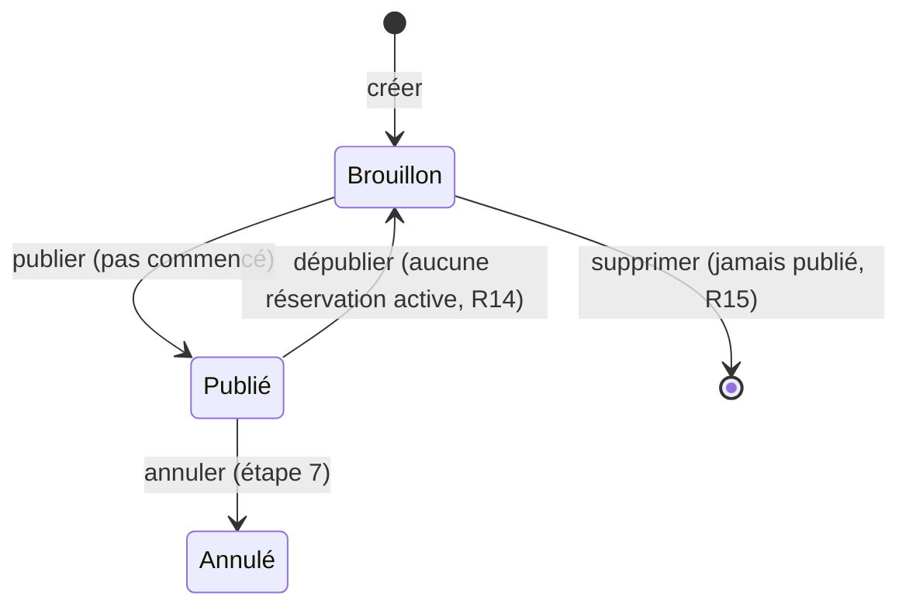

# Règles métier et cycle de vie — AAAS

> Tenu par l'agent `expert-technique`. Pour chaque règle : ce qui est appliqué, et **où** dans le code.
> Références : `docs/cahier-des-charges.md` (RG-xx), `docs/fonctionnel/mvp.md` (R-xx, US-xx), `docs/adr/`.
> État : **étape 2** (comptes ; événements côté admin et consultation publique ; numéro de contact). Les règles des réservations et des actualités seront ajoutées aux étapes suivantes.

## 1. Comptes et authentification

### 1.1 Inscription (US-A1, R20, RG-11)

| Règle | Comportement | Où dans le code |
|---|---|---|
| Champs obligatoires | Prénom (≤ 100), nom (≤ 100), e-mail valide (≤ 256), téléphone, mot de passe (≤ 128), case de consentement cochée. Sinon **400**, erreur sur le champ concerné. | `RegisterRequest` (attributs de validation) — `src/Aaas.Application/Accounts/AccountDtos.cs` |
| Téléphone tunisien uniquement (RG-11) | Accepté : `+216` suivi d'exactement 8 chiffres (0-9), **mobile ou fixe** (`+216 20 123 456`, `+216 71 123 456`), espaces tolérés. Refusé : saisie locale (`20 123 456`), préfixe `00`, autre indicatif, tirets ou points, chiffres non latins. Stocké normalisé : `+21620123456`. Message : « Le numéro de téléphone doit être un numéro tunisien au format +216 suivi de 8 chiffres, par exemple +216 20 123 456. » | `PhoneNumber.TryParse` — `src/Aaas.Domain/Common/PhoneNumber.cs` ; utilisé par `TunisianPhoneNumberAttribute` (400, `src/Aaas.Application/Common/Validation/`) et revérifié par `AccountService.RegisterAsync` |
| E-mail unique sans tenir compte de la casse | `Salma@Exemple.tn` = `salma@exemple.tn`. Doublon : **409** `email_taken`, « Un compte existe déjà avec cet e-mail. ». Protégé aussi contre deux inscriptions simultanées par l'index unique filtré `UX_AspNetUsers_NormalizedEmail`. Ce cas (erreur SQL 2601) n'est pas journalisé comme erreur et l'e-mail n'apparaît pas dans les journaux (R24) : `SaveChangesFailed` ignoré ; `CommandError` et les autres événements EF Core porteurs d'une exception SQL (`QueryIterationFailed`, `ConnectionError`, `TransactionError`, échecs d'`ExecuteUpdate`/`ExecuteDelete`) rétrogradés en Debug. | `IdentityService.CreateUserAsync` + `AppUserConfiguration` (index) ; `ConfigureWarnings` dans `src/Aaas.Infrastructure/DependencyInjection.cs` |
| Mot de passe (R21) | Au moins 8 caractères, au moins un chiffre, au moins une lettre (minuscule ou majuscule, accents compris). Sinon **400** avec tous les messages sur le champ `password`. | Options Identity dans `src/Aaas.Infrastructure/DependencyInjection.cs` + `LetterRequiredPasswordValidator` ; messages : `FrenchIdentityErrorDescriber` |
| Consentement (R24, § 6.4) | Case obligatoire. On enregistre la **date** (`PrivacyConsentAt`) et la **version** de la politique acceptée (`PrivacyPolicyVersion`, valeur de la configuration `PrivacyPolicy:CurrentVersion`, actuellement `1.0`). | `AccountService.RegisterAsync`, `PrivacyPolicyOptions` |
| Rôle à l'inscription (R22) | Toujours `User`. Aucun champ de rôle n'est lu dans la requête. | `AccountService.RegisterAsync` |
| Connexion automatique | L'inscription renvoie directement un jeton ; `LastLoginAt` = date d'inscription. | `AccountService.RegisterAsync`, `IdentityService.CreateUserAsync` |
| Atomicité | Compte et rôle sont créés dans une même transaction : jamais de compte sans rôle. | `IdentityService.CreateUserAsync` (execution strategy + transaction) |
| Mineurs | Aucun contrôle ni case dédiée (décision du porteur, § 6.4). | — |

Données conservées pour un compte (R20, § 6.4) : prénom, nom, e-mail, téléphone, mot de passe **haché** (PBKDF2, Identity), date de création (`CreatedAt`), date de dernière connexion (`LastLoginAt`), date et version du consentement. Rien d'autre. Toutes les dates sont en UTC (ADR 0003).

### 1.2 Connexion (US-A2, R21)

| Règle | Comportement | Où dans le code |
|---|---|---|
| Identifiants incorrects | E-mail inconnu **ou** mauvais mot de passe : même réponse **401** `invalid_credentials`, « E-mail ou mot de passe incorrect. » | `AccountService.LoginAsync`, `IdentityService.CheckPasswordAsync` |
| Blocage après échecs | Après **5 échecs consécutifs**, le compte est bloqué **15 minutes**. La réponse au 5e échec est déjà **401** `account_locked` ; pendant le blocage, même le bon mot de passe est refusé. Message : « Trop de tentatives de connexion. Votre compte est bloqué temporairement : réessayez dans N minutes. » (N calculé sur la fin réelle du blocage). | `SignInManager.CheckPasswordSignInAsync(lockoutOnFailure: true)` ; options `Lockout` dans `DependencyInjection.cs` |
| Remise à zéro | Une connexion réussie remet le compteur d'échecs à zéro (« 5 fois **de suite** »). | Identity (`CheckPasswordSignInAsync`) |
| Dernière connexion (R25) | `LastLoginAt` mis à jour à chaque connexion réussie. | `IdentityService.RecordLoginAsync` |

### 1.3 Session et jeton (US-A3, ADR 0002)

| Règle | Comportement | Où dans le code |
|---|---|---|
| Durée de session | Jeton valable **60 minutes** (`Jwt:LifetimeMinutes`), sans renouvellement automatique. Ensuite : **401**, le front renvoie vers la connexion. | `TokenService`, `JwtOptions` |
| Révocation immédiate | À chaque requête authentifiée, le *security stamp* du jeton est comparé à celui de la base. Compte supprimé ou stamp renouvelé (changement de rôle) : **401** immédiat. | `JwtAuthenticationExtensions.ValidateSecurityStampAsync` → `IdentityService.IsSecurityStampValidAsync` |
| Sécurisé par défaut | Tout endpoint exige un jeton valide, sauf ceux marqués explicitement anonymes (`/api/auth/*`, `/health`, `/health/ready` ; `/openapi/v1.json` en Development seulement). Un chemin inconnu renvoie **401** `unauthorized` (et non 404) à un anonyme. | Politique de repli (`SetFallbackPolicy`) dans `JwtAuthenticationExtensions` |
| Contenu du jeton | Identifiant, prénom, rôles, security stamp. Ni e-mail ni téléphone. | `TokenService.CreateAccessToken` |

### 1.4 Administrateurs (R22, RG-09, ADR 0008)

| Règle | Comportement | Où dans le code |
|---|---|---|
| Pas d'inscription admin | Le rôle Admin ne s'obtient jamais par l'API publique. | `AccountService.RegisterAsync` |
| Premier admin | Au démarrage, **si aucun admin n'existe** et que `Bootstrap:AdminEmail`, `AdminPassword`, `AdminFirstName`, `AdminLastName`, `AdminPhone` sont renseignés : création du compte avec les rôles `User` + `Admin` (mêmes règles de mot de passe et de téléphone que l'inscription). Consentement daté de la création. | `DatabaseInitializer.EnsureFirstAdminAsync` — `src/Aaas.Infrastructure/Initialization/DatabaseInitializer.cs` |
| Idempotence | S'il existe déjà un admin, rien n'est fait, même si `Bootstrap:*` est présent. Redémarrer ne crée jamais un second admin. | idem |
| E-mail déjà inscrit (par défaut) | Aucun admin n'existe et un compte porte déjà `Bootstrap:AdminEmail` : **pas de promotion automatique**, l'API **refuse de démarrer** (`InvalidOperationException` : « Un compte existe déjà avec Bootstrap:AdminEmail… »). Le message ne contient pas l'e-mail (R24). Raison : n'importe qui aurait pu s'inscrire avec cet e-mail avant le premier démarrage. Solution : promotion manuelle (`exploitation.md` § 6) ou option ci-dessous. | `DatabaseInitializer.HandleExistingAccountAsync` |
| E-mail déjà inscrit, `Bootstrap:PromoteExistingAccount=true` | Le compte existant est **promu** : rôles `User` + `Admin`, mot de passe inchangé (celui du Bootstrap est ignoré), security stamp renouvelé (ancien jeton : 401). Trace d'audit en `Warning` (identifiant du compte, pas l'e-mail). **Une seule instance de l'API doit tourner pendant cette promotion** : les démarrages simultanés ne sont pas gérés sur ce chemin. | idem |
| Deux instances au même démarrage : rôles | Base neuve : si la création d'un rôle échoue (violation d'unicité SQL 2601/2627 sur `RoleNameIndex`, ou refus « rôle déjà existant » d'Identity), l'initialisation vide le suivi EF et revérifie : le rôle existe → on continue ; sinon → l'erreur est relancée. | `DatabaseInitializer.CreateRoleAsync` |
| Deux instances au même démarrage : premier admin | Si la création échoue sur « e-mail déjà utilisé » (index unique), l'initialisation revérifie : un admin existe → rien à faire ; sinon → même règle que « e-mail déjà inscrit ». | `DatabaseInitializer.HandleEmailTakenConcurrentlyAsync` |
| Configuration absente ou incomplète | Avertissement listant les clés manquantes (sans valeur), l'API démarre sans admin. Avec docker compose, un `BOOTSTRAP_ADMIN_EMAIL` ou `BOOTSTRAP_ADMIN_PASSWORD` vide bloque `docker compose up`. | `DatabaseInitializer.EnsureFirstAdminAsync`, `BootstrapOptions.MissingKeys` |
| Échec de l'initialisation | Log `Critical` puis arrêt de l'API. Exception SQL/EF : seuls le type et le numéro SQL sont journalisés, l'exception relancée est neutre (R24) mais reprend ce type et ce numéro (`erreur SQL : 208`, ou `aucune`). L'hôte est libéré avant l'arrêt pour que le log `Critical` soit bien écrit. | `src/Aaas.Api/Program.cs` |
| Configuration invalide | Mot de passe trop faible, mot de passe d'exemple public (`ChangeMe2026`) ou téléphone invalide : l'API **refuse de démarrer** avec un message explicite. | idem, `BootstrapOptions.KnownExamplePasswords` |
| Admins suivants | Procédure manuelle (script SQL) : voir `docs/technique/exploitation.md` § 6. | — |
| Au moins un admin (RG-09) | Garanti à la création ; la protection contre la suppression du dernier admin arrive avec US-F2 (ADR 0007). | à venir |

## 2. Dates

Toutes les dates sont des `DateTimeOffset` stockées en UTC (décalage forcé à `+00:00` par la convention `UtcDateTimeOffsetConverter`, `src/Aaas.Infrastructure/Persistence/Conventions/`). L'heure courante vient toujours de `TimeProvider` (jamais `DateTime.Now`). La conversion à l'heure de Tunis est faite par le front (ADR 0003).

**Dates saisies** (étape 2) : l'API exige un décalage explicite (`2026-12-05T10:00+01:00` ou `...Z`) ; sans décalage → 400 sur le champ. Le front ajoute `+01:00` à la saisie d'un champ `datetime-local` (heure de Tunis). Où : `IsoDateTimes` et `[DateTimeWithOffset]` — `src/Aaas.Application/Common/` (ADR 0009).

## 3. Événements (US-E2, US-C1, US-C2)

Code : entité `Event` et règles `EventRules` — `src/Aaas.Domain/Events/` ; cas d'usage `AdminEventService`, `PublicEventService`, `EventOccupancyReader`, `EventQueries` — `src/Aaas.Application/Events/` ; verrou `EventLock` — `src/Aaas.Infrastructure/Persistence/EventLock.cs`.

### 3.1 Statuts et cycle de vie

| Statut stocké | Valeur (`tinyint`) | Visible du public ? |
|---|---|---|
| Brouillon (`Draft`) | 1 | non |
| Publié (`Published`) | 2 | oui |
| Annulé (`Cancelled`) | 3 | oui, mention « Annulé » (transition à l'étape 7) |

« Commencé » (`StartsAt <= maintenant`) et « terminé » (`EndsAt <= maintenant`) sont **calculés**, jamais stockés.

| Transition / action | Conditions | Refus (409) | Où |
|---|---|---|---|
| Créer | valeurs valides (§ 3.2) | — (400 sinon) | `Event.Create` ; `AdminEventService.CreateAsync` |
| Publier | brouillon, début pas encore atteint. Enregistre `PublishedAt` et, la première fois, `FirstPublishedAt` | `event_state_changed` (déjà publié), `event_cancelled`, `event_started` | `Event.Publish` ; `AdminEventService.PublishAsync` (sans verrou, `rowversion`) |
| Dépublier | publié ; **aucune demande en attente ni réservation confirmée** (R14). `PublishedAt` remis à vide, `FirstPublishedAt` conservé | `event_state_changed` (pas publié), `event_cancelled`, `event_has_active_reservations` | `Event.Unpublish` ; `AdminEventService.UnpublishAsync` (sous verrou) |
| Supprimer | brouillon **jamais publié** (`FirstPublishedAt` nul) : il n'a jamais pu recevoir de réservation (R15 étape 2, RG-07). Suppression définitive | `event_already_published` (publié, annulé, ou publié puis dépublié) | `Event.EnsureCanBeDeleted`, `EventRules.CanBeDeleted` ; `AdminEventService.DeleteAsync` |
| Modifier | ni annulé ni terminé ; **un événement commencé reste modifiable** (R28, RG-12) | `event_cancelled`, `event_ended`, puis R11, R12 (§ 3.3) | `Event.EnsureCanBeEdited`, `Event.Update` ; `AdminEventService.UpdateAsync` (sous verrou) |

Pourquoi `FirstPublishedAt` : la dépublication remet `PublishedAt` à vide ; sans marqueur persistant, un événement publié puis dépublié ressemblerait à un brouillon jamais publié. Or des membres ont pu le voir (et, à partir de l'étape 4, y réserver). La suppression d'un événement publié sans aucune réservation arrivera à l'étape 7 (US-E3, Q29).

### 3.2 Valeurs saisies (RG-13, R28, R29, RG-08)

| Règle | Comportement | Où |
|---|---|---|
| Textes (R29) | titre et lieu obligatoires, ≤ 200 caractères ; description obligatoire, ≤ 4 000. Espaces de début et de fin retirés à l'enregistrement. | attributs de `EventInput` (`EventDtos.cs`) + `EventRules.Validate` (filet) |
| Début | dans le futur à la création ; à la modification, **seulement s'il change** (un événement commencé garde son début passé, mais on ne peut pas le déplacer dans le passé, R28) | `EventRules.Validate` |
| Fin | après le début ; **toujours dans le futur** (R28, Q28 : on ne termine pas un événement en avançant sa fin dans le passé) | `EventRules.Validate` |
| Capacité (RG-13) | entier de 1 à 10 000 | `EventRules.Validate` |
| Prix (RG-08, R12, ADR 0010) | facultatif, en TND ; ≥ 0, ≤ 99 999,999, au plus 3 décimales (refus, pas d'arrondi). `0` ou vide = **gratuit**, stocké `NULL`. Affichage (front) : « Gratuit », « 15 TND, à régler sur place », « 12,500 TND, à régler sur place » | `EventRules.Validate`, `EventRules.NormalizePrice` |

Erreurs de saisie → **400** par champ (`errors.startsAt`…). Ordre : forme d'abord (obligatoire, longueur, format de date), puis valeurs (Domain). Les messages exacts sont dans `api.md` et dans les constantes de `EventRules`.

Filets en base (contraintes `CHECK`, une écriture qui contournerait le Domain échoue) : `CK_Events_Dates` (`EndsAt > StartsAt`), `CK_Events_Capacity` (`>= 1`), `CK_Events_Price` (`NULL` ou `> 0`), `CK_Events_Status` (`1, 2, 3`).

### 3.3 Places et inscrits (R2, R7, R11, R12, R14)

| Règle | Comportement | Où |
|---|---|---|
| Places occupées | demandes en attente non échues + réservations confirmées. **Étape 2 : toujours 0** (la table des réservations arrive à l'étape 4) | `EventOccupancyReader` (seul endroit qui compte ; à modifier à l'étape 4) |
| R7 places restantes | capacité − places occupées, jamais négatif ; « Complet » si toutes occupées | `EventRules.RemainingSeats`, `EventRules.IsFull` |
| R2 réservable | publié, pas commencé, pas complet (annulé ou brouillon : jamais) | `EventRules.IsBookable` |
| R11 capacité | la capacité ne peut pas descendre sous les places occupées : 409 `capacity_below_reserved` avec le décompte (« 15 places sont déjà occupées (10 confirmées, 5 en attente)… ») | `Event.Update` |
| R12 avertissement | avec des inscrits, changer le **début, la fin ou le prix** demande une confirmation : 409 `registrants_warning`, rien n'est enregistré ; la même requête avec `confirmRegistrantsWarning: true` enregistre et **conserve les réservations**. Changer le lieu ou le titre : pas d'avertissement (Q21). Même instant exprimé avec un autre décalage, ou prix 0 sur un événement gratuit : pas un changement | `Event.RequiresRegistrantsWarning`, `Event.Update` |
| Priorité | R11 est vérifiée avant R12 : une capacité trop basse est refusée même si l'avertissement est confirmé | `Event.Update` |
| R14 dépublication | refusée s'il reste une demande en attente ou une réservation confirmée ; proposer d'annuler à la place | `Event.Unpublish` |

**Verrou** : modifier et dépublier prennent un verrou SQL sur la ligne de l'événement (`UPDLOCK`, dans une transaction) avant de compter les places, pour qu'une demande de place (étape 4) ne puisse pas s'intercaler (ADR 0004, 0012). La publication et la suppression d'un brouillon n'en ont pas besoin (aucune réservation possible).

**Concurrence entre admins** (ADR 0006) : la fiche admin porte une `version` ; une modification avec une version périmée → 409 `concurrent_update`, rien n'est écrit. Publier, dépublier, supprimer sont des actions sans `version` : la règle de transition suffit, et une écriture simultanée est arrêtée par le `rowversion` (409 `concurrent_update`).

### 3.4 Visibilité publique (RG-14, R19)

| Règle | Comportement | Où |
|---|---|---|
| Liste | publiés **ou annulés**, **non terminés** (un événement en cours reste listé avec « Réservations closes ») ; tri par début croissant puis par identifiant ; 20 par page (max 50) | `EventQueries.IsListedPublicly`, `PublicEventService.ListAsync` |
| Détail | publié ou annulé, **même terminé** (historique, utile à « Mes réservations ») ; `hasEnded` permet d'afficher « Terminé » | `EventQueries.IsVisiblePublicly`, `PublicEventService.GetAsync` |
| Brouillon | jamais visible : 404 « Contenu introuvable », comme un identifiant inconnu (on ne révèle pas son existence) | idem |
| Mention affichée (front) | priorité : Annulé > Terminé > Réservations closes > Complet > « N places restantes » | DTO `status`, `hasEnded`, `hasStarted`, `isFull` |

Liste admin : tous statuts ; filtre `status` ; `period` = à venir (non terminés, défaut), passés, tous. Où : `AdminEventService.ListAsync`, `EventQueries.InPeriod`.

## 4. Numéro de contact de l'association (US-E8, RG-10, RG-11, R8)

| Règle | Comportement | Où |
|---|---|---|
| Un seul numéro | une ligne unique `AssociationSettings` (`Id = 1`), créée par la migration avec un numéro vide ; une deuxième ligne est impossible (`CHECK Id = 1`) | `AssociationSettings` (Domain), `AssociationSettingsConfiguration` (Infrastructure) |
| Format (RG-11) | même règle que le téléphone des membres : `+216` + 8 chiffres, **mobile ou fixe** (`+216 71 123 456` accepté) ; stocké `+21671123456` | `PhoneNumber` ; `[TunisianPhoneNumber]` (`src/Aaas.Application/Common/Validation/`) ; revérifié par `SettingsService.UpdateContactAsync` |
| Option WhatsApp | case « joignable sur WhatsApp » enregistrée avec le numéro | `AssociationSettings.UpdateContact` |
| Retrait (RG-10, R8) | un admin peut retirer le numéro : plus de numéro, **WhatsApp repasse à non**. Retirer un numéro déjà absent est sans effet visible (accepté) | `AssociationSettings.RemoveContact` ; `SettingsService.RemoveContactAsync` |
| Lecture | membres connectés et admins ; **jamais un visiteur** (401) | `SettingsController` (`[Authorize]`) |
| Écriture | admin uniquement (enregistrer, changer, retirer), avec `version` : 409 `concurrent_update` si un autre admin a écrit entre-temps | `AdminSettingsController` (`AdminOnly`) ; `ConcurrencyGuard` |
| Pas de copie | le numéro n'est jamais recopié dans les demandes : un changement vaut aussi pour les demandes anciennes (US-E8) | conception (ADR 0013) |
| Avertissement à la publication | sans numéro configuré, la publication est faite et renvoie `warnings: [{ code: "contact_not_configured", … }]` (non bloquant) | `AdminEventService.PublishAsync`, `SettingsService.IsContactConfiguredAsync` |
| Journaux (R24) | le numéro n'est jamais journalisé | aucun log dans `SettingsService` |

## 5. Codes d'erreur (extension `code` des réponses d'erreur)

| Code | HTTP | Sens |
|---|---|---|
| `validation_failed` | 400 | Un ou plusieurs champs invalides (détail dans `errors`) |
| `email_taken` | 409 | Un compte existe déjà avec cet e-mail |
| `invalid_credentials` | 401 | E-mail ou mot de passe incorrect |
| `account_locked` | 401 | Compte bloqué temporairement après 5 échecs |
| `unauthorized` | 401 | Jeton absent, expiré ou révoqué |
| `forbidden` | 403 | Rôle insuffisant |
| `not_found` | 404 | Ressource introuvable |
| `method_not_allowed` | 405 | Méthode HTTP non prise en charge par la route (refus du framework) |
| `unsupported_media_type` | 415 | Corps envoyé sans `Content-Type: application/json` (refus du framework) |
| `internal_error` | 500 | Erreur inattendue |
| `concurrent_update` | 409 | La fiche a été modifiée par un autre admin depuis sa lecture : recharger (étape 2) |
| `event_state_changed` | 409 | Publier un événement déjà publié, dépublier un brouillon : recharger |
| `event_cancelled` | 409 | Action impossible sur un événement annulé |
| `event_started` | 409 | Publication d'un événement déjà commencé |
| `event_ended` | 409 | Modification d'un événement terminé |
| `event_has_active_reservations` | 409 | Dépublication avec des demandes en attente ou réservations confirmées (R14) |
| `capacity_below_reserved` | 409 | Capacité inférieure aux places occupées (R11) |
| `registrants_warning` | 409 | Changement de date ou de prix avec des inscrits : confirmer puis renvoyer avec `confirmRegistrantsWarning: true` (R12) |
| `event_already_published` | 409 | Suppression d'un événement qui a déjà été publié (R15 étape 2) |
| `contact_not_configured` | — | **Avertissement** (pas une erreur), dans `warnings` de la réponse 200 de publication |

Liste de référence : `src/Aaas.Domain/Common/ErrorCodes.cs`. Un code existant ne doit jamais être renommé (le front s'appuie dessus).
